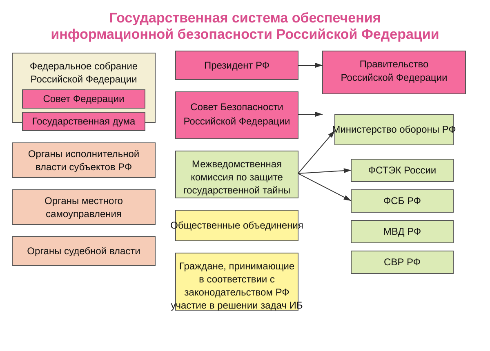
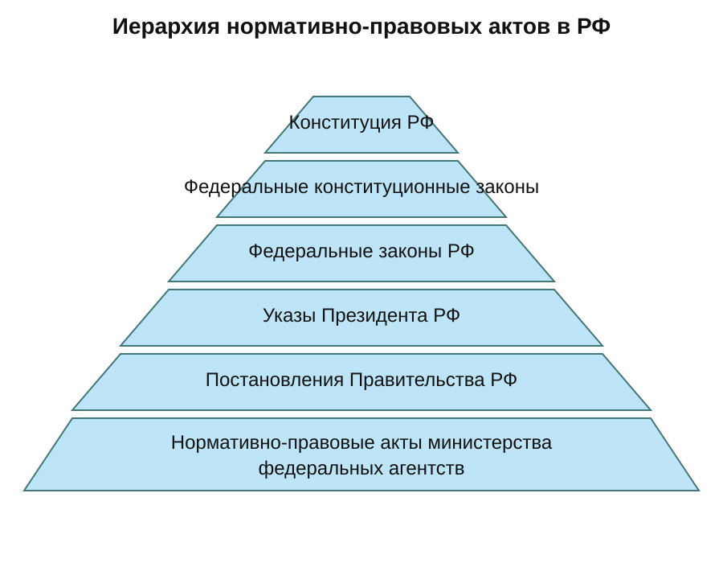
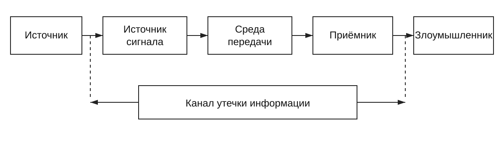
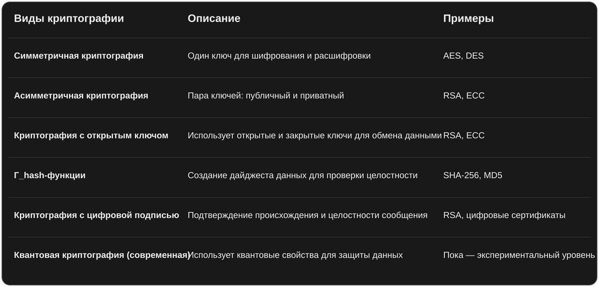

# Экзамен ОИБ — полный материал из Word (2025, 1 курс)

> [!info]
> Полный перенос `Вопросы ОИБ 25-1.docx` без сокращения содержания. Орфография, повторы и спорные формулировки источника сохранены.

> [!tip]
> Жёлтое — «спросит обязательно». Красное — «там где он гасит».

---

## Оригинальный заголовок

<strong><em>Вопросы ОИБ</em></strong>

_________ - там где он гасит

_________ - спросит обязательно

## <strong>Информация</strong>

1. Информация - результат взаимодействия субъекта(человека) с материальными носителями информации (вроде бы его)
1. Информация - сведения, данные, независимо от формы их представления (по закону) 
1. Информация - сведения воспринимаемые человеком или специальными устройствами как форму отражения материальности духовного мира в процессе коммуникации (ГОСТ).
1. Информация - сведения о лицах, предметах, фактах, событиях, явлениях и процессах независимо от формы их представления (ГОСТ).

## <strong>Способы восприятия информации. </strong>

1. Зрительная
1. Звуковая
1. Осязательная
1. Вкусовая
1. Обонятельная

## <strong>Формы представления информации.</strong>

Текстовую — последовательность символов, формирующих слова, предложения, абзацы.

Числовую — представленную в виде чисел и числовых величин.

Графическую — изображения, схемы, диаграммы.

Звуковую — аудиозаписи, музыкальные произведения.

Комбинированную — сочетание разных форм (мультимедиа).

## <strong>Классификация информации по назначению.</strong>

Массовая — содержит тривиальные сведения и оперирует набором понятий, понятным большей части социума.

Специальная — содержит специфический набор понятий, при использовании происходит передача сведений, которые могут быть не понятны основной массе социума, но необходимы и понятны в рамках узкой социальной группы, где используется данная информация.

Секретная — передаваемая узкому кругу лиц и по закрытым (защищённым) каналам.

Личная (приватная) — набор сведений о какой-либо личности, определяющий социальное положение и типы социальных взаимодействий внутри популяции.

## <strong>Классификация информации по значению.</strong>

Актуальная. Информация, ценная в данный момент времени.

Достоверная. Информация, полученная без искажений с надёжных источников.

Понятная. Информация, выраженная на языке, понятном тому, кому она предназначена.

Полная. Информация, достаточная для принятия правильного решения или понимания.

Полезная. Полезность информации определяется субъектом, получившим информацию в зависимости от объёма возможностей её использования.

## <strong>Классификация информации по истинности.</strong>

Истинная

Ложная

## <strong>Классификация информации по истинности.</strong>

Истинная

Ложная

## <strong>Основные определения понятия информации.</strong>

Информация - результат взаимодействия субъекта(человека) с материальными носителями информации (вроде бы его)

Информация - сведения, данные, независимо от формы их представления (по закону)

Информация - сведения воспринимаемые человеком или специальными устройствами как форму отражения материальности духовного мира в процессе коммуникации (ГОСТ).

Информация - сведения о лицах, предметах, фактах, событиях, явлениях и процессах независимо от формы их представления (ГОСТ).

## <strong>Структура органов власти в сфере информационной безопасности.</strong>

*Структура органов власти в сфере информационной безопасности.*

## <strong>Структура нормативно-правовой базы информационной безопасности. </strong>

*Структура нормативно-правовой базы информационной безопасности.*

## <strong>Каналы утечки информации.</strong>

Под <strong>утечкой информации</strong> понимается несанкционированный процесс переноса информации от источника к злоумышленнику.

Схема:

*Схема канала утечки информации.*

<strong>Материально-вещественный</strong> – совокупность материально-вещественных носителей информации ограниченного доступа и методов и средств вероятного противника для съёма информации

<strong>Социальный</strong> - совокупность социальных объектов, владеющих информацией ограниченного доступа и методов и средств вероятного противника для съёма информации

<strong>Технический</strong> - совокупность физических полей, несущих информацию ограниченного доступа и элементов окружающей среды, взаимодействующих с ними, а также методов и средств вероятного противника для съёма информации

<strong>Физ. Поля</strong>: механические волны, электромагнитные волны, акустические и вибрационные волны.

<strong>Звук</strong>:

- до 16 Гц – Инфразвук – Шум атмосферы, моря, сотрясения земной коры – не слышим
- 16Гц-20кГц – Звук – Колеблющиеся тела – Слышим
- 2*10^4-10^9 – Ультразвук – Колеблющиеся с большой частотой тела – Не слышим
- 10^9 - 10^13 – Гиперзвук – Сверхвысокочастотные колебания тел – Не слышим
ПЭМИН (побочные электромагнитные излучения и наводки) — это электромагнитные сигналы, которые возникают в процессе работы любого компьютерного оборудования. Они могут распространиться за пределы устройства и использоваться для получения информации без прямого подключения к компьютеру.

В контексте ПЭМИН (побочные электромагнитные излучения и наводки), наводки — это электромагнитные сигналы, которые возникают в результате работы электронных компонентов и цепей устройства и могут передавать информацию.

Что такое ПЭМИН?

ПЭМИН — это совокупность электромагнитных излучений и наводок, которые возникают в электронных компонентах и кабелях при работе компьютера или другого электронного устройства.

Эти излучения сопровождают работу устройства и могут содержать зашифрованные или очевидные сведения, связанные с обрабатываемыми данными.

В среде информационной безопасности ПЭМИН рассматривается как потенциальный источник утечки информации — так называемый «связанный с утечкой электромагнитных данных канал» (TEMPEST — термин, используемый в ряде стран).

Как возникают ПЭМИН?

Работа электронных цепей: при передаче сигналов внутри компьютера возникают электромагнитные поля, излучения, наводки по кабелям.

Высокочастотные компоненты: современные микросхемы и коммуникационные модули создают электромагнитные сигналы, которые можно улавливать.

Кабели и шнуры: передающие данные кабели усиливают или «размножают» излучения, делая их более доступными для перехвата.

Почему ПЭМИН опасен?

Незаметная утечка информации: злоумышленник может зафиксировать электромагнитные сигналы с помощью специальных приёмных устройств, расположенных недалеко от объекта.

Доступ без физического подключения: не нужно взламывать сеть или иметь прямой доступ, чтобы получить выдержки информации.

Использование технологий радиосканирования и фиксации электромагнитных волн: современные приёмы позволяют даже из дальнего расстояния извлекать важные данные.

Проще говоря,

ПЭМИН — это способ «слушать» работу компьютера на расстоянии и попробовать восстановить хранящуюся или передаваемую информацию. Это активный аспект электромагнитной разведки и защиты информации.

Что делается для борьбы с ПЭМИН?

Экранирование: использование специальных материалов для защиты оборудования.

Размещение аппаратуры в защищённых помещениях: специальных камер TEMPEST.

Контроль сигнальных уровней: мониторинг электромагнитных излучений в важных объектах.

Политика безопасной эксплуатации оборудования: регистрация и контроль за устройствами, предотвращающими утечки.

История становление Российской системы защиты информации с октября 1917 по настоящее время,

Основные нормативно-правовые акты

- <strong>Федеральный закон «О безопасности» – основные положения и проблемы реализации.</strong>
- Федеральный закон «О безопасности» Российской Федерации, обычно обозначаемый как Закон РФ от 28 декабря 2010 г. № 390-ФЗ «Об обеспечении безопасности», регулирует основные принципы и механизмы обеспечения безопасности в стране. Ниже представлены его основные положения и основные проблемы реализации:
- <em>Основные положения закона:</em>
- <em>Цели и принципы безопасности:</em>
- Обеспечение суверенитета, территориальной целостности, конституционного строя и прав и свобод граждан.
- Основные принципы включают приоритет безопасности государства, законность, системность, превентивность.
- Субъекты обеспечения безопасности:
- Федеральные органы власти, субъекты РФ, муниципальные органы, а также непубличные организации и граждане.
- Создана система органов безопасности, включая Федеральную службу безопасности (ФСБ), Министерство обороны, МВД и другие.
- <em>Инструменты и механизмы:</em>
- Разработка стратегий и программ обеспечения безопасности.
- Оценка угроз безопасности, профилактика, реагирование и ликвидация последствий чрезвычайных ситуаций.
- Создание системы информационной безопасности.
- <em>Правовые основы:</em>
- Регулирование прав и обязанностей участников в вопросах безопасностии.
- Введение нормативных актов и стандартов по обеспечению безопасности.
- <em>Проблемы реализации закона:</em>
- Недостаточная системность и координация:
- Реализация мер безопасности зачастую осуществляется фрагментарно, без эффективной межведомственной координации.
- <em>Проблемы законодательного регулирования:</em>
- Неаодекватное соответствие новым угрозам (кибербезопасности, информационной безопасности).
- Недостаточная хармонизация с международным правом.
- Ограниченные ресурсы и финансирование:
- Недостаточное финансирование систем безопасности, особенно в регионах.
- Проблемы с внедрением современных технологий:
- Замедленная адаптация к новым видам угроз, в том числе киберугрозам.
- Проблемы прозрачности и контроля:
- Ограниченная публикация информации о реальных уровнях угроз и мерах безопасности.
- <strong>Доктрина информационной безопасности Российской Федерации – основные положения и проблемы реализации.  </strong>
- Доктрина информационной безопасности Российской Федерации — это концептуальный документ, определяющий основные направления, цели и принципы обеспечения безопасности страны в информационной сфере. В ней отражены угрозы, вызовы и способы реагирования на них.
- Основные положения Доктрины информационной безопасности РФ:
- Цели и задачи:
- Защита национальных интересов в информационной сфере.
- Обеспечение информационной безопасности государственных органов, граждан и организаций.
- Защита информации, составляющей государственную тайну, коммерческую тайну, личные данные и критическую инфраструктуру.
- Угрозы информационной безопасности:
- Внешние: кибератаки, информационные операции, манипуляции общественным мнением, распространение фейковых новостей.
- Внутренние: коррупция, неэффективное управление информационными системами, разрушение моральных и этических основ через информационное воздействие.
- Транснациональные угрозы, связанные с глобализацией информационных технологий.
- Основные принципы:
- Суверенитет в информационной сфере.
- Конфиденциальность, целостность и доступность информации.
- Обеспечение информационной безопасности в интересах национальной безопасности, экономики и общества.
- Механизмы реализации:
- Создание системы информационной безопасности страны.
- Разработка нормативно-правовых актов, стандартов и технологий.
- Формирование инфраструктуры защиты критической информационной инфраструктуры.
- Образование специалистов и повышение их квалификации.
- Основные проблемы реализации Доктрины:
- Обеспечение защиты критической инфраструктуры:
- Недостаточная защищенность важных объектов (энергетика, связь, транспорт).
- Медленная адаптация законодательства к новым угрозам.
- Кибербезопасность и кибератаки:
- Высокая сложность предотвращения и отражения целевых киберпреступлений.
- Недостаточная оснащенность государственных и частных систем современными средствами защиты.
- Информационная политика и контроль:
- Конфликты между свободой слова и необходимостью фильтрации вредоносного контента.
- Недостаточный контроль за распространением дезинформации и санкционирование интернет-ресурсов.
- Международное сотрудничество:
- Ограниченность возможностей для эффективной совместной борьбы с глобальными киберугрозами из-за нежелания некоторых стран делиться данными.
- Технологическая зависимость:
- Зависимость от иностранных технологий и программного обеспечения, что создает угрозы национальной безопасности.
- Недостаток кадров:
- Острый дефицит квалифицированных специалистов в сфере информационной безопасности.
- <strong>Федеральный закон "Об информации, информационных технологиях и о защите информации" –  основные положения и проблемы реализации.</strong>
- Федеральный закон № 149-ФЗ «Об информации, информационных технологиях и о защите информации», принятый в 2006 году, является основным нормативным актом, регулирующим правовые отношения в сфере информации, информационных технологий и защиты информации в Российской Федерации.
- Основные положения закона:
- Объем и понятие информации:
- Закон определяет понятие информации как сведения, обладающие ценностью для личных, общественных и государственных интересов.
- Регулирует права и обязанности субъектов в использовании, распространении и хранении информации.
- Об обеспечении информационной безопасности:
- Обязательства государственных органов по защите информации, содержащейся в государственных информационных систем.
- Установление требований к безопасности информационных систем, в том числе государственных.
- Доступ к информации:
- Гарантируется право граждан и организаций на получение, использование и распространение информации.
- Регламентируется порядок ограничений доступа (например, к сведениям, составляющим государственную тайну).
- Правовые режимы информационных ресурсов:
- Разграничение открытых, ограниченных и засекреченных информационных ресурсов.
- Регулирование вопросов их использования и доступа.
- Использование информационных технологий:
- Создание и развитие информационных систем и технологий.
- Поддержка развития электронных коммуникаций, электронных документов и электронных подписей.
- Ответственность за нарушение требований закона:
- Вводятся санкции за нарушение порядка использования и защиты информации.
- Основные проблемы реализации закона:
- Недостаточная координация и системность:
- В практике наблюдается фрагментарность регулирования, отсутствие единой системы нормативных правовых актов.
- Проблемы с защитой персональных данных:
- Недостаточная защита личной информации граждан, нарушение требований законодательства о персональных данных.
- Размытые границы регулирования:
- Неясные критерии разграничения открытой и закрытой информации, что создает сложности при применении правил.
- Недостаточная оснащенность инфраструктур:
- Несовершенство технических средств защиты информации, особенно в государственных органах и коммерческом секторе.
- Развитие информационных технологий:
- Быстрый технологический прогресс требует постоянных изменений и дополнений к нормативной базе, что затрудняет своевременное реагирование.
- Проблемы с правовым регулированием в сфере кибербезопасности:
- Недостаточная регламентация мер против кибератак и злоупотреблений в сети.
- Недостаточный уровень правовой грамотности субъектов:
- Хаотичное применение правил, недостаточная информированность граждан и организаций о своих правах и обязанностях.
- <strong>Федеральный закон "О государственной тайне" –  основные положения и проблемы реализации. </strong>

## <strong>ГОС ТАЙНА: Закон РФ "О государственной тайне" от 21.07.1993 N 5485-1 (последняя редакция)</strong>

<strong>Государственная тайна</strong> - защищаемые государством сведения в области его военной, внешнеполитической, экономической, разведывательной, контрразведывательной и оперативно-розыскной деятельности, распространение которых может нанести ущерб безопасности Российской Федерации

<strong>Степени</strong>: Секретно, Совершено Секретно, Особая важность 

<strong>Гриф секретности - </strong>реквизиты, свидетельствующие о степени секретности сведений, содержащихся в их носителе, проставляемые на самом носителе и (или) в сопроводительной документации на него:

<em>Гриф «особой важности»</em> присваивают сведениям, распространение которых может нанести ущерб интересам Российской Федерации в целом.

<em>Гриф «совершенно секретно»</em> присваивают сведениям, разглашение которых может нанести ущерб интересам государственного органа или определенной отрасли экономики Российской Федерации.

<em>Гриф «секретно»</em> присваивают всем прочим сведениям, составляющим гостайну. Их разглашение может нанести ущерб предприятию, учреждению или организации в военной, внешнеполитической, экономической, научно-технической, разведывательной, контрразведывательной или оперативно-розыскной деятельности.

## <strong>Реквизиты носителей сведений, составляющих государственную тайну</strong>

На носители сведений, составляющих государственную тайну, наносятся реквизиты, включающие следующие данные:

- о степени секретности содержащихся в носителе сведений с ссылкой на соответствующий пункт действующего в данном органе государственной власти, на данном предприятии, в данных учреждении и организации перечня сведений, подлежащих засекречиванию;
- об органе государственной власти, о предприятии, об учреждении, организации, осуществивших засекречивание носителя;
- о регистрационном номере;
- о дате или условии рассекречивания сведений либо о событии, после наступления которого сведения будут рассекречены.
При невозможности нанесения таких реквизитов на носитель сведений, составляющих государственную тайну, эти данные указываются в сопроводительной документации на этот носитель.

Если носитель содержит составные части с различными степенями секретности, каждой из этих составных частей присваивается соответствующий гриф секретности, а носителю в целом присваивается гриф секретности, соответствующий тому грифу секретности, который присваивается его составной части, имеющей высшую для данного носителя степень секретности сведений.

<strong>Перечень сведений, составляющих государственную тайну</strong> - совокупность категорий сведений, в соответствии с которыми сведения относятся к государственной тайне и засекречиваются на основаниях и в порядке, установленных федеральным законодательством.

1. Военные сведения
1. Экономические сведения
1. Внешнеполитические сведения
1. Разведывательные сведения
1. Контрразведывательные сведения
1. Оперативно-розыскные сведения

## <strong>Есть информация, которую засекретить невозможно в принципе, даже если очень хочется. К ней относятся сведения:</strong>

- О чрезвычайных происшествиях и катастрофах, угрожающих безопасности и здоровью граждан, их последствиях, о стихийных бедствиях, их официальных прогнозах и последствиях таких происшествий.
- О состоянии экологии, здравоохранения, санитарии, демографии, образования, культуры, сельского хозяйства и преступности.
- О привилегиях, компенсациях и социальных гарантиях гражданам, должностным лицам, предприятиям, учреждениям и организациям.
- О фактах нарушений прав и свобод человека и гражданина.
- О состоянии здоровья высших должностных лиц РФ.
- О фактах нарушения законности органами государственной власти и их должностными лицами.
- О состоянии окружающей среды.

## <strong>Новое в гос. тайне:</strong>

В соответствии с Законом № 432-ФЗ государственной тайной будут признаваться любые защищаемые государством сведения, распространение которых может нанести ущерб безопасности Российской Федерации.

Кроме того, в принятой редакции закона в качестве основания для отказа должностному лицу в доступе к государственной тайне указано постоянное проживание за границей, наличие гражданства (подданства) иностранного государства либо вида на жительство или иного документа, подтверждающего право на постоянное проживание гражданина на территории иностранного государства самого лица или его близких родственников.

Также скорректированы положения ст. 24 Закона о гостайне. Секретоноситель будет ограничиваться в своем праве на выезд из РФ при условии его осведомленности в сведениях особой важности или совершенно секретных сведениях. Закон вступит в силу с 5 февраля 2024 года.

Межведомственная комиссия создает перечень, а президент утверждает

- Федеральный закон № 5486-1 «О государственной тайне» от 21 июля 1993 года регулирует порядок установления, охраны и разглашения государственной тайны в Российской Федерации. Этот закон является основой правового регулирования режима секретности и защиты важных государственных средств информации.
- Основные положения закона:
- Понятие государственной тайны:
- Информация, охраняемая государством, обладающая особенной важностью для обеспечения безопасности, обороны, внешней политики, экономики, прав и свобод граждан.
- Критерии и объём:
- Устанавливаются конкретные категории и виды информации, которая подлежит охране как государственная тайна (например, сведения о вооружённых силах, разведке, торговых тайнах, критической инфраструктуре).
- Определяется перечень документов и информации, признаваемых государственной тайной.
- Органы и порядок установления тайны:
- Право устанавливать режим секретности принадлежит уполномченным государственным органам.
- Созданы специальные базы данных и системы учёта секретной информации.
- Права и обязанности:
- Обязанности работников государственных органов и иных лиц по соблюдению режима секретности.
- Условия допуска к информации, содержащей государственную тайну.
- Обеспечение защиты:
- Меры по обеспечению защиты секретной информации от несанкционированного доступа, утраты, раскрытия.
- Механизм обеспечения сохранности и уничтожения информации после истечения срока секретности.
- Ответственность:
- За нарушение режима секретности предусмотрены гражданско-правовая, административная и уголовная ответственность.
- Основные проблемы реализации закона:
- Застарелость и недостаточная актуализация:
- Закон был принят в 1993 году, и многие его положения не учитывают современные технологические вызовы, такие как кибербезопасность, цифровизация, размывание границ секретности.
- Размытость критериев и процедур:
- Не всегда четко регламентированы критерии установления режима секретности, что может вести к чрезмерной засекреченности или, наоборот, утечкам информации.
- Проблемы контроля и надзора:
- Недостаточный контроль со стороны компетентных органов за соблюдением режима секретности и его нарушителями, а также за разграничением открытой и закрытой информации.
- Коррупционные и административные злоупотребления:
- Возможность неправомерного использования режима секретности для скрытия коррупционных схем, неправомерных действий или личных интересов.
- Недостаточная информационная прозрачность:
- Строгие ограничения в доступе к информации могут негативно отражаться на гражданском обществе, журналистике и научных исследованиях.
- Отсутствие современных технологий защиты:
- Не все государственные организации используют современные средства защиты информации, что ставит под угрозу безопасность секретных данных.
- <strong>Федеральный закон "О безопасности критической информационной инфраструктуры Российской Федерации"  – основные положения и проблемы реализации.</strong>
- Федеральный закон № 187-ФЗ «О безопасности критической информационной инфраструктуры Российской Федерации» от 26 июля 2017 года регламентирует порядок обеспечения безопасности объектов критической инфраструктуры, важнейших для функционирования государства и экономики.
- Основные положения закона:
- Определение критической информационной инфраструктуры (КИИ):
- Объекты, системы и ресурсы, жизненно важные для национальной безопасности, экономики, здоровья, безопасности граждан и иных важных сфер. Это включает системы энергетики, транспорта, связи, финансовых рынков, обороны и др.
- Задачи закона:
- Создание системы обеспечения безопасности КИИ.
- Предотвращение и устранение угроз информационной безопасности.
- Регламентирование процедуры выявления, учета и защиты объектов КИИ.
- Обязанности субъектов:
- Обеспечивать безопасность своих информационных систем.
- Проходить обязательную сертификацию и аттестацию объектов.
- Вести учет и отчетность о выявленных угрозах и инцидентах.
- Организация защиты:
- Формирование системы мониторинга и реагирования.
- Исполнение требований к защите информации, в том числе мероприятий по противодействию киберугрозам.
- Государственный контроль и наделение полномочиями:
- Федеральные органы (Федеральная служба по техническому и экспортному контролю) осуществляют контроль за выполнением требований закона.
- Создание единой системы защиты КИИ.
- Меры реагирования:
- Введение мер по локализации инцидентов.
- В случае угрозы — временное ограничение или приостановление работы объектов.
- Проблемы реализации закона:
- Недостаточная техническая оснащенность и кадровое обеспечение:
- Многие организации, особенно в частном секторе, недостаточно оснащены современными средствами защиты и لديها дефицит специалистов по кибербезопасности.
- Разъем между регулированием и практикой:
- Недостаточно четко прописаны процедуры оценки угроз и реагирования, что затрудняет эффективную работу системы.
- Объем и сложность регулируемых объектов:
- Огромное число потенциальных объектов КИИ, их разнообразие и сложность создания централизованной системы контроля.
- Требования к сертификации и учету:
- Сложности с прохождением процедур сертификации, которая требует времени и ресурсов, а также возможные изменения в характеристиках систем.
- Конфликт интересов и коммерческая тайна:
- Публичное раскрытие информации о системах КИИ может противоречить интересам бизнес-сектора, что вызывает сопротивление к реформам.
- Угрозы и спецоперации:
- Постоянное развитие новых видов кибератак и информационных угроз требует постоянного обновления мер защиты и адаптации законодательства.
- Информационная прозрачность и ответственность:
- Недостаточный уровень открытости информации о выявленных угрозах, что уменьшает возможности совместного реагирования.
- <strong>Федеральный закон "О коммерческой тайне"  – основные положения и проблемы реализации.</strong>
<strong>Коммерческая тайна</strong> - режим конфиденциальности информации, позволяющий ее обладателю при существующих или возможных обстоятельствах увеличить доходы, избежать неоправданных расходов, сохранить положение на рынке товаров, работ, услуг или получить иную коммерческую выгоду;

<strong>Информация, составляющая коммерческую тайну</strong> (секрет производства), - сведения любого характера (производственные, технические, экономические, организационные и другие), в том числе о результатах интеллектуальной деятельности в научно-технической сфере, а также сведения о способах осуществления профессиональной деятельности, которые имеют действительную или потенциальную коммерческую ценность в силу неизвестности их третьим лицам, к которым у третьих лиц нет свободного доступа на законном основании и в отношении которых обладателем таких сведений введен режим коммерческой тайны

## <strong>Режим коммерческой тайны не может быть установлен лицами, осуществляющими предпринимательскую деятельность, в отношении следующих сведений:</strong>

- информация, содержащаяся в документах, определяющих юридический статус организаций и предпринимателей;
- информация, содержащаяся в документах, предоставляющих разрешение на ведение коммерческой деятельности;
- сведения о составе и использовании имущества государственных или муниципальных организаций;
- условия, касающиеся пожарной безопасности, санитарно-эпидемиологического и радиологического состояния, а также безопасности пищевых продуктов и других факторов, отрицательно влияющих на безопасное функционирование производственных объектов, граждан и населения в целом;
- данные о численности работников, распределении их по категориям, системах оплаты труда, условиях труда, производственных травмах и профессиональных заболеваниях, а также о наличии вакансий;
- информация о задержке работодателем выплаты заработной платы и социальных пособий;
- о нарушениях законодательства Российской Федерации и привлечении к ответственности за такие нарушения;
- условия, касающиеся приватизации государственной или муниципальной собственности;
- о доходах и расходах некоммерческих организаций, численности и оплате труда их работников, использовании неоплачиваемого труда граждан в деятельности некоммерческих организаций;
- о лицах, уполномоченных действовать от имени юридического лица без доверенности;
- требования к раскрытию информации в соответствии с другими федеральными законами;
- экологическая информация о состоянии окружающей среды.
- Федеральный закон № 248-ФЗ «О коммерческой тайне» от 29 июля 2004 года регулирует правовые основы защиты сведений, составляющих коммерческую тайну, а также порядок их разглашения и использования.
- Основные положения закона:
- Понятие коммерческой тайны:
- Это сведения независимо от формы их представления, конфиденциальные сведения, удовлетворяющие одновременно двум условиям:
- Не доступны широкой кругу лиц;
- Обладают коммерческой или иной ценностью в связи с их нераспространением.
- Объекты защиты:
- Технические, технологические, коммерческие, маркетинговые, организационные сведения и другая информация, составляющая коммерческую тайну.
- Права и обязанности работодателей и работников:
- Работодатели обязаны защищать сведения, составляющие коммерческую тайну.
- Работники имеют право знать о содержании конфиденциальных сведений, а также о порядке их разглашения.
- Меры защиты:
- Устанавливаются внутренние правила, режимы доступа, использование паролей, подписания обязательств о неразглашении.
- Разграничение прав:
- Определяются границы использования информации и ответственность за разглашение.
- Ответственность:
- За неправомерное разглашение коммерческой тайны предусмотрены гражданско-правовая, административная и уголовная ответственности.
- Особенности охраны:
- Предусмотрены også механизмы защиты в случае утраты, доступа или неправомерного использования информации.
- Проблемы реализации закона:
- Недостаточная ясность и стандартизация:
- Не всегда четко определяются, какие сведения подходят под определение коммерческой тайны, что вызывает разногласия и злоупотребления.
- Бремя для предприятий:
- Обязательства по обеспечению конфиденциальности требуют ресурсов — создание системы защиты, обучение сотрудников, что особенно трудно для малого и среднего бизнеса.
- Размытость границ:
- Часто возникает трудность различения коммерческой тайны и обычной коммерческой информацией или публичными данными.
- Недостаточные правовые механизмы контроля:
- Отсутствие системы независимых контрольных и судебных органов, которые могли бы эффективно защищать права владельцев информации.
- Механизмы привлечения к ответственности:
- Иногда затруднительно доказать факт неправомерного использования или разглашения, что снижает эффективность защиты.
- Международные аспекты:
- В условиях глобализации и международного обмена информацией возникают сложности с защитой коммерческой тайны за пределами РФ.
- Конфликт интересов:
- Баланс между защитой конфиденциальных сведений и свободой конкуренции, а также прозрачностью в некоторых случаях вызывает споры.
- <strong>Федеральный закон "О персональных данных"  – основные положения и проблемы реализации.</strong>
- Федеральный закон № 152-ФЗ «О персональных данных» от 27 июля 2006 года регулирует обработку, хранение и защиту персональных данных граждан Российской Федерации.
- Основные положения закона:
- Определение персональных данных:
- Любая информация, относящаяся прямо или косвенно к определенному или определяемому гражданину (например, ФИО, дата рождения, паспортные данные, адрес, телефон и т.д.).
- Принципы обработки персональных данных:
- Законность обработки;
- Добровольность и согласие субъекта данных;
- Ограничение целей обработки;
- Актуальность и точность данных;
- Сохранение конфиденциальности и безопасности.
- Обязанности операторов:
- Получать согласие субъекта на обработку данных;
- Обеспечивать защиту данных от несанкционированного доступа;
- Уведомлять о целях, способах и сроках обработки данных;
- Вести учет и хранить сведения о действиях с данными.
- Права субъектов персональных данных:
- Получить подтверждение о наличии обработки данных;
- Требовать уточнения, блокировки или уничтожения своих данных;
- Отозвать согласие на обработку в любой момент.
- Требования к защите данных:
- Использование технических и организационных мер по обеспечению безопасности, соответствующих степени риска.
- Передача данных:
- Возможна только при соблюдении условий законодательства (например, согласие субъекта, соглашения о передаче и т.д.).
- Контроль и ответственность:
- Федеральная служба по надзору в сфере связи, информационных технологий и массовых коммуникаций (Роскомнадзор) осуществляет контроль за соблюдением закона.
- За нарушения предусмотрены административные штрафы и иные меры ответственности.
- Проблемы реализации закона:
- Недостаточность технических средств защиты:
- Многие организации недостаточно оснащены современными системами информационной безопасности.
- Недостаточная осведомленность и обучение:
- Бизнес и государственные организации часто плохо информированы о требованиях закона и механизмах защиты.
- Несовершенство нормативных актов и процедур:
- Неясные или противоречивые инструкции по исполнению требований закона вызывают сложности при практике.
- Информационная нагрузка и бюрократия:
- Объем документации и отчетности увеличивает нагрузку на организации, особенно малый бизнес.
- Проблемы международной передачи данных:
- Закон содержит ограничения на передачу данных за границу, что осложняет международные бизнес-операции.
- Низкий уровень контроля и санкций:
- Несмотря на наличие регулирующих органов, фактическим нарушителям редко наласят серьезные штрафы, что снижает профилактическую эффективность.
- Расширение полномочий Роскомнадзора:
- Вызвало критику по поводу возможных злоупотреблений и чрезмерного контроля.
<strong>Лицензия</strong> – это специальное разрешение на осуществление конкретного вида деятельности (зи) юр. и физ. лицам, при обязательном соблюдение требований федеральными органами

<strong>Сертификация</strong> – процедура подтверждения соответствия, по средствам которой независимая от изготовителя и потребителя организация удостоверяет в письменной форме, что продукт соответствует установленным требованиям

<strong>Аттестация объекта информатизации </strong>– процесс оценки и подтверждения различных систем защиты (ПО и т.д.) требованиям, установленными уполномоченными органами

## <strong>РЕГУЛЯТОРЫ ИБ:</strong>

<strong>Федеральная служба безопасности</strong>(ФСБ) — единая централизованная система органов федеральной службы безопасности, осуществляющая решение в пределах своих полномочий задач по обеспечению безопасности Российской Федерации.

Руководство деятельностью федеральной службы безопасности осуществляется Президентом Российской Федерации. Управление федеральной службой безопасности осуществляется руководителем федерального органа исполнительной власти в области обеспечения безопасности через указанный федеральный орган исполнительной власти и его территориальные органы. Руководитель федерального органа исполнительной власти в области обеспечения безопасности назначается на должность и освобождается от должности Президентом Российской Федерации.

Деятельность органов федеральной службы безопасности осуществляется по следующим основным направлениям:

- контрразведывательная деятельность;
- борьба с терроризмом;
- борьба с преступностью;
- разведывательная деятельность;
- пограничная деятельность;
- обеспечение информационной безопасности.
<strong>Федеральная служба по техническому и экспортному контролю (ФСТЭК России)</strong> — федеральный орган исполнительной власти, осуществляющий реализацию государственной политики, организацию межведомственной координации и взаимодействия, специальные и контрольные функции в области государственной безопасности по вопросам: 

- обеспечения безопасности критической информационной инфраструктуры России;
- противодействия иностранным техническим разведкам на территории России;
- обеспечения защиты (не криптографическими методами) информации, содержащей сведения, составляющие государственную тайну, иной информации с ограниченным доступом, предотвращения ее утечки по техническим каналам, несанкционированного доступа к ней, специальных воздействий на информацию (носители информации) в целях ее добывания, уничтожения, искажения и блокирования доступа к ней на территории России;
- защиты информации при разработке, производстве, эксплуатации и утилизации неинформационных излучающих комплексов, систем и устройств;
- осуществления экспортного контроля.
ФСТЭК России является органом защиты государственной тайны, наделенным полномочиями по распоряжению сведениями, составляющими государственную тайну.

ФСТЭК России организует деятельность государственной системы противодействия техническим разведкам и технической защиты информации и руководит ею.

ФСТЭК (Федеральная служба технического и экспортного контроля) и ФСБ (Федеральная служба безопасности) отличаются сферами ответственности в области информационной безопасности.

ФСТЭК занимается вопросами сертификации средств защиты информации, аттестации рабочих мест по требованиям безопасности информации, противодействия иностранным техническим разведкам и т. д.. В ведении Службы находится работа с техническими средствами защиты данных, не использующими криптографические алгоритмы шифрования информации.

ФСБ отвечает за регулирование работы со средствами негласного получения информации, защиту государственной тайны, разработку и оборот технических средств криптографической защиты данных.

Обязанности ведомств разделены следующим образом:

- ФСТЭК формирует требования и производит контроль мероприятий по защите информации некриптографическими методами (разграничение прав пользователей, защита информации от побочных электромагнитных излучений, защита речевой информации и др.).
- ФСБ формирует требования и производит контроль мероприятий по защите информации криптографическими методами (защита каналов связи, электронная подпись).
<strong>Роскомнадзор</strong> - федеральная служба по контролю и надзору в сфере связи, информационных технологий и массовых коммуникаций

Осуществляет:

- функции по контролю и надзору в сфере средств массовой информации, в том числе электронных, и массовых коммуникаций, информационных технологий и связи
- функции по контролю и надзору за соответствием обработки персональных данных требованиям законодательства Российской Федерации в области персональных данных
- функции по организации деятельности радиочастотной службы.
<strong>Минкомсвязь России</strong> — федеральный орган исполнительной власти, который занимается выработкой и реализацией государственной политики, и нормативно-правовым регулированием в следующих сферах:

- сфере информационных технологий (включая использование информационных технологий при формировании государственных информационных ресурсов и обеспечение доступа к ним),
- сфере электросвязи (включая использование и конверсию радиочастотного спектра) и почтовой связи,
- сфере массовых коммуникаций и СМИ, в том числе электронных (включая развитие сети Интернет, систем телевизионного (в том числе цифрового) вещания и радиовещания и новых технологий в этих областях),
- сфере печати, издательской и полиграфической деятельности,
- сфере обработки персональных данных.
Минкомсвязь России выступает в качестве почтовой администрации Российской Федерации и выполняет функции администрации связи Российской Федерации при осуществлении международной деятельности в области связи.

Министерство осуществляет координацию и контроль деятельности находящихся в его ведении Федеральной службы по надзору в сфере связи и массовых коммуникаций, Федерального агентства связи, Федерального агентства по печати и массовым коммуникациям.

<strong>Федеральная служба охраны Российской Федерации (ФСО России)</strong> - является федеральным органом исполнительной власти в области государственной охраны, осуществляющим функции по выработке и реализации государственной политики, нормативно-правовому регулированию, контролю и надзору в сфере государственной охраны, связи для нужд органов государственной власти (далее — специальная связь), а также функции по информационно-технологическому и информационно-аналитическому обеспечению деятельности Президента Российской Федерации, Правительства Российской Федерации, иных государственных органов.

Основными задачами ФСО России являются:

- прогнозирование и выявление угроз безопасности объектов государственной охраны, осуществление комплекса мер по предотвращению этих угроз;
- обеспечение безопасности объектов государственной охраны;
- обеспечение в пределах своих полномочий организации и функционирования специальной связи;
- участие в пределах своих полномочий в борьбе с терроризмом;
- обеспечение защиты охраняемых объектов;
- предупреждение, выявление и пресечение преступлений и иных правонарушений на охраняемых объектах и трассах проезда (передвижения) объектов государственной охраны;
- обеспечение организации и функционирования федеральных информационных систем, находящихся во владении или пользовании органов государственной охраны (далее — федеральные информационные системы);
- участие в пределах своих полномочий в обеспечении информационной безопасности Российской Федерации.
- обеспечение защиты персональных данных объектов государственной охраны и членов их семей.
<strong>Профессиональная тайна </strong>- конфиденциальные сведения, составляющие тайну юридического или физического лица, связанные с их профессиональной деятельностью

Виды профессиональной тайны:

- Врачебная (Сведения о факте обращения граждан за мед помощью; Сведения о состоянии здоровья и диагнозе; Иные сведения, полученные при мед обследовании и лечении)
- Банковская (закон о банковской деятельности: сведения о счетах клиента, перевод средств, транзакции)
- Нотариальная (Основы законодательства РФ о нотариате: Нотариус обязан хранить в тайне сведения, полученные им в ходе осуществления профессиональной деятельности.)
- Адвокатская (ФЗ "Об адвокатской деятельности и адвокатуре": охраняется коммуникация; сведения об оказании адвокатом юр помощи своему доверителю
- Журналистская тайна (Журналист в праве не указывать источник полученных сведений, но исходя из решения будет должен это сделать)

## <strong>Право интеллектуальной собственности</strong>

- Авторское право
- Патентное право
- Изобретение
- Полезная модель
- Промышленный образец
- Товарный знак
- Ноу-хау (секрет производства)
- Базы данных
<strong>АВТОРСКОЕ ПРАВО</strong> – право, позволяющее регулировать правоотношения, связанные с созданием и использованием (изданием, исполнением, показом и т. д.) произведений науки, литературы или искусства, то есть объективных результатов творческой деятельности людей в этих областях.

<strong>Объектами авторских прав являются произведения науки, литературы и искусства независимо от достоинств и назначения произведения, а также от способа его выражения:</strong>

- литературные произведения;
- драматические и музыкально-драматические произведения, сценарные произведения;
- хореографические произведения и пантомимы;
- музыкальные произведения с текстом или без текста;
- аудиовизуальные произведения;
- произведения живописи, скульптуры, графики, дизайна, графические рассказы, комиксы и другие произведения изобразительного искусства;
- произведения декоративно-прикладного и сценографического искусства;
- произведения архитектуры, градостроительства и садово-паркового искусства, в том числе в виде проектов, чертежей, изображений и макетов;
- фотографические произведения и произведения, полученные способами, аналогичными фотографии;
- географические и другие карты, планы, эскизы и пластические произведения, относящиеся к географии и к другим наукам;
<strong>Патентное право</strong> – интеллектуальные права на изобретения, полезные модели и промышленные образцы.

Автору изобретения, полезной модели или промышленного образца принадлежат следующие права:

- исключительное право;
- право авторства
- право на получение патента,
- право на вознаграждение за использование служебного изобретения, полезной модели или промышленного образца.
<strong>Автором изобретения</strong>, полезной модели или промышленного образца признается гражданин, творческим трудом которого создан соответствующий результат интеллектуальной деятельности. Лицо, указанное в качестве автора в заявке на выдачу патента на изобретение, полезную модель или промышленный образец, считается автором изобретения, полезной модели или промышленного образца, если не доказано иное.

## <strong>Не могут быть объектами патентных прав: </strong>

- способы клонирования человека;
- способы модификации генетической целостности клеток зародышевой линии человека;
- использование человеческих эмбрионов в промышленных и коммерческих целях;
- иные решения, противоречащие общественным интересам, принципам гуманности и морали.
<strong>Интел. собственность</strong> – совокупность исключительных прав на результат инт. деятельности

<strong>Изобретение</strong> – некое техническое решение входе чего создается устройство

<strong>Полезная модель</strong> – это какое-то техническое решение не являющиеся изобретением

<strong>Промышленный образец</strong> – это художественно-конструкторское решение

<strong>Товарный знак </strong>— обозначение, цель которого обеспечить различие между товарами или услугами разных предприятий. Товарный знак представляет собой охраняемое право интеллектуальной собственности.

Товарные знаки могут быть изобразительными, словесными, комбинированными, звуковыми, трёхмерными — представляющими собой упаковку товаров или сами товары. Кроме того, могут быть, конечно, защищены и цветовые решения товарных знаков, то есть товарный знак защищается в той цветовой гамме, в которой он был подан на регистрацию.

- <strong>Чем занимается ФСБ</strong><strong>?</strong>
- ФСБ (Федеральная служба безопасности России)
- <em>Что он лицензирует и сертифицирует:</em>
- Ключевое направление — криптографические средства и шифровальные технологии: сертификация и контроль стандартов шифрования, криптографических алгоритмов.
- Криптографические средства защиты информации: также получение специальных разрешений и сертификация шифровальных устройств и программ.
- Государственные системы шифрования: контроль за их использованием, внедрение и сертификация.
- Контроль за экспортом и импортом криптографической техники и программного обеспечения.
- Ключевая задача: контроль за применением криптографических средств, соответствие шифровальных технологий государственным стандартам, обеспечение их безопасности и защиты государственных секретов.
- <strong>Чем занимается  ФСТЭК</strong><strong>?</strong>
- ФСТЭК (Федеральная служба по техническому и экспортному контролю)
- <em>Что он лицензирует и сертифицирует:</em>
- Техническую защиту информации (ТЗИ): сертификаты на программные и аппаратные средства, обеспечивающие безопасность информации.
- Средства защиты информации: системы, устройства, оборудование, программное обеспечение, предназначенные для защиты конфиденциальных данных.
- Оборудование и программное обеспечение, используемые в информационных системах: сертификация в рамках требований законодательства по защите государственных, коммерческих данных.
- Лицензирование деятельности по экспорту товаров и технологий, связанных с информационной безопасностью: экспортно-импортные лицензии на средства безопасности.
- Ключевая задача: обеспечить, чтобы средства защиты информации соответствовали установленным стандартам для работы в государственных или коммерческих системах.
- <strong>Методы крипотографии, её виды </strong>
- Криптография — это раздел информационной безопасности, занимающийся защитой данных с помощью методов шифрования и расшифровки. Она обеспечивает конфиденциальность, целостность, аутентификацию и неотказуемость информации.
- <em>Методы криптографии</em>
- 1. Симметричные методы
- Описание: используются одни и те же ключи для шифрования и расшифровки.
- Примеры: DES, 3DES, AES.
- Плюсы: высокая скорость, эффективны для обработки больших объемов данных.
- Минусы: необходимость безопасной передачи ключа между сторонами.
- 2. Асимметричные методы
- Описание: используют пару ключей — публичный и приватный.
- Примеры: RSA, ECC, ElGamal.
- Плюсы: обеспечивает безопасную передачу ключей, подходит для цифровых подписей и обмена ключами.
- Минусы: меньшая скорость по сравнению с симметричными методами.
- 3. Г_hash-функции (хеширование)
- Описание: создают уникальный короткий дайджест (отпечаток) данных.
- Примеры: MD5, SHA-1, SHA-256.
- Использование: проверка целостности данных, создание цифровых подписей.
- 4. Электронная подпись
- Описание: использует асимметричное шифрование для подтверждения авторства и целостности сообщений.
- <em>Виды криптографии</em>

*Виды криптографии.*
