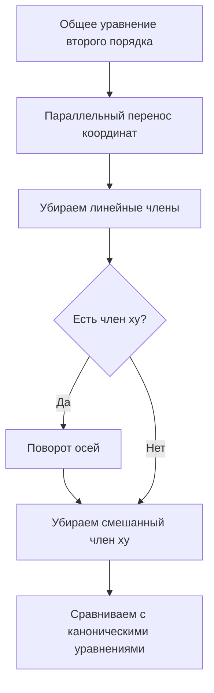

# Подготовка к тесту по кривым второго порядка — 19.10.2026

## Что входит в тест

Основной блок подготовки: темы 11–14.

- [[../notes/11 - Окружность и эллипс|11 — Окружность и эллипс]]
- [[../notes/12 - Гипербола|12 — Гипербола]]
- [[../notes/13 - Директрисы эллипса и гиперболы. Парабола|13 — Директрисы и парабола]]
- [[../notes/14 - Касательные, нормали и общее уравнение кривой второго порядка|14 — Касательные и общее уравнение второго порядка]]

---

# 1. Самое важное: различать кривые по уравнению

## Окружность

$$
(x-a)^2+(y-b)^2=R^2.
$$

Центр: $(a,b)$, радиус: $R$.

Если центр в начале координат:

$$
x^2+y^2=R^2.
$$

## Эллипс

$$
\frac{x^2}{a^2}+\frac{y^2}{b^2}=1,
\qquad a>b>0.
$$

Связь параметров:

$$
c^2=a^2-b^2.
$$

Фокусы:

$$
F_1(-c,0),\qquad F_2(c,0).
$$

Эксцентриситет:

$$
\varepsilon=\frac ca,
\qquad 0\le \varepsilon<1.
$$

Главное геометрическое свойство:

$$
MF_1+MF_2=2a.
$$

## Гипербола

$$
\frac{x^2}{a^2}-\frac{y^2}{b^2}=1.
$$

Связь параметров:

$$
c^2=a^2+b^2.
$$

Фокусы:

$$
F_1(-c,0),\qquad F_2(c,0).
$$

Эксцентриситет:

$$
\varepsilon=\frac ca>1.
$$

Главное свойство:

$$
|MF_1-MF_2|=2a.
$$

Асимптоты:

$$
y=\pm\frac ba x.
$$

## Парабола

Каноническое уравнение:

$$
y^2=2px,
\qquad p>0.
$$

Фокус:

$$
F\left(\frac p2,0\right).
$$

Директриса:

$$
x=-\frac p2.
$$

Для любой точки $M$ параболы:

$$
MF=d(M,\text{директриса}).
$$

Эксцентриситет:

$$
\varepsilon=1.
$$

---

# 2. Как мгновенно определить тип кривой

Смотри на квадратные члены.

| Вид | Тип |
|---|---|
| $x^2+y^2$ с одинаковыми коэффициентами | окружность |
| $\frac{x^2}{a^2}+\frac{y^2}{b^2}=1$ | эллипс |
| $\frac{x^2}{a^2}-\frac{y^2}{b^2}=1$ | гипербола |
| только одна переменная во второй степени, например $y^2=2px$ | парабола |

Ещё один способ — через эксцентриситет:

$$
\boxed{\varepsilon<1\Rightarrow \text{эллипс}}
$$

$$
\boxed{\varepsilon=1\Rightarrow \text{парабола}}
$$

$$
\boxed{\varepsilon>1\Rightarrow \text{гипербола}}
$$

---

# 3. Директрисы

Для эллипса и гиперболы:

$$
x=\pm\frac a\varepsilon.
$$

Для точки соответствующей коники:

$$
\frac{MF}{d}=\varepsilon,
$$

где $MF$ — расстояние до фокуса, а $d$ — расстояние до соответствующей директрисы.

### Эллипс

Так как $\varepsilon<1$:

$$
\frac a\varepsilon>a,
$$

поэтому директрисы лежат вне эллипса.

### Гипербола

Так как $\varepsilon>1$:

$$
\frac a\varepsilon<a,
$$

поэтому директрисы расположены между центром и вершинами.

---

# 4. Фокальные радиусы гиперболы

Для правой ветви:

$$
r_1=\varepsilon x+a,
$$

$$
r_2=\varepsilon x-a.
$$

Отсюда:

$$
r_1-r_2=2a.
$$

Это соответствует основному определению гиперболы через постоянную разность расстояний до фокусов.

---

# 5. Оптическое свойство параболы

Если лучи падают на параболу параллельно её оси, после отражения они проходят через фокус.

Обратно: лучи, выходящие из фокуса, после отражения идут параллельно оси параболы.

Это используется в:
- параболических антеннах;
- прожекторах;
- отражателях;
- оптических системах.

---

# 6. Касательные

## К эллипсу

Если точка

$$
M_0(x_0,y_0)
$$

лежит на эллипсе

$$
\frac{x^2}{a^2}+\frac{y^2}{b^2}=1,
$$

то касательная:

$$
\boxed{\frac{xx_0}{a^2}+\frac{yy_0}{b^2}=1}.
$$

## К гиперболе

Для

$$
\frac{x^2}{a^2}-\frac{y^2}{b^2}=1
$$

касательная в $M_0(x_0,y_0)$:

$$
\boxed{\frac{xx_0}{a^2}-\frac{yy_0}{b^2}=1}.
$$

## Нормаль

Нормаль — прямая, проходящая через точку касания перпендикулярно касательной.

---

# 7. Общее уравнение кривой второго порядка

$$
\boxed{Ax^2+2Bxy+Cy^2+2Dx+2Ey+F=0}.
$$

Квадратичная часть:

$$
Ax^2+2Bxy+Cy^2.
$$

Линейная часть:

$$
2Dx+2Ey.
$$

---

# 8. Приведение общего уравнения к простому виду

Алгоритм:

## Параллельный перенос

$$
x=x'+x_0,
$$

$$
y=y'+y_0.
$$

Используется для устранения линейных членов.

## Поворот осей

$$
x'=x''\cos\alpha-y''\sin\alpha,
$$

$$
y'=x''\sin\alpha+y''\cos\alpha.
$$

Используется для устранения смешанного члена $xy$.

---

# 9. Классификация через $\delta$

Для квадратичной части

$$
Ax^2+2Bxy+Cy^2
$$

используется величина

$$
\boxed{\delta=AC-B^2}.
$$

Для невырожденных случаев:

| Условие | Тип |
|---|---|
| $\delta>0$ | эллиптический |
| $\delta<0$ | гиперболический |
| $\delta=0$ | параболический |

Важно: одной только $\delta$ не всегда достаточно, чтобы полностью определить конкретную кривую — ещё нужно учитывать остальные коэффициенты и возможность вырожденного случая.

---

# 10. Что нужно уметь на тесте

## Минимум

1. Узнать по уравнению окружность, эллипс, гиперболу и параболу.
2. Написать канонические уравнения.
3. Знать определения через фокусы.
4. Знать $c$, $a$, $b$, $\varepsilon$ и связи между ними.
5. Найти фокусы.
6. Для гиперболы записать асимптоты.
7. Для параболы найти фокус и директрису.
8. Знать свойство $MF/d=\varepsilon$.
9. Знать формулы касательных к эллипсу и гиперболе.
10. Знать общее уравнение второй степени.
11. Понимать, зачем нужны перенос и поворот осей.
12. Знать $\delta=AC-B^2$ и её смысл.

---

# 11. Типовые вопросы с короткими ответами

**Что называется эллипсом?**  
Геометрическое место точек, сумма расстояний от которых до двух фокусов постоянна и равна $2a$.

**Что называется гиперболой?**  
Геометрическое место точек, модуль разности расстояний от которых до двух фокусов постоянен и равен $2a$.

**Что называется параболой?**  
Геометрическое место точек, равноудалённых от фиксированной точки — фокуса — и фиксированной прямой — директрисы.

**Эксцентриситет эллипса?**

$$
\varepsilon=\frac ca<1.
$$

**Эксцентриситет параболы?**

$$
\varepsilon=1.
$$

**Эксцентриситет гиперболы?**

$$
\varepsilon=\frac ca>1.
$$

**Связь $a,b,c$ для эллипса?**

$$
c^2=a^2-b^2.
$$

**Связь $a,b,c$ для гиперболы?**

$$
c^2=a^2+b^2.
$$

**Асимптоты гиперболы?**

$$
y=\pm\frac ba x.
$$

**Директрисы эллипса/гиперболы?**

$$
x=\pm\frac a\varepsilon.
$$

**Каноническое уравнение параболы?**

$$
y^2=2px.
$$

**Фокус параболы $y^2=2px$?**

$$
F\left(\frac p2,0\right).
$$

**Директриса?**

$$
x=-\frac p2.
$$

**Общее уравнение кривой второго порядка?**

$$
Ax^2+2Bxy+Cy^2+2Dx+2Ey+F=0.
$$

**Для чего перенос координат?**  
Для устранения линейных членов.

**Для чего поворот осей?**  
Для устранения смешанного члена $xy$.

**Что такое $\delta$?**

$$
\delta=AC-B^2.
$$

Она помогает определить тип квадратичной части кривой.

---

# 12. Мини-тест для самопроверки

1. Какое уравнение задаёт эллипс?
   - A) $x^2-y^2=1$
   - B) $x^2+y^2=1$
   - C) $\frac{x^2}{9}+\frac{y^2}{4}=1$
   - D) $y^2=4x$

2. Для эллипса $a=5$, $b=4$. Найти $c$.

3. Для гиперболы $a=3$, $b=4$. Найти $c$ и $\varepsilon$.

4. Найти фокус параболы

$$
y^2=8x.
$$

5. Найти директрису той же параболы.

6. Написать асимптоты гиперболы

$$
\frac{x^2}{9}-\frac{y^2}{4}=1.
$$

7. При каком $\varepsilon$ получается парабола?

8. Что устраняет поворот координат?

9. Определить тип квадратичной части, если $A=2$, $B=1$, $C=3$.

10. Написать касательную к эллипсу

$$
\frac{x^2}{9}+\frac{y^2}{4}=1
$$

в точке $(x_0,y_0)$.

## Ответы

1. **C**.
2. $c=3$.
3. $c=5$, $\varepsilon=5/3$.
4. $2p=8\Rightarrow p=4$, поэтому $F(2,0)$.
5. $x=-2$.
6. $y=\pm\frac23x$.
7. $\varepsilon=1$.
8. Смешанный член $xy$.
9. $\delta=AC-B^2=6-1=5>0$ — эллиптический тип.
10. $\frac{xx_0}{9}+\frac{yy_0}{4}=1$.

---

# 13. Быстрая шпаргалка перед тестом

$$
\boxed{\text{Эллипс: }\frac{x^2}{a^2}+\frac{y^2}{b^2}=1,\ c^2=a^2-b^2,\ \varepsilon<1}
$$

$$
\boxed{\text{Гипербола: }\frac{x^2}{a^2}-\frac{y^2}{b^2}=1,\ c^2=a^2+b^2,\ \varepsilon>1}
$$

$$
\boxed{\text{Парабола: }y^2=2px,\ F(p/2,0),\ x=-p/2,\ \varepsilon=1}
$$

$$
\boxed{\text{Директрисы: }x=\pm\frac a\varepsilon}
$$

$$
\boxed{\text{Гипербола: }y=\pm\frac ba x\text{ — асимптоты}}
$$

$$
\boxed{\delta=AC-B^2}
$$

Главная последовательность при общем уравнении:

**перенос → убрать линейные члены → поворот → убрать $xy$ → определить канонический вид.**
