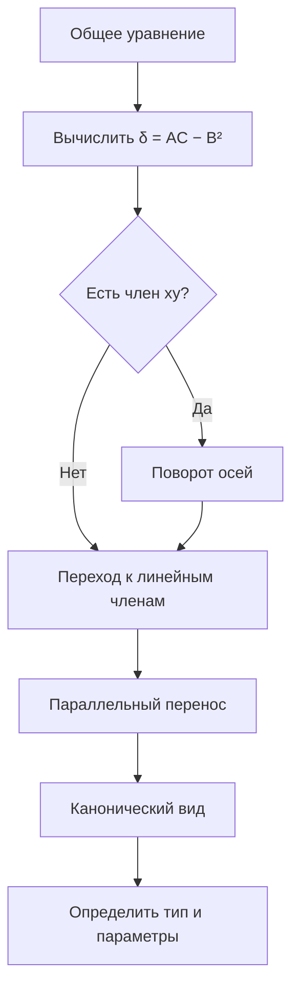

# Подготовка к тесту по кривым второго порядка — 19.10.2026

## Что входит

Основной блок: темы 11–14.

- [[../notes/11 - Окружность и эллипс|11 — Окружность и эллипс]]
- [[../notes/12 - Гипербола|12 — Гипербола]]
- [[../notes/13 - Директрисы эллипса и гиперболы. Парабола|13 — Директрисы и парабола]]
- [[../notes/14 - Касательные, нормали и общее уравнение кривой второго порядка|14 — Касательные и общее уравнение второго порядка]]

---

# 1. Канонические уравнения

## Окружность

$$
(x-a)^2+(y-b)^2=R^2.
$$

Центр: $C(a,b)$, радиус: $R$.

При центре в начале координат:

$$
x^2+y^2=R^2.
$$

## Эллипс

Для горизонтальной большой оси:

$$
\frac{x^2}{a^2}+\frac{y^2}{b^2}=1,
\qquad a>b>0.
$$

Связь параметров:

$$
c^2=a^2-b^2.
$$

Фокусы:

$$
F_1(-c,0),\qquad F_2(c,0).
$$

Эксцентриситет:

$$
\varepsilon=\frac ca,
\qquad 0<\varepsilon<1.
$$

Для окружности как частного случая эллипса $a=b$, $c=0$, $\varepsilon=0$.

Главное геометрическое свойство:

$$
MF_1+MF_2=2a.
$$

## Гипербола

Для ветвей вдоль оси $Ox$:

$$
\frac{x^2}{a^2}-\frac{y^2}{b^2}=1.
$$

Связь параметров:

$$
c^2=a^2+b^2.
$$

Фокусы:

$$
F_1(-c,0),\qquad F_2(c,0).
$$

Эксцентриситет:

$$
\varepsilon=\frac ca>1.
$$

Главное свойство:

$$
|MF_1-MF_2|=2a.
$$

Асимптоты:

$$
y=\pm\frac ba x.
$$

Если гипербола имеет вид

$$
\frac{y^2}{a^2}-\frac{x^2}{b^2}=1,
$$

то ветви направлены вдоль $Oy$, а асимптоты имеют вид

$$
y=\pm\frac ab x.
$$

## Парабола

В принятом в конспекте обозначении:

$$
y^2=2px,
\qquad p>0.
$$

Фокус:

$$
F\left(\frac p2,0\right).
$$

Директриса:

$$
x=-\frac p2.
$$

Для любой точки $M$ параболы:

$$
MF=d(M,\text{директриса}).
$$

Эксцентриситет:

$$
\varepsilon=1.
$$

Если записано

$$
x^2=2py,
$$

то ось параболы — $Oy$.

---

# 2. Как различать кривые

Для уже приведённых к каноническому или близкому к нему виду уравнений:

| Признак | Кривая |
|---|---|
| $x^2$ и $y^2$ с одинаковыми положительными коэффициентами | окружность |
| $x^2$ и $y^2$ одного знака, коэффициенты обычно разные | эллипс |
| $x^2$ и $y^2$ разных знаков | гипербола |
| только одна переменная входит во второй степени | парабола |

> [!important]
> Для общего уравнения с членом $xy$ этого правила недостаточно: кривая может быть повернута. Тогда используют преобразование координат и величину $\delta=AC-B^2$.

По эксцентриситету:

$$
0\le\varepsilon<1 \Rightarrow \text{эллиптический случай},
$$

$$
\varepsilon=1 \Rightarrow \text{парабола},
$$

$$
\varepsilon>1 \Rightarrow \text{гипербола}.
$$

---

# 3. Директрисы

Для невырожденного неокружностного эллипса и гиперболы с главной осью $Ox$:

$$
x=\pm\frac a\varepsilon=\pm\frac{a^2}{c}.
$$

Для точки соответствующей коники:

$$
\frac{MF}{d}=\varepsilon,
$$

где $MF$ — расстояние до соответствующего фокуса, $d$ — перпендикулярное расстояние до соответствующей директрисы.

### Эллипс

Так как $0<\varepsilon<1$,

$$
\frac a\varepsilon>a,
$$

поэтому директрисы лежат вне эллипса.

### Гипербола

Так как $\varepsilon>1$,

$$
\frac a\varepsilon<a,
$$

поэтому директрисы расположены между центром и вершинами.

> [!note]
> Для окружности $\varepsilon=0$, поэтому формула $a/\varepsilon$ для директрис не используется.

---

# 4. Фокальные радиусы гиперболы

Для правой ветви гиперболы

$$
\frac{x^2}{a^2}-\frac{y^2}{b^2}=1
$$

при $F_1(-c,0)$ и $F_2(c,0)$:

$$
r_1=MF_1=\varepsilon x+a,
$$

$$
r_2=MF_2=\varepsilon x-a.
$$

Поэтому

$$
r_1-r_2=2a.
$$

В общем виде для гиперболы всегда верно:

$$
|r_1-r_2|=2a.
$$

---

# 5. Оптическое свойство параболы

Луч, идущий параллельно оси параболы, после зеркального отражения от параболы проходит через фокус.

Обратно: луч, выходящий из фокуса, после отражения идёт параллельно оси параболы.

Применение:
- параболические отражатели;
- антенны;
- прожекторы;
- телескопы и другие оптические системы.

---

# 6. Касательные

## Эллипс

Для точки $M_0(x_0,y_0)$, лежащей на

$$
\frac{x^2}{a^2}+\frac{y^2}{b^2}=1,
$$

касательная:

$$
\boxed{\frac{xx_0}{a^2}+\frac{yy_0}{b^2}=1}.
$$

## Гипербола

Для точки $M_0(x_0,y_0)$, лежащей на

$$
\frac{x^2}{a^2}-\frac{y^2}{b^2}=1,
$$

касательная:

$$
\boxed{\frac{xx_0}{a^2}-\frac{yy_0}{b^2}=1}.
$$

## Нормаль

Нормаль — прямая, проходящая через точку касания перпендикулярно касательной.

---

# 7. Общее уравнение кривой второго порядка

$$
\boxed{Ax^2+2Bxy+Cy^2+2Dx+2Ey+F=0},
$$

причём $A,B,C$ не равны нулю одновременно.

Квадратичная часть:

$$
Ax^2+2Bxy+Cy^2.
$$

Линейная часть:

$$
2Dx+2Ey.
$$

---

# 8. Классификация через $\delta$

Для квадратичной части используется

$$
\boxed{\delta=AC-B^2}.
$$

Для невырожденных коник:

| Условие | Тип |
|---|---|
| $\delta>0$ | эллиптический |
| $\delta<0$ | гиперболический |
| $\delta=0$ | параболический |

Важно: $\delta$ определяет тип квадратичной части, но **не всегда полностью определяет саму кривую**. Возможны вырожденные случаи: точка, пара прямых, одна прямая, пустое множество и др.

---

# 9. Как привести общее уравнение к каноническому виду

Универсально безопасный алгоритм:

## Поворот осей

$$
x=x'\cos\alpha-y'\sin\alpha,
$$

$$
y=x'\sin\alpha+y'\cos\alpha.
$$

Поворот используют для устранения смешанного члена $xy$.

## Параллельный перенос

$$
x'=x''+x_0,
\qquad
y'=y''+y_0.
$$

Перенос используют для упрощения линейных членов.

Для эллипса и гиперболы при $\delta\ne0$ подходящим переносом можно убрать оба линейных члена.

Для параболического случая $\delta=0$ вообще говоря один линейный член остаётся: именно он приводит к форме типа

$$
y^2=2px.
$$

---

# 10. Что нужно уметь на тесте

1. Узнать окружность, эллипс, гиперболу и параболу по каноническому уравнению.
2. Записать их канонические уравнения.
3. Знать определения через фокусы и директрисы.
4. Знать связи между $a,b,c$.
5. Находить эксцентриситет.
6. Находить фокусы.
7. Для гиперболы записывать асимптоты.
8. Для параболы находить фокус и директрису.
9. Знать свойство $MF/d=\varepsilon$.
10. Знать формулы касательных к эллипсу и гиперболе.
11. Знать общее уравнение второй степени.
12. Понимать назначение поворота и переноса осей.
13. Знать $\delta=AC-B^2$ и понимать ограниченность этой классификации.

---

# 11. Частые ошибки

1. **Не путать связи параметров:**

Эллипс:

$$
c^2=a^2-b^2.
$$

Гипербола:

$$
c^2=a^2+b^2.
$$

2. **Не путать эксцентриситет:**

$$
\varepsilon_{\text{элл}}<1,\qquad
\varepsilon_{\text{пар}}=1,\qquad
\varepsilon_{\text{гип}}>1.
$$

3. В формуле директрис эллипса и гиперболы:

$$
x=\pm\frac a\varepsilon.
$$

4. Для принятой формы параболы $y^2=2px$:

$$
F\left(\frac p2,0\right),\qquad x=-\frac p2.
$$

5. Нельзя по знакам $x^2$ и $y^2$ мгновенно классифицировать произвольное общее уравнение, если есть член $xy$.

6. Нельзя говорить, что перенос всегда убирает все линейные члены: для параболы это в общем случае неверно.

---

# 12. Типовые вопросы с ответами

**Что называется эллипсом?**  
Геометрическое место точек, сумма расстояний от которых до двух фокусов постоянна и равна $2a$.

**Что называется гиперболой?**  
Геометрическое место точек, модуль разности расстояний от которых до двух фокусов постоянен и равен $2a$.

**Что называется параболой?**  
Геометрическое место точек, равноудалённых от фокуса и директрисы.

**Эксцентриситет эллипса?**

$$
\varepsilon=\frac ca<1.
$$

**Эксцентриситет параболы?**

$$
\varepsilon=1.
$$

**Эксцентриситет гиперболы?**

$$
\varepsilon=\frac ca>1.
$$

**Связь $a,b,c$ для эллипса?**

$$
c^2=a^2-b^2.
$$

**Связь для гиперболы?**

$$
c^2=a^2+b^2.
$$

**Асимптоты горизонтальной гиперболы?**

$$
y=\pm\frac ba x.
$$

**Директрисы эллипса/гиперболы с осью $Ox$?**

$$
x=\pm\frac a\varepsilon.
$$

**Каноническое уравнение параболы в конспекте?**

$$
y^2=2px.
$$

**Фокус?**

$$
F\left(\frac p2,0\right).
$$

**Директриса?**

$$
x=-\frac p2.
$$

**Общее уравнение кривой второго порядка?**

$$
Ax^2+2Bxy+Cy^2+2Dx+2Ey+F=0.
$$

**Что убирает поворот?**  
Смешанный член $xy$.

**Что делает перенос?**  
Меняет начало координат и позволяет упростить или устранить линейные члены.

**Что такое $\delta$?**

$$
\delta=AC-B^2.
$$

Она определяет тип квадратичной части.

---

# 13. Мини-тест

1. Определи кривую:

$$
\frac{x^2}{9}+\frac{y^2}{4}=1.
$$

2. Для эллипса $a=5$, $b=4$. Найди $c$ и $\varepsilon$.

3. Для гиперболы $a=3$, $b=4$. Найди $c$ и $\varepsilon$.

4. Запиши асимптоты:

$$
\frac{x^2}{9}-\frac{y^2}{16}=1.
$$

5. Для

$$
y^2=12x
$$

найди $p$, фокус и директрису.

6. Какой тип квадратичной части, если

$$
A=2,\quad B=1,\quad C=3?
$$

7. Что делает поворот координат?

8. Чем отличается эллипс от гиперболы по эксцентриситету?

9. Запиши касательную к эллипсу

$$
\frac{x^2}{25}+\frac{y^2}{9}=1
$$

в точке $(4,9/5)$.

10. Почему по одной величине $\delta$ нельзя всегда однозначно назвать конкретную кривую?

## Ответы

1. Эллипс.

2.

$$
c=3,\qquad \varepsilon=\frac35.
$$

3.

$$
c=5,\qquad \varepsilon=\frac53.
$$

4.

$$
y=\pm\frac43x.
$$

5. Так как $2p=12$,

$$
p=6,
$$

$$
F(3,0),\qquad x=-3.
$$

6.

$$
\delta=AC-B^2=2\cdot3-1=5>0,
$$

эллиптический тип.

7. Устраняет смешанный член $xy$.

8. Для эллипса $\varepsilon<1$, для гиперболы $\varepsilon>1$.

9.

$$
\frac{4x}{25}+\frac{(9/5)y}{9}=1,
$$

то есть

$$
\frac{4x}{25}+\frac y5=1.
$$

10. Потому что $\delta$ классифицирует квадратичную часть, а итоговая кривая зависит также от линейных и свободного членов; возможны вырожденные случаи.

---

# 14. Финальная шпаргалка

$$
\boxed{\text{Эллипс: }\frac{x^2}{a^2}+\frac{y^2}{b^2}=1,\quad c^2=a^2-b^2,\quad \varepsilon=c/a<1}
$$

$$
\boxed{\text{Гипербола: }\frac{x^2}{a^2}-\frac{y^2}{b^2}=1,\quad c^2=a^2+b^2,\quad \varepsilon=c/a>1}
$$

$$
\boxed{\text{Парабола: }y^2=2px,\quad F(p/2,0),\quad x=-p/2,\quad \varepsilon=1}
$$

$$
\boxed{\text{Директрисы: }x=\pm a/\varepsilon}
$$

$$
\boxed{\text{Гипербола: }y=\pm(b/a)x}
$$

$$
\boxed{\delta=AC-B^2}
$$

Перед тестом в первую очередь повторить: **канонические уравнения → связи $a,b,c$ → эксцентриситет → директрисы → асимптоты → парабола → $\delta$ и преобразования координат**.
