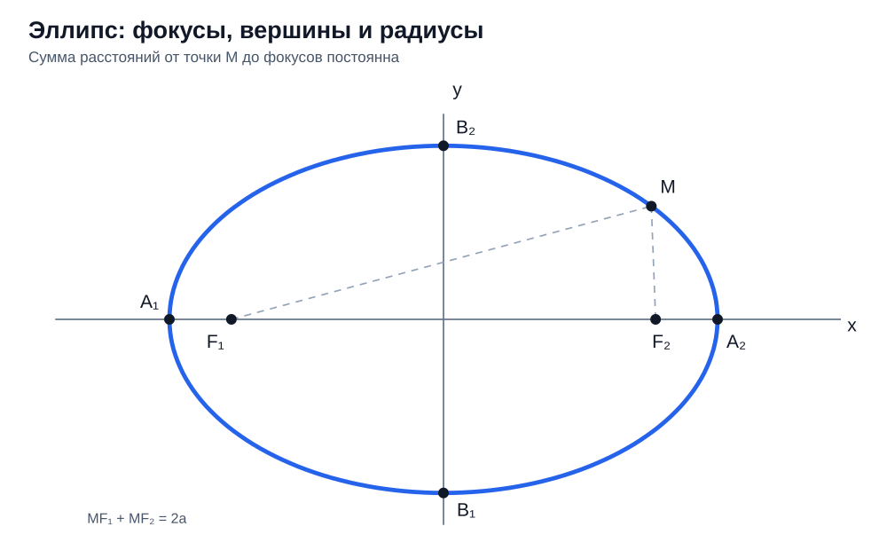
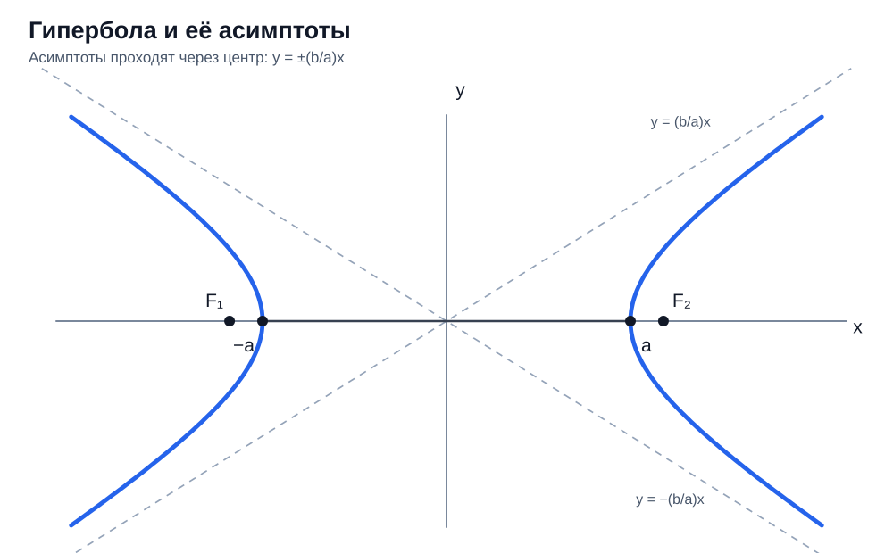
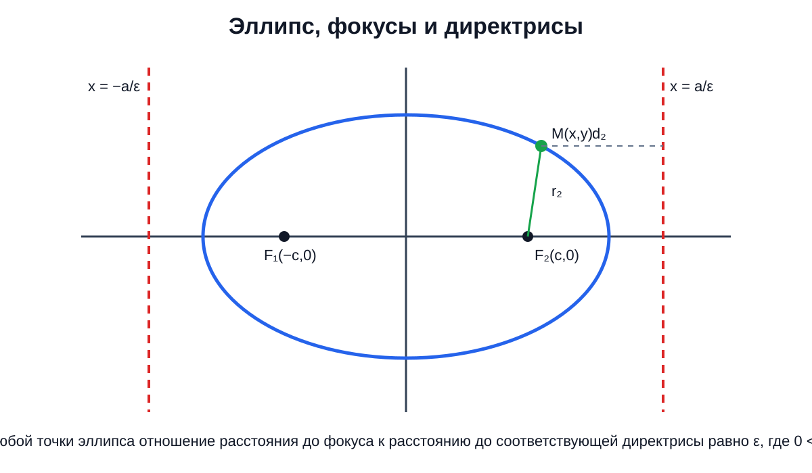
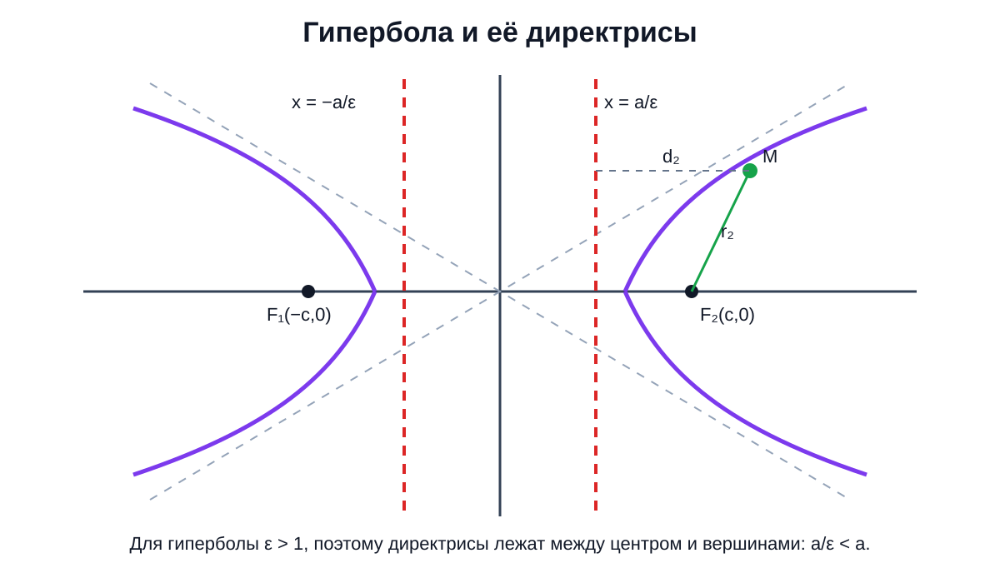
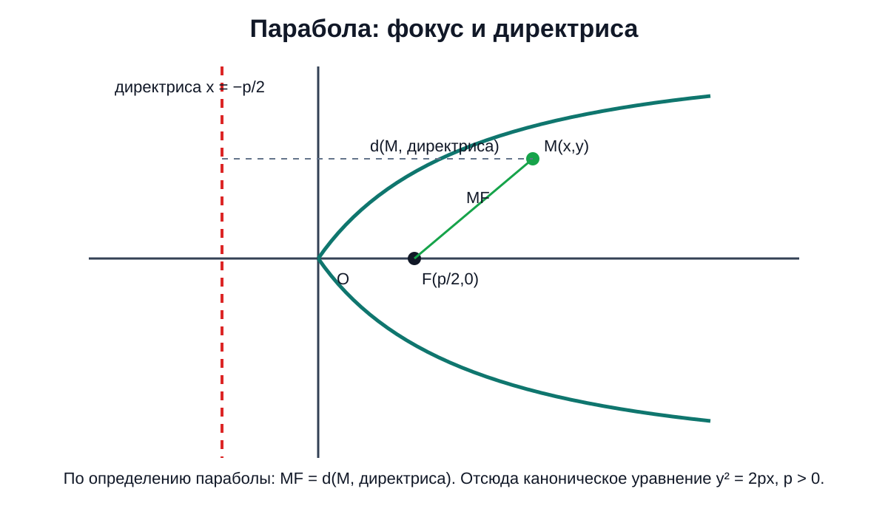
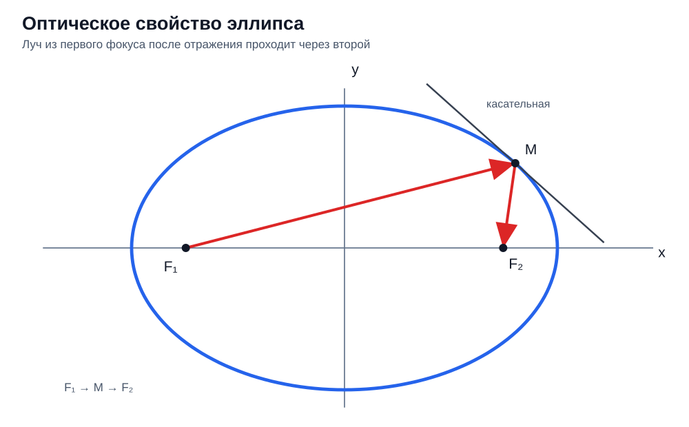
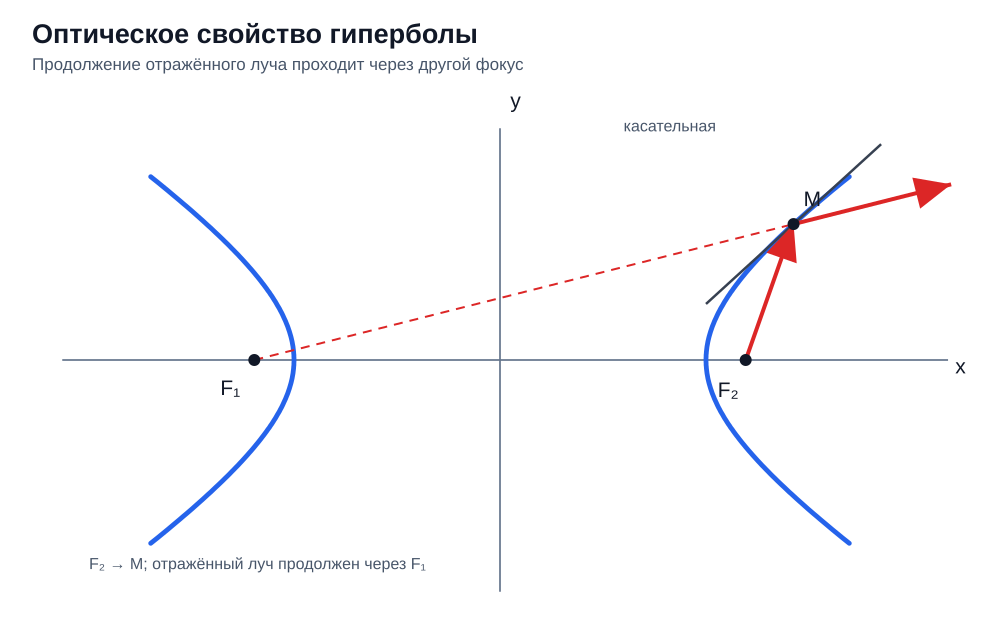
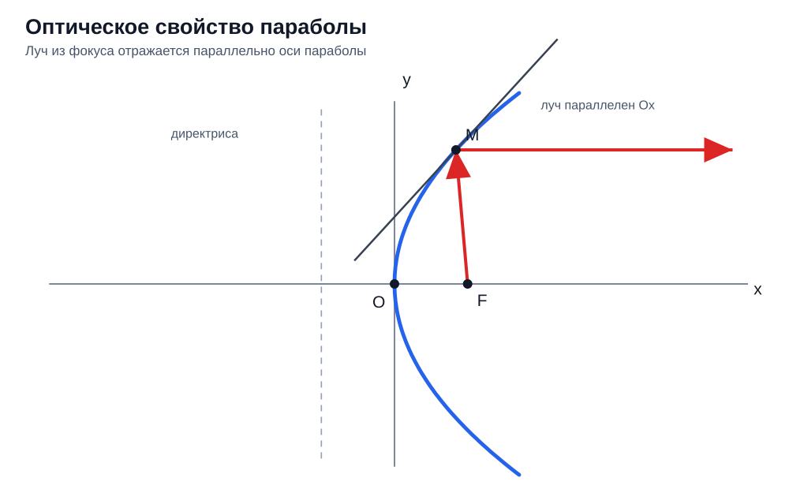

# 06 — Кривые второго порядка. Полная подготовка к коллоквиуму

> [!important] Источник и формат
> Список из **9 вопросов** дословно взят из документа «КРИВЫЕ ВТОРОГО ПОРЯДКА НА ПЛОСКОСТИ». Содержательные ответы построены по рукописным лекциям на 33 страницах, размещённым в [[../notes/11 - Окружность и эллипс|№11]], [[../notes/12 - Гипербола|№12]], [[../notes/13 - Директрисы эллипса и гиперболы. Парабола|№13]], [[../notes/14 - Касательные, нормали и общее уравнение кривой второго порядка|№14]], [[../notes/15 - Приведение общего уравнения кривой второго порядка к каноническому виду|№15]].
>
> Для оценки на 4–5 приведены **определения, выводы уравнений, обратные проверки, исследования графиков, доказательства формул и комментарии к рисункам**. Дополнительные формулы, которые полезны для законченного ответа, но не прочитываются прямо из рукописи, отмечены как пояснения. Исправленные элементы записаны с подчёркиванием. [[07 - Кривые второго порядка - краткая подготовка к коллоквиуму|Краткое повторение]].

## Вопрос 1. Окружность. Определение и уравнение

### Определение

**Окружность** — геометрическое место точек плоскости, равноудалённых от одной фиксированной точки, называемой **центром**. Постоянное расстояние — **радиус**.

Пусть $M_0(a,b)$ — центр, $M(x,y)$ — произвольная точка окружности, $R>0$ — радиус.

### Вывод

Из определения:
$$
M_0M=R.
$$

Формула расстояния:
$$
M_0M=\sqrt{(x-a)^2+(y-b)^2}.
$$

Следовательно:
$$
\sqrt{(x-a)^2+(y-b)^2}=R.
$$

Возводим в квадрат:
$$
\boxed{(x-a)^2+(y-b)^2=R^2}.
$$

При $M_0=O(0,0)$:
$$
\boxed{x^2+y^2=R^2}.
$$

### Обратная проверка

Если точка удовлетворяет $(x-a)^2+(y-b)^2=R^2$, то расстояние от неё до $M_0$ равно $\sqrt{R^2}=R$ при $R\ge0$; значит, она лежит на окружности.

### Как рисовать

Нанести $M_0(a,b)$, произвольную точку $M(x,y)$ и отрезок $M_0M=R$. В частном случае центр лежит в начале координат.

### Что может дополнительно спросить преподаватель

- Что такое геометрическое место точек? Совокупность точек с общим характеризующим свойством.
- Что означает $R=0$? Вырожденный случай: одна точка.
- Почему после возведения в квадрат не появляются лишние решения? Обе части исходного равенства неотрицательны.

---

## Вопрос 2. Эллипс. Определение и вывод уравнения

### Геометрическое определение

**Эллипс** — геометрическое место точек плоскости, сумма расстояний от каждой из которых до двух фиксированных точек — **фокусов** — постоянна и больше расстояния между фокусами.

Пусть:
$$
F_1F_2=2c,\qquad F_1M=r_1,\quad F_2M=r_2.
$$

Тогда
$$
\boxed{r_1+r_2=2a},\qquad \boxed{a>c}.
$$

Неравенство $a>c$ объясняется неравенством треугольника: сумма расстояний от $M$ до двух фокусов для невырожденного эллипса больше расстояния между ними.

### Размещение фокусов

Выберем координаты так, чтобы
$$
F_1(-c,0),\qquad F_2(c,0),\qquad M(x,y).
$$

По формуле расстояния:
$$
r_1=\sqrt{(x+c)^2+y^2},
$$
$$
r_2=\sqrt{(x-c)^2+y^2}.
$$

Подставляем:
$$
\sqrt{(x+c)^2+y^2}+\sqrt{(x-c)^2+y^2}=2a.
$$

### Первое возведение в квадрат

Изолируем первый корень:
$$
\sqrt{(x+c)^2+y^2}
=2a-\sqrt{(x-c)^2+y^2}.
$$

Возводим в квадрат:
$$
(x+c)^2+y^2
=4a^2-4a\sqrt{(x-c)^2+y^2}+(x-c)^2+y^2.
$$

Разность квадратов $(x+c)^2-(x-c)^2=4cx$:
$$
4cx=4a^2-4a\sqrt{(x-c)^2+y^2}.
$$

Следовательно:
$$
\boxed{\sqrt{(x-c)^2+y^2}=a-\frac ca x}.
$$

### Второе возведение в квадрат

$$
(x-c)^2+y^2=\left(a-\frac ca x\right)^2.
$$

$$
x^2-2cx+c^2+y^2
=a^2-2cx+\frac{c^2x^2}{a^2}.
$$

После сокращения:
$$
a^2x^2+a^2c^2+a^2y^2=a^4+c^2x^2.
$$

$$
(a^2-c^2)x^2+a^2y^2=a^2(a^2-c^2).
$$

Обозначим
$$
\boxed{b^2=\underline{a^2-c^2}>0}.
$$

Получаем:
$$
b^2x^2+a^2y^2=a^2b^2,
$$

$$
\boxed{\frac{x^2}{a^2}+\frac{y^2}{b^2}=1}.
$$

**Это каноническое уравнение эллипса.**

### Почему нужно проверить обратный переход?

Возведение в квадрат — не всегда равносильная операция. Из канонического уравнения следует $|x|\le a$. Поэтому
$$
a-\frac ca x\ge a-c>0,\qquad
a+\frac ca x\ge a-c>0.
$$

Следовательно, радиусы действительно равны:
$$
r_1=a+\frac ca x,\qquad r_2=a-\frac ca x
$$
и их сумма $2a$. Значит, каноническое уравнение задаёт именно исходный эллипс.

### Запомнить

- **Сумма** фокальных радиусов постоянна.
- $a>c$.
- $b^2=a^2-c^2$.
- Знак между дробями **плюс**.
- Фокусы: $(\pm c,0)$.

---

## Вопрос 3. Исследование формы эллипса. Эксцентриситет. Фокальные радиусы

### Исследование формы

Каноническое уравнение:
$$
\frac{x^2}{a^2}+\frac{y^2}{b^2}=1,\qquad a>b>0.
$$

**1. Симметрия.** $x$ и $y$ входят только квадратами. Следовательно, кривая симметрична относительно $Ox$, $Oy$ и начала координат.

**2. Ограниченность.**
$$
\frac{x^2}{a^2}\le1,\qquad \frac{y^2}{b^2}\le1.
$$
Значит $-a\le x\le a$ и $-b\le y\le b$.

**3. Пересечение с осями.**
- $y=0$ ⇒ $x=\pm a$;
- $x=0$ ⇒ $y=\pm b$.

Вершины:
$$
(\pm a,0),\quad (0,\pm b).
$$

**4. Исследование первой четверти.**
$$
y=\frac ba\sqrt{a^2-x^2},\qquad 0\le x\le a.
$$
При $x=0$, $y=b$; при $x=a$, $y=0$. При увеличении $x$ от $0$ до $a$, $y$ уменьшается. Остальные четверти строим симметрией.

**5. Полуоси.** $a$ — большая, $b$ — малая. Длины осей: $2a$ и $2b$. Если $a=b$, получается окружность.

### Эксцентриситет

**Определение:** отношение половины расстояния между фокусами к большой полуоси:
$$
\boxed{\varepsilon=\frac ca}.
$$

Поскольку $c<a$:
$$
0\le\varepsilon<1.
$$

Из $b^2=a^2-c^2$:
$$
\varepsilon^2=\frac{c^2}{a^2}=1-\frac{b^2}{a^2},
$$

$$
\boxed{\varepsilon=\sqrt{1-\left(\frac ba\right)^2}}.
$$

Чем больше $\varepsilon$, тем более вытянут эллипс. Для окружности $\varepsilon=0$.

### Фокальные радиусы

Для $F_1(-c,0)$:
$$
r_1=\sqrt{(x+c)^2+y^2}.
$$
Для $F_2(c,0)$:
$$
r_2=\sqrt{(x-c)^2+y^2}.
$$

Из вывода канонического уравнения:
$$
r_2=a-\frac ca x=a-\varepsilon x.
$$

Из $r_1+r_2=2a$:
$$
r_1=a+\varepsilon x.
$$

**Рациональные формулы:**
$$
\boxed{r_1=a+\varepsilon x,\qquad r_2=a-\varepsilon x}.
$$

Проверка: $r_1+r_2=2a$.

### Вопрос с подвохом

Можно ли утверждать, что все точки эллипса удовлетворяют $x\in[-a,a]$? **Да**, если большая полуось размещена по $Ox$ и уравнение записано в показанной форме.

---

## Вопрос 4. Гипербола. Определение и вывод канонического уравнения

### Определение

**Гипербола** — геометрическое место точек плоскости, для которых **модуль разности расстояний до двух фокусов** равен положительной постоянной величине.

$$
\boxed{|r_1-r_2|=2a}.
$$

Пусть $F_1F_2=2c$. По неравенству треугольника:
$$
2a<2c,\qquad \boxed{a<c}.
$$

Фокусы: $F_1(-c,0)$, $F_2(c,0)$.

### Уравнение в радикалах

$$
\left|
\sqrt{(x+c)^2+y^2}
-\sqrt{(x-c)^2+y^2}
\right|=2a.
$$

Для правой ветви:
$$
\sqrt{(x+c)^2+y^2}
-\sqrt{(x-c)^2+y^2}
=2a.
$$

### Вывод

Изолируем первый радикал и возводим в квадрат:
$$
(x+c)^2+y^2
=4a^2+4a\sqrt{(x-c)^2+y^2}+(x-c)^2+y^2.
$$

Сокращаем:
$$
4cx=4a^2+4a\sqrt{(x-c)^2+y^2}.
$$

$$
\sqrt{(x-c)^2+y^2}=\frac ca x-a.
$$

Второй раз возводим в квадрат:
$$
(x-c)^2+y^2=\left(\frac ca x-a\right)^2.
$$

$$
a^2x^2+a^2c^2+a^2y^2=c^2x^2+a^4.
$$

$$
(a^2-c^2)x^2+a^2y^2=a^2(a^2-c^2).
$$

Так как $c>a$, вводим
$$
\boxed{b^2=\underline{c^2-a^2}>0}.
$$

Тогда:
$$
-b^2x^2+a^2y^2=-a^2b^2.
$$

Делим на $-a^2b^2$:
$$
\boxed{\frac{x^2}{a^2}-\frac{y^2}{b^2}=1}.
$$

### Проверка обратного утверждения

Из уравнения $|x|\ge a$. Тогда:
$$
r_1=|\varepsilon x+a|,
\qquad r_2=|\varepsilon x-a|,
\qquad\varepsilon=\frac ca>1.
$$

Для $x\ge a$:
$$
r_1-r_2=(\varepsilon x+a)-(\varepsilon x-a)=2a.
$$

Для $x\le-a$:
$$
r_2-r_1=(-\varepsilon x+a)-(-\varepsilon x-a)=2a.
$$

Значит $|r_1-r_2|=2a$, как требуется.

**Главное различие с эллипсом:** у эллипса $b^2=a^2-c^2$ и сумма квадратов; у гиперболы $b^2=c^2-a^2$ и разность квадратов.

---

## Вопрос 5. Исследование формы гиперболы. Эксцентриситет. Рациональные фокальные радиусы

### Форма

Уравнение:
$$
\frac{x^2}{a^2}-\frac{y^2}{b^2}=1.
$$

1. Оно симметрично относительно $Ox$, $Oy$ и начала координат.
2. Из него:
   $$
   x^2=a^2\left(1+\frac{y^2}{b^2}\right)\ge a^2,
   $$
   поэтому $|x|\ge a$.
3. В вертикальной полосе $-a<x<a$ точек нет.
4. Пересечение с $Ox$ — вершины $(-a,0)$ и $(a,0)$. С $Oy$ пересечений нет.
5. Кривая состоит из двух бесконечных ветвей: левой и правой.
6. Раскрываем $y$:
   $$
   \boxed{y=\pm\frac ba\sqrt{x^2-a^2}}.
   $$

### Асимптоты: доказательство

Сравним верхнюю правую ветвь с прямой $y_1=(b/a)x$:
$$
y=\frac ba\sqrt{x^2-a^2}.
$$

Расстояние по вертикали между точкой гиперболы и прямой:
$$
y_1-y=\frac ba\left(x-\sqrt{x^2-a^2}\right).
$$

Рационализируем:
$$
=\frac ba\frac{x^2-(x^2-a^2)}{x+\sqrt{x^2-a^2}}
=\frac{ab}{x+\sqrt{x^2-a^2}}.
$$

При $x\to+\infty$:
$$
\frac{ab}{x+\sqrt{x^2-a^2}}\to0.
$$

Следовательно, прямая — асимптота. Вторая получается симметрией:
$$
\boxed{y=\pm\frac ba x}.
$$

При $a=b$ асимптоты $y=\pm x$ перпендикулярны; гипербола **прямоугольная**.

### Эксцентриситет

$$
\boxed{\varepsilon=\frac ca>1}.
$$

$$
c^2=a^2+b^2,
$$

$$
\boxed{\varepsilon=\sqrt{1+\left(\frac ba\right)^2}}.
$$

При $a=b$:
$$
\varepsilon=\sqrt2.
$$

### Рациональные фокальные радиусы

Для двух ветвей общий правильный вид:
$$
\boxed{r_1=|\varepsilon x+a|,\qquad r_2=|\varepsilon x-a|}.
$$

**Правая ветвь $x\ge a$:**
$$
r_1=\varepsilon x+a,\qquad r_2=\varepsilon x-a.
$$

**Левая ветвь $x\le-a$:**
$$
r_1=-\varepsilon x-a,\qquad r_2=-\varepsilon x+a.
$$

Нельзя применять формулы без модулей с правой ветви к левой: расстояния не бывают отрицательными.

### Что рисовать

Оси $Ox$, $Oy$; вершины $\pm a$; фокусы $\pm c$, располагающиеся дальше от центра, чем вершины; основной прямоугольник $(\pm a,\pm b)$; его диагонали $y=\pm(b/a)x$; две ветви, приближающиеся к этим диагоналям.

---

## Вопрос 6. Директрисы эллипса и гиперболы

### Определение директрис эллипса

Директрисы — две параллельные прямые, перпендикулярные большой оси эллипса, симметричные относительно центра и находящиеся от него на расстоянии $a/\varepsilon$.

Если большая ось — $Ox$:
$$
\boxed{x=\pm\frac a\varepsilon}.
$$

Для эллипса $0<\varepsilon<1$, поэтому $a/\varepsilon>a$: директрисы **за пределами вершин**.

### Определение директрис гиперболы

Две параллельные прямые, перпендикулярные действительной оси гиперболы, симметричные относительно её центра и находящиеся на расстоянии $a/\varepsilon$.

$$
\boxed{x=\pm\frac a\varepsilon}.
$$

Для гиперболы $\varepsilon>1$, поэтому $a/\varepsilon<a$: директрисы **между вершинами**.

### Теорема о постоянном отношении

Для точки $M$ на кривой:
$$
r=\operatorname{dist}(M,F),
\qquad d=\operatorname{dist}(M,\text{соответствующая директриса}).
$$

Тогда:
$$
\boxed{\frac rd=\varepsilon}.
$$

#### Доказательство для эллипса

Правый фокус $F_2(c,0)$, правая директриса $x=a/\varepsilon$. Радиус:
$$
r_2=a-\varepsilon x.
$$

Расстояние до правой директрисы (которая лежит правее всего эллипса):
$$
d_2=\frac a\varepsilon-x.
$$

Значит:
$$
r_2=\varepsilon d_2,
\qquad\boxed{\frac{r_2}{d_2}=\varepsilon}.
$$

Для левого фокуса:
$$
r_1=a+\varepsilon x,\qquad
d_1=x+\frac a\varepsilon,
$$
и $r_1=\varepsilon d_1$.

#### Доказательство для гиперболы

Для соответствующих правого фокуса и директрисы:
$$
r_2=|\varepsilon x-a|,
$$
$$
d_2=\left|x-\frac a\varepsilon\right|.
$$

Тогда:
$$
r_2=\varepsilon\left|x-\frac a\varepsilon\right|=\varepsilon d_2.
$$

Аналогично для левых.

### Общий фокально-директрисный критерий

$$
\boxed{
\varepsilon<1\text{ — эллипс};
\quad\varepsilon=1\text{ — парабола};
\quad\varepsilon>1\text{ — гипербола}
}.
$$

В случае эллипса с совпавшими фокусами $\varepsilon=0$ получается окружность, но директрисы $x=\pm a/\varepsilon$ не являются конечными прямыми.

**Важно для ответов:** $d$ — всегда **расстояние**, а не просто алгебраическая разность координат; при необходимости нужен модуль. В рукописи на стр. 21 это место записано неясно, корректная запись $\underline{|x-a/\varepsilon|}$.

---

## Вопрос 7. Парабола. Вывод канонического уравнения. Исследование формы

### Определение

**Парабола** — геометрическое место точек плоскости, равноудалённых от фиксированной точки — **фокуса** — и фиксированной прямой — **директрисы**. Директриса не проходит через фокус.

Для неё $\varepsilon=1$.

### Выбор координат

Пусть фокус и директриса находятся на расстоянии $p>0$, ось $Ox$ перпендикулярна директрисе, а начало координат — посредине:
$$
F\left(\frac p2,0\right),\qquad\text{директриса }x=-\frac p2.
$$

Пусть $M(x,y)$ принадлежит параболе. Тогда:
$$
MF=\sqrt{\left(x-\frac p2\right)^2+y^2}.
$$

Расстояние до директрисы:
$$
d=x+\frac p2,
$$
поскольку парабола будет лежать при $x\ge0$.

### Вывод

Из определения $MF=d$:
$$
\sqrt{\left(x-\frac p2\right)^2+y^2}=x+\frac p2.
$$

Возводим в квадрат:
$$
\left(x-\frac p2\right)^2+y^2=\left(x+\frac p2\right)^2.
$$

Раскрываем:
$$
x^2-px+\frac{p^2}4+y^2
=x^2+px+\frac{p^2}4.
$$

После сокращения:
$$
\boxed{y^2=2px}.
$$

Обратно: из $y^2=2px$ следует $x\ge0$, так что обе стороны исходного равенства расстояний неотрицательны; возведение в квадрат было обратимым.

### Исследование

- **Симметрия:** замена $y\mapsto-y$ сохраняет уравнение ⇒ симметрия относительно $Ox$.
- **Вершина:** при $x=0$ ⇒ $y=0$, значит $(0,0)$.
- **Область:** $x=y^2/(2p)\ge0$.
- **Ветви:** $y=\pm\sqrt{2px}$, уходят вправо вверх и вправо вниз.
- **Парабола не ограничена:** при $x\to+\infty$ $|y|\to\infty$.

### Все направления

| Вид | Направление |
|---|---|
| $y^2=2px$ | Вправо |
| $y^2=-2px$ | Влево |
| $x^2=2py$ | Вверх |
| $x^2=-2py$ | Вниз |

Здесь $p>0$.

### Как рисовать

Ось $Ox$ — ось симметрии; фокус в $(p/2,0)$; директриса — вертикальная прямая $x=-p/2$; вершина — середина между фокусом и директрисой.

---

## Вопрос 8. Оптические свойства эллипса, гиперболы и параболы. Касательные к кривым второго порядка

### Оптические свойства

**Эллипс:** луч, исходящий из одного фокуса, после отражения от эллиптической поверхности проходит через другой фокус.

**Гипербола:** направления падающего и отражённого лучей связаны с двумя фокусами; при необходимости **продолжение** одного из лучей проходит через второй фокус. На коллоквиуме надо показать схему и обозначить реальные лучи и продолжения.

**Парабола:** любой луч, падающий параллельно оси, после отражения проходит через фокус; в обратном направлении луч из фокуса после отражения идёт параллельно оси.

На стр. 25–26 преподаватель связывает свойства с поверхностями вращения: эллипсоидом, гиперболоидом и параболоидом.

### Касательная — определение

### Три схемы оптических свойств к вопросу №8

*Синие кривые — отражающие поверхности; красные линии со стрелками — ход лучей, пунктир — вспомогательное продолжение.*

**Касательная к кривой в точке** — предельное положение секущей, когда вторая точка секущей стремится к первой.

**Нормаль** — прямая, проходящая через точку касания перпендикулярно касательной.

### Универсальная формула (пояснение для доказательства)

Для дифференцируемой кривой $F(x,y)=0$ в гладкой точке $(x_0,y_0)$:
$$
F_x(x_0,y_0)(x-x_0)+F_y(x_0,y_0)(y-y_0)=0.
$$

Вектор $(F_x,F_y)$ направлен по нормали.

### Эллипс: вывод касательной

Для
$$
\frac{x^2}{a^2}+\frac{y^2}{b^2}=1
$$
неявно дифференцируем:
$$
\frac{2x}{a^2}+\frac{2y}{b^2}y'=0
\quad\Longrightarrow\quad
y'=-\frac{b^2x}{a^2y}.
$$

Через точку $M_0(x_0,y_0)$:
$$
y-y_0=-\frac{b^2x_0}{a^2y_0}(x-x_0)\quad(y_0\ne0).
$$

Так как $x_0^2/a^2+y_0^2/b^2=1$, преобразуем к:
$$
\boxed{\underline{\frac{xx_0}{a^2}+\frac{yy_0}{b^2}=1}}.
$$

Это выражение верно и для $y_0=0$ (вертикальная касательная).

Для $y_0\ne0$:
$$
\boxed{y=\frac{b^2}{y_0}-\frac{b^2x_0}{a^2y_0}x}.
$$

### Гипербола: касательная (пояснение, отдельный вывод неразличим в рукописи)

Для $x^2/a^2-y^2/b^2=1$ аналогично:
$$
\boxed{\frac{xx_0}{a^2}-\frac{yy_0}{b^2}=1}.
$$

### Парабола: вывод касательной

Для
$$
y^2=2px
$$
дифференцируем:
$$
2yy'=2p\quad\Longrightarrow\quad y'=\frac py.
$$

В точке $M_0(x_0,y_0)$:
$$
y-y_0=\frac p{y_0}(x-x_0).
$$

Умножим на $y_0$:
$$
yy_0-y_0^2=p(x-x_0).
$$

С учётом $y_0^2=2px_0$:
$$
\boxed{yy_0=p(x+x_0)}.
$$

В вершине $(0,0)$ эта же формула даёт $x=0$.

### Рисунки к ответу

На эллипсе показать касательную в $M_0$ и перпендикулярную ей нормаль; на гиперболе — касательную к одной ветви; на параболе — фокус, ось, отражённый луч, касательную и нормаль в точке отражения.

---

## Вопрос 9. Общая теория кривых второго порядка

> [!important] Что требуется по лекции
> На **страницах 28–33** тетради рассматриваются: общее уравнение, устранение линейных членов параллельным переносом, устранение смешанного члена поворотом, два случая для системы центра, получение канонических форм и критерий $\delta=AC-B^2$. Ниже сохранён порядок преподавателя, а дополнительные алгебраические выкладки и вырожденные случаи помечены отдельно. Вопрос №9 из файла коллоквиума называется просто **«Общая теория кривых второго порядка»**.

### 1. Общее уравнение кривой второго порядка

В рукописи (стр. 28) общий вид записан как

$$
Ax^2+Bxy+Cy^2+2Dx+2Ey+F=0.
$$

На стр. 33 стоит критерий $\delta=AC-B^2$. **Это разночтение обозначений:** в таком критерии под $B$ понимается **половина коэффициента** при $xy$. Поэтому для согласованного дальнейшего вывода принимаем

$$
\boxed{Ax^2+\underline{2B}xy+Cy^2+2Dx+2Ey+F=0}.
\tag{1}
$$

Здесь $A,B,C,D,E,F$ — действительные коэффициенты; $A,B,C$ не могут быть все нулевыми, иначе уравнение не будет второго порядка.

Если исходное уравнение написано именно с $Bxy$, то соответствующий определитель равен $\delta=AC-\underline{B^2/4}$. Это **исправление несовместимых записей**, а не дословная замена формулы преподавателя.

### 2. Цель приведения к каноническому виду

Требуется заменой прямоугольной системы координат убрать:

1. **линейные члены** $2Dx+2Ey$;
2. **смешанный член** $2Bxy$.

Используются **параллельный перенос** и **поворот осей**. В результате определяем, является ли кривая эллипсом, гиперболой, параболой или вырожденным случаем.

### 3. Параллельный перенос (стр. 29)

Пусть $S(x_0,y_0)$ — новое начало координат. В новых координатах:

$$
\boxed{x=x'+x_0,\qquad y=y'+y_0}.
\tag{2}
$$

Подставим в (1):

$$
\begin{aligned}
&A(x'+x_0)^2+2B(x'+x_0)(y'+y_0)+C(y'+y_0)^2\\
&\quad+2D(x'+x_0)+2E(y'+y_0)+F=0.
\end{aligned}
$$

Раскрываем скобки, группируем квадратичные и линейные члены:

$$
\begin{aligned}
Ax'^2+2Bx'y'+Cy'^2
&+2(Ax_0+By_0+D)x'\\
&+2(Bx_0+Cy_0+E)y'+F_0=0,
\end{aligned}
\tag{3}
$$

где

$$
F_0=Ax_0^2+2Bx_0y_0+Cy_0^2+2Dx_0+2Ey_0+F.
$$

Чтобы исчезли **оба линейных члена**, необходимо и достаточно решить систему

$$
\boxed{
\begin{cases}
Ax_0+By_0+D=0,\\
Bx_0+Cy_0+E=0.
\end{cases}}
\tag{4}
$$

Это **система определения центра**. Именно она указана на стр. 29–31 тетради.

### 4. Определитель системы центра

Матрица:

$$
Q=
\begin{pmatrix}
A&B\\
B&C
\end{pmatrix}.
$$

Её определитель:

$$
\boxed{\delta=\det Q=AC-B^2}.
$$

- Если $\delta\ne0$, то (4) имеет **единственное решение**, следовательно, единственный центр.
- Если $\delta=0$, то система (4) может **не иметь решений** либо иметь **бесконечно много решений**. Нельзя заранее утверждать, что центра нет.

**Уточнение к рукописи:** преподаватель на стр. 31 разбирает именно случай **«система (4) не имеет решений»**. Условие $\delta=0$ само по себе шире этого случая.

### 5. Случай I: система центра имеет единственное решение (стр. 29–30)

При $\delta\ne0$ решаем (4), переносим начало координат в $S(x_0,y_0)$. Линейные члены исчезают:

$$
Ax'^2+2Bx'y'+Cy'^2+F_0=0.
\tag{5}
$$

Теперь нужно избавиться от $x'y'$ с помощью поворота осей.

#### Поворот координат

Пусть поворот выполнен на угол $\alpha$:

$$
\boxed{
\begin{cases}
x'=u\cos\alpha-v\sin\alpha,\\
y'=u\sin\alpha+v\cos\alpha.
\end{cases}}
\tag{6}
$$

Подставляем в квадратичную часть (5). После раскрытия квадратов коэффициент при **$2uv$** становится равен

$$
B'=B(\cos^2\alpha-\sin^2\alpha)+(C-A)\sin\alpha\cos\alpha.
$$

Применяем формулы двойного угла:

$$
B'=B\cos 2\alpha+\frac{C-A}{2}\sin 2\alpha.
$$

Полагаем $\underline{B'=0}$, поскольку смешанный член надо устранить:

$$
\boxed{2B\cos 2\alpha+(C-A)\sin 2\alpha=0}.
$$

При $A\ne C$ получаем

$$
\boxed{\tan 2\alpha=\frac{2B}{A-C}}.
\tag{7}
$$

Если $A=C$, $B\ne0$, можно взять $\alpha=\pi/4$. Если $B=0$, смешанный член отсутствует уже в исходной системе и поворот для этой цели не нужен.

После подстановки угол устраняет произведение координат, и уравнение принимает форму

$$
\boxed{\lambda_1u^2+\lambda_2v^2+F_0=0}.
\tag{8}
$$

Здесь $\lambda_1,\lambda_2$ — коэффициенты после поворота. Для них:

$$
\lambda_1+\lambda_2=A+C,\qquad
\lambda_1\lambda_2=AC-B^2=\delta.
$$

Последнее равенство показывает, что **знак $\delta$** определяет соотношение знаков квадратов.

#### Какие кривые получаются?

**При $\delta>0$** оба квадратичных коэффициента имеют один знак. Если свободный член допускает действительные точки и полуоси положительны, получится эллипс:

$$
\boxed{\frac{u^2}{a^2}+\frac{v^2}{b^2}=1}.
$$

При $a=b$ — окружность. Однако возможны также **одна точка** либо **отсутствие действительных точек**.

**При $\delta<0$** коэффициенты при квадратах имеют разные знаки. При ненулевом свободном члене получится гипербола, например:

$$
\boxed{\frac{u^2}{a^2}-\frac{v^2}{b^2}=1}.
$$

При нулевом свободном члене получаются **две пересекающиеся прямые**, а не невырожденная гипербола.

> [!note] Пояснение, выходящее за краткую запись тетради
> Различие между *эллиптическим или гиперболическим типом квадратичной части* и *действительным видом кривой* нужно для математически строгого ответа. На стр. 30–31 преподаватель приводит сокращённую классификацию.

### 6. Случай II: система центра не имеет решений (стр. 31–32)

Если система (4) **несовместна**, то центра кривой нет. Это возможно лишь при $\delta=0$.

Преподаватель предлагает **сначала повернуть оси**, устранив смешанный член. Поскольку одно собственное значение матрицы $Q$ равно нулю, после возможной перестановки новых координат получаем форму

$$
\lambda u^2+2D'u+2E'v+F'=0,
\qquad \lambda\ne0.
\tag{9}
$$

В этой форме **отсутствие центра равносильно $E'\ne0$**: производная по $v$ не содержит $v$, и убрать член $2E'v$ переносом невозможно.

Теперь **выделяем полный квадрат** (переход в тетради на стр. 32):

$$
\lambda\left(u^2+\frac{2D'}{\lambda}u\right)+2E'v+F'=0,
$$

$$
\lambda\left(u+\frac{D'}{\lambda}\right)^2
+2E'v+F'-\frac{D'^2}{\lambda}=0.
$$

Введём новые переменные:

$$
U=\underline{u+\frac{D'}{\lambda}},
\qquad
V=\underline{v+\frac{F'-D'^2/\lambda}{2E'}}.
$$

Тогда

$$
\lambda U^2+2E'V=0,
$$

$$
\boxed{U^2=-\frac{2E'}{\lambda}V}.
$$

После выбора направления оси и положительного параметра $p$ получаем стандартную форму параболы:

$$
\boxed{U^2=2pV},\qquad p>0.
$$

Это **каноническое уравнение параболы** с осью, направленной вдоль $V$. По желанию можно переименовать координаты, получив $y^2=2px$.

#### Важная проверка при $\delta=0$

Если система (4) **совместна**, то при $\delta=0$ она имеет бесконечно много решений, и случай будет иным. После поворота и переноса вместо параболы может получиться

$$
\lambda U^2+K=0,
$$

что даёт **две параллельные прямые, одну двойную прямую либо отсутствие действительных точек**.

Поэтому утверждение «$\delta=0$ означает, что кривая обязательно парабола» — **неверно без уточнения**.

### 7. Итоговая классификация (стр. 33)

В конце лекции указана формула

$$
\boxed{\delta=AC-B^2}.
$$

| Условие | Тип квадратичной части | Возможный реальный результат |
|---|---|---|
| $\delta>0$ | Эллиптический | Эллипс, окружность, точка, пустое множество |
| $\delta<0$ | Гиперболический | Гипербола или две пересекающиеся прямые |
| $\delta=0$ | Параболический | Парабола, параллельные/совпадающие прямые, пустое множество |

**Для устного ответа:** назвать критерий, но пояснить, что он классифицирует квадратичную часть, а окончательный вид кривой зависит также от линейных коэффициентов и свободного члена.

### 8. Два коротких примера для проверки случаев (дополнительные, не из тетради)

**Пример А. Эллипс ($\delta>0$).**

$$
x^2+4y^2-2x+8y+1=0.
$$

Выделяем квадраты:

$$
(x-1)^2+4(y+1)^2=4
\quad\Longrightarrow\quad
\boxed{\frac{(x-1)^2}{4}+(y+1)^2=1}.
$$

Центр $S(1,-1)$, полуоси $2$ и $1$.

**Пример Б. Два случая при $\delta=0$.**

- $y^2-2x=0$ — парабола: система центра несовместна, так как уравнение $-1=0$ не имеет решений.
- $y^2-1=0$ — две параллельные прямые $y=\pm1$: система центра совместна, содержит условие $y_0=0$, а $x_0$ произволен.

В обоих примерах $\delta=0$, но только в первом получилась парабола.

### 9. План ответа по девятому билету

1. Записать общее уравнение и объяснить соглашение о $2Bxy$.
2. Назвать цель: исключение линейных и смешанного членов.
3. Записать перенос и получить систему центра (4).
4. Ввести $\delta=AC-B^2$, рассмотреть совместность системы.
5. При $\delta\ne0$: перенести начало в центр.
6. Поворотом исключить смешанный член, вывести условие $B'=0$.
7. Рассмотреть эллиптический и гиперболический типы.
8. Если центра нет: сначала повернуть оси, затем выделить полный квадрат и получить параболу.
9. Пояснить возможность вырождения при $\delta=0$ и отличие типа квадратичной части от действительной кривой.

**Сопоставление с первоисточником:** [[../notes/15 - Приведение общего уравнения кривой второго порядка к каноническому виду|тема №15]] · [[../transcripts/2026-11-24 - Кривые второго порядка - PDF 33 страницы|стр. 28–33]] · [[../checks/02 - Исправления исходных формул кривых второго порядка - 33 страницы|проверка исправлений]].

---

## Сводная таблица всех кривых (обязательно выучить)

| Свойство | Эллипс | Гипербола | Парабола |
|---|---|---|---|
| Геометрическое определение | $r_1+r_2=2a$ | $|r_1-r_2|=2a$ | $r=d$ |
| Фокусов | 2 | 2 | 1 |
| Каноническое уравнение | $x^2/a^2+y^2/b^2=1$ | $x^2/a^2-y^2/b^2=1$ | $y^2=2px$ |
| Связь $a,b,c$ | $c^2=a^2-b^2$ | $c^2=a^2+b^2$ | Параметр $p$ |
| Эксцентриситет | $0\le\varepsilon<1$ | $\varepsilon>1$ | $\varepsilon=1$ |
| Асимптоты | Нет | $y=\pm(b/a)x$ | Нет |
| Директрисы по $Ox$ | $x=\pm a/\varepsilon$ при $\varepsilon>0$ | $x=\pm a/\varepsilon$ | $x=-p/2$ |
| Ограниченность | Ограничен | Не ограничен | Не ограничена |

## Вопросы преподавателя на уточнение

1. **Почему $a>c$ у эллипса и $a<c$ у гиперболы?** — неравенство треугольника для суммы и модуля разности расстояний.
2. **Почему эллипс симметричен относительно осей?** — координаты стоят в квадрате.
3. **Почему у гиперболы нет точек при $|x|<a$?** — $x^2/a^2=1+y^2/b^2\ge1$.
4. **Почему асимптоты именно $y=\pm(b/a)x$?** — разность ординат стремится к нулю при $x\to\infty$.
5. **Может ли фокальный радиус быть отрицательным?** — нет; для обеих ветвей гиперболы нужны модули.
6. **Где расположены директрисы эллипса и гиперболы?** — у эллипса дальше вершин, у гиперболы между вершинами.
7. **Почему для параболы $p>0$?** — $p$ — расстояние между фокусом и директрисой.
8. **Почему после квадрата нужна обратная проверка?** — квадрат может породить дополнительные корни.
9. **Что означает $\delta$?** — определитель квадратичной части в согласованной системе обозначений.
10. **Почему $\delta=0$ не обязательно означает невырожденную параболу?** — возможны параллельные/совпадающие прямые или пустое действительное множество.

## Последовательность подготовки к устному ответу

1. Прочитать все определения.
2. Самостоятельно вывести окружность, эллипс, гиперболу, параболу без просмотра формул.
3. Отдельно восстановить обратные проверки после возведения в квадрат.
4. Исследовать графики: симметрия, пересечение с осями, ограничения, асимптоты.
5. Воспроизвести доказательство $r/d=\varepsilon$ и касательных.
6. Объяснить алгоритм общей теории без подсказки.
7. Пройти [[07 - Кривые второго порядка - краткая подготовка к коллоквиуму|краткую подготовку]].

## Статус источников

- **Документ коллоквиума:** содержит только 9 формулировок вопросов, без ответов.
- **Рукописный PDF:** 33 фотографии с формулами и пояснениями; части стр. 4–5, 10–11, 16–17, 21 и 28–32 не полностью читаются.
- **Дополнительные математические пояснения:** включены в полные ответы для сохранения логики доказательств и особо отмечены там, где отсутствуют в записи.
- **Исправления:** внесены с подчёркиванием математически проверенных элементов. См. [[../checks/02 - Исправления исходных формул кривых второго порядка - 33 страницы]].
