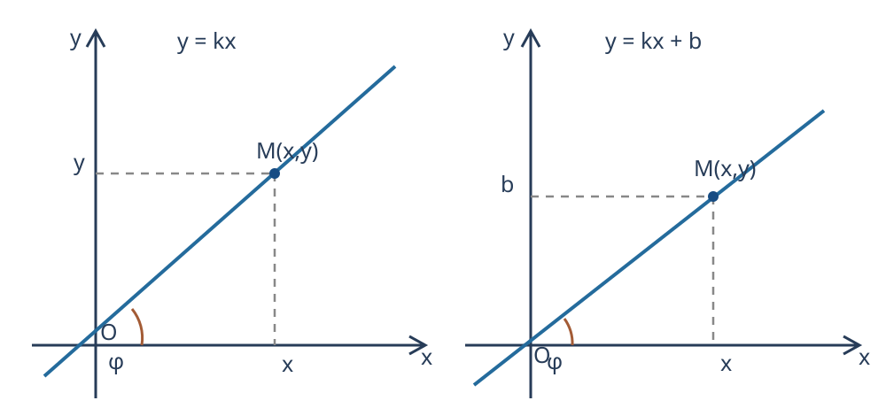
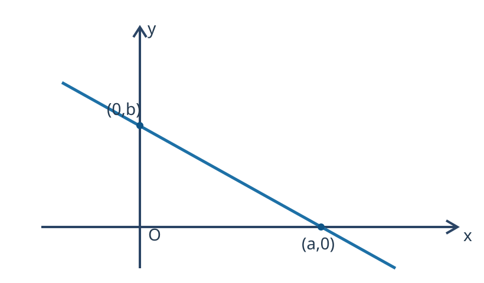
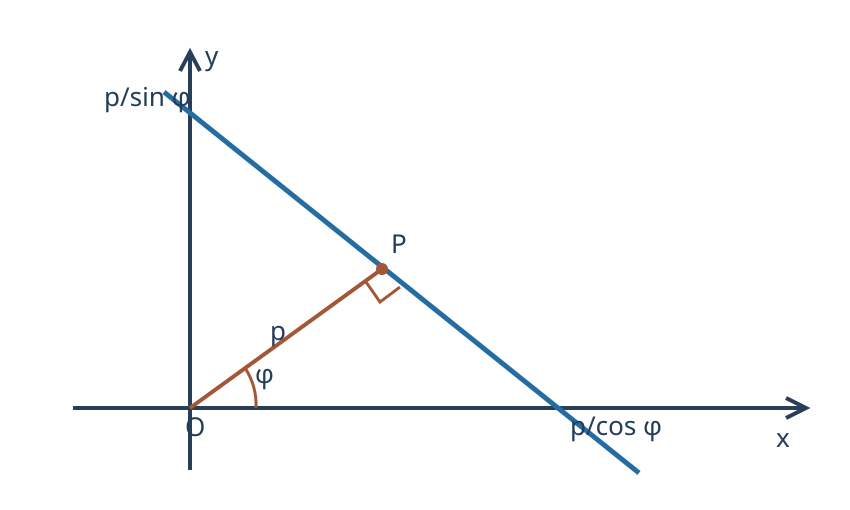
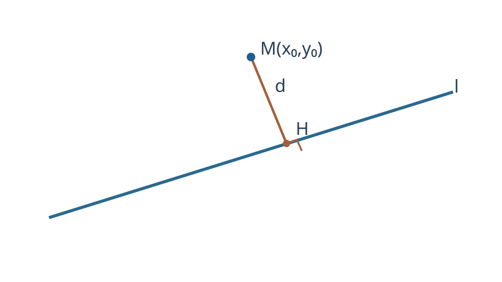

# Коллоквиум — Прямая линия на плоскости

**Подготовка по конспекту преподавателя.**

Источник: [[../notes/10 - Уравнения прямой на плоскости|Лекция №10 — Уравнения прямой на плоскости]], а также [[../transcripts/Прямые на плоскости - 1000042920-1000042929|постраничная расшифровка десяти фотографий]].

Порядок вопросов соответствует списку для коллоквиума. Формулы, построения и промежуточные преобразования взяты из конспекта. Там, где полный ответ по конспекту отсутствует, указано **«Разберёмся»**. Дополнительные формулы из учебников не подставляются вместо записей преподавателя.

## 1. Понятие прямой линии. Уравнение прямой с угловым коэффициентом

### Прямая через начало координат

В конспекте прямая проходит через начало координат $O$ и точку $M(x,y)$. С осью $Ox$ она образует угол $\varphi$.

Из рисунка записано:

$$
\frac{y}{x}=\operatorname{tg}\varphi.
$$

Отсюда:

$$
y=\operatorname{tg}\varphi\cdot x=kx.
$$

### Прямая, пересекающая ось $Oy$

Для прямой, пересекающей ось $Oy$ на высоте $b$:

$$
\frac{y-b}{x}=\operatorname{tg}\varphi.
$$

Получается уравнение с угловым коэффициентом:

$$
\boxed{y=kx+b}.
$$

### Частные случаи из конспекта

Прямая параллельна $Oy$, $\varphi=90^\circ$:

$$
x=l.
$$

$\operatorname{tg}90^\circ$ не существует.

Прямая параллельна $Ox$, $\varphi=0^\circ$:

$$
\operatorname{tg}0^\circ=0,\qquad y=b.
$$

Для координатных осей:

$$
Ox:\quad y=0,\qquad Oy:\quad x=0.
$$

**Разберёмся:** отдельного строгого словесного определения *прямой линии* в этих страницах нет. Есть изображение прямой и последовательный вывод её уравнений. На странице о вертикальной прямой также записано «$b$ не существует»; это спорное место тетради, его не следует молча заменять другой фразой.

## 2. Уравнение прямой в общем виде

В тетради:

$$
\boxed{Ax+By+C=0}.
$$

Указано, что уравнение первой степени относительно $x$ и $y$ описывает прямую.

При $B\ne0$:

$$
By=-Ax-C,
$$

$$
y=-\frac ABx-\frac CB.
$$

Следовательно:

$$
\boxed{k=-\frac AB,\qquad b=-\frac CB}.
$$

### Нормаль к прямой

В конспекте записано, что $A,B$ — координаты вектора нормали:

$$
\boxed{\vec n=(A,B)}.
$$

**Нормаль** — вектор, перпендикулярный прямой.

### Частные случаи

1) При $B=0$:

$$
Ax+C=0,\qquad x=-\frac CA.
$$

Прямая параллельна $Oy$.

2) При $C=0$ в тетради отмечена точка $(0;0)$.

3) При $A=C=0$:

$$
y=0.
$$

**Разберёмся:** точная фраза о том, какие коэффициенты должны быть ненулевыми, прочитана неоднозначно. Это отмечено в файле проверки; формулировку не заменяем утверждением из другого учебника.

## 3. Уравнение прямой, проходящей через заданную точку

Дано уравнение

$$
y=kx+b
$$

и точка

$$
M_1(x_1;y_1).
$$

Подставим координаты точки:

$$
y_1=kx_1+b.
$$

Выразим $b$:

$$
b=y_1-kx_1.
$$

Подставим в первоначальное уравнение:

$$
y=kx+y_1-kx_1.
$$

Получим:

$$
\boxed{y=k(x-x_1)+y_1}.
$$

Это формула прямой, проходящей через заданную точку, записанная в конспекте при заданном угловом коэффициенте $k$.

**Разберёмся:** в этом разделе преподаватель использует не только точку, но и коэффициент $k$. Отдельного способа определить единственную прямую **только по одной точке** здесь нет.

## 4. Уравнение прямой, проходящей через две заданные точки

Заданы точки:

$$
M_1(x_1;y_1),\qquad M_2(x_2;y_2).
$$

В конспекте подставлены координаты второй точки в формулу предыдущего вопроса:

$$
y_2=k(x_2-x_1)+y_1.
$$

Отсюда:

$$
k=\frac{y_2-y_1}{x_2-x_1}.
$$

Подставляем:

$$
y=\frac{y_2-y_1}{x_2-x_1}(x-x_1)+y_1.
$$

Переносим $y_1$:

$$
y-y_1=(y_2-y_1)\frac{x-x_1}{x_2-x_1}.
$$

И записываем:

$$
\boxed{\frac{x-x_1}{x_2-x_1}=\frac{y-y_1}{y_2-y_1}}.
$$

**Разберёмся:** в тетради отдельно не обсуждаются случаи, когда в знаменателе появляется нуль. Полноценный разбор вертикальных и горизонтальных прямых в этой форме отсутствует.

## 5. Уравнение прямой в отрезках

Прямая пересекает оси координат в точках $(a;0)$ и $(0;b)$.

По конспекту:

$$
\frac{x-a}{-a}=\frac yb.
$$

Умножаем:

$$
b(x-a)=-ay.
$$

Раскрываем скобки:

$$
bx+ay=ab.
$$

Делим на $ab$:

$$
\boxed{\frac xa+\frac yb=1}.
$$

**Разберёмся:** особые случаи $a=0$ и $b=0$ при выводе в тетради отдельно не рассматриваются.

## 6. Уравнение прямой, проходящей через заданную точку и имеющей заданный направляющий вектор

**Направляющий вектор** — любой ненулевой вектор, параллельный прямой.

В конспекте:

$$
\vec s=(a,b).
$$

Дана точка

$$
M(x_0;y_0).
$$

Также записана точка прямой:

$$
M'(x_0+a,y_0+b)\in l.
$$

Применяется формула для двух точек:

$$
\frac{x-x_0}{x_0+a-x_0}
=
\frac{y-y_0}{y_0+b-y_0}.
$$

Сокращаем знаменатели:

$$
\boxed{\frac{x-x_0}{a}=\frac{y-y_0}{b}}.
$$

В тетради это названо **каноническим уравнением прямой**.

**Разберёмся:** в конспекте нет отдельного обсуждения нулевых компонент $a$ или $b$ направляющего вектора.

## 7. Параметрические уравнения прямой

Из канонического уравнения преподаватель переходит к равенству:

$$
\frac{x-x_0}{a}=\frac{y-y_0}{b}=t.
$$

При этом:

$$
t\in\mathbb R.
$$

Получаем два уравнения:

$$
\frac{x-x_0}{a}=t,\qquad
\frac{y-y_0}{b}=t.
$$

И отсюда:

$$
\boxed{\begin{cases}
x=at+x_0,\\
y=bt+y_0.
\end{cases}}
$$

В конспекте отмечено: придавая параметру $t$ всевозможные числовые значения, будем получать координаты точек прямой.

## 8. Нормальное уравнение прямой

На рисунке из начала координат проведён перпендикуляр к прямой.

Обозначено:

$$
OP=p.
$$

В конспекте записано уравнение прямой в отрезках:

$$
\frac{x}{p/\cos\varphi}+\frac{y}{p/\sin\varphi}=1.
$$

После преобразования:

$$
\boxed{x\cos\varphi+y\sin\varphi-p=0}.
$$

Это **нормальное уравнение прямой**.

В тетради:

$$
p\ge0.
$$

**Разберёмся:** вывод через уравнение в отрезках не рассматривает отдельно случаи, когда $\sin\varphi$ или $\cos\varphi$ равны нулю.

## 9. Задача о нахождении расстояния от точки до прямой

Дана прямая $l$ и точка:

$$
M(x_0;y_0)\notin l.
$$

Нормальное уравнение прямой:

$$
x\cos\varphi+y\sin\varphi-p=0.
$$

В конспекте записана промежуточная формула:

$$
x_0\cos\varphi+y_0\sin\varphi-(p\pm d)=0.
$$

Отсюда расстояние:

$$
\boxed{d=|x_0\cos\varphi+y_0\sin\varphi-p|}.
$$

### Отклонение точки от прямой

$$
\delta=x_0\cos\varphi+y_0\sin\varphi-p.
$$

В тетради $\delta$ называется **отклонением точки от прямой**.

Если $\delta>0$, то точка и начало координат лежат по разные стороны от прямой.

### Переход от общего уравнения к нормальному

$$
Ax+By+C=0.
$$

Нормализующий множитель:

$$
\boxed{\mu=\pm\frac1{\sqrt{A^2+B^2}}}.
$$

**Разберёмся:** выбор знака множителя $\mu$ в тетради не объяснён полностью. Отдельная готовая формула расстояния непосредственно через $A,B,C,x_0,y_0$ в текущем полном конспекте не записана; подставлять её как формулу преподавателя не будем.

## 10. Условия параллельности и перпендикулярности прямых

### Через угловые коэффициенты

Две прямые:

$$
l_1:\ y=k_1x+b_1,
$$

$$
l_2:\ y=k_2x+b_2.
$$

**Параллельность:**

$$
\boxed{l_1\parallel l_2,\quad k_1=k_2}.
$$

**Перпендикулярность:**

$$
\boxed{l_1\perp l_2,\quad k_1k_2=-1}.
$$

### Через общие уравнения прямых

$$
l_1:\ A_1x+B_1y+C_1=0,
$$

$$
l_2:\ A_2x+B_2y+C_2=0.
$$

При параллельности:

$$
l_1\parallel l_2\Rightarrow\vec n_1\parallel\vec n_2
\Rightarrow\frac{A_1}{A_2}=\frac{B_1}{B_2}.
$$

При перпендикулярности:

$$
l_1\perp l_2\Rightarrow\vec n_1\perp\vec n_2
\Rightarrow\vec n_1\cdot\vec n_2=0.
$$

Отсюда:

$$
\boxed{A_1A_2+B_1B_2=0}.
$$

**Разберёмся:** условия через дроби записаны без разбора нулевых знаменателей. Кроме того, совпадающие прямые в конспекте обсуждаются отдельно, в вопросе о пересечении.

## 11. Угол между двумя прямыми

В конспекте:

$$
k_1=\operatorname{tg}\varphi_1,\qquad
k_2=\operatorname{tg}\varphi_2.
$$

Рассматривается:

$$
\operatorname{tg}(\varphi_2-\varphi_1).
$$

Преподаватель записывает:

$$
\operatorname{tg}(\varphi_2-\varphi_1)
=
\frac{\operatorname{tg}\varphi_2-\operatorname{tg}\varphi_1}
{1+\operatorname{tg}\varphi_1\operatorname{tg}\varphi_2}.
$$

Подставляя угловые коэффициенты:

$$
\boxed{\operatorname{tg}(\varphi_2-\varphi_1)=\frac{k_2-k_1}{1+k_1k_2}}.
$$

### Угол через нормали

В конспекте также есть запись:

$$
l_1\wedge l_2=\vec n_1\wedge\vec n_2.
$$

И формула:

$$
\cos(l_1\wedge l_2)
=
\frac{\vec n_1\cdot\vec n_2}
{|\vec n_1|\,|\vec n_2|}.
$$

По координатам нормалей:

$$
\boxed{
\cos(l_1\wedge l_2)
=
\frac{A_1A_2+B_1B_2}
{\sqrt{A_1^2+B_1^2}\sqrt{A_2^2+B_2^2}}
}.
$$

**Разберёмся:** в конспекте не разобран отдельно случай $1+k_1k_2=0$ и не уточнён выбор одного из углов между прямыми при противоположной ориентации нормалей.

## 12. Пересечение двух прямых

Даны прямые:

$$
l_1:\ A_1x+B_1y+C_1=0,
$$

$$
l_2:\ A_2x+B_2y+C_2=0.
$$

Рассматривается система:

$$
\boxed{
\begin{cases}
A_1x+B_1y+C_1=0,\\
A_2x+B_2y+C_2=0.
\end{cases}
}
$$

В конспекте записано:

- **Точка пересечения** — решение системы.
- Если система **не имеет решений**, прямые параллельны.
- Если система имеет **бесконечное количество решений**, уравнения описывают одну прямую.

**Разберёмся:** отдельного полного метода вычисления координат точки пересечения, например с выводом через определители, в данных страницах нет. Вопрос в тетради заканчивается перечислением случаев решения системы.

## Что требуется разобрать дополнительно

Без дополнительных источников пока нельзя выдать как материал преподавателя:

1. Строгое определение прямой линии в первом вопросе.
2. Условие ненулевых коэффициентов в общем уравнении — исходная фраза читается неоднозначно.
3. Особые случаи формул для двух точек, направляющего вектора и уравнения в отрезках, когда знаменатель равен нулю.
4. Выбор знака нормализующего множителя и переход к формуле расстояния от точки непосредственно из общего уравнения.
5. Обработка прямых с неопределёнными угловыми коэффициентами при выводе угла и условий взаимного расположения.
6. Полный алгоритм вычисления точки пересечения двух прямых.

Каждое из этих мест отмечено как **«Разберёмся»**, а не заполнено неподтверждённой теорией.

## Источники

- [[../notes/10 - Уравнения прямой на плоскости|Полный дословный конспект №10]].
- [[../transcripts/Прямые на плоскости - 1000042920-1000042929|Постраничная расшифровка]].
- [[../checks/Прямые - проверка 1000042920-1000042929|Проверка сомнительных мест]].
