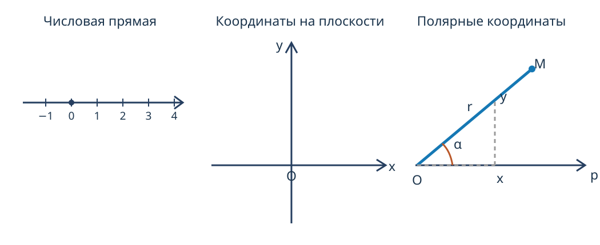

---
aliases:
  - "Вектор и системы координат"
tags:
  - university
  - analytical-geometry
  - lecture-note
subject: "Аналитическая геометрия"
type: "lecture-note"
status: "verbatim-draft"
---

# 01 — Вектор и системы координат

> [!info] Навигация
> [[../README|Аналитическая геометрия]] · [[02 - Линейные операции над векторами|Следующая]]

## Системы координат

**Аналитическая геометрия**

**Векторная алгебра**

1. Системы координат.

а) Числовая прямая.

б) Координаты на плоскости.

в) Трёхмерные координаты.

Они делятся на квадранты.

3 оси .

Система координат — это <u>некоторый</u> способ описать положение точки с помощью некоторых числовых параметров.

**Полярная система координат**

$$r=\sqrt{x^2+y^2},\qquad \operatorname{tg}\alpha=\frac{y}{x}.$$

$O$ — полюс.

↓ — угол.

Ось $Op$ — полярная ось.

$M(30^\circ,2)$.

$$x=r\cos\alpha,\qquad y=r\sin\alpha.$$

## Векторы

**Векторы**

Вектор — это отрезок, имеющий начало, конец, направление и длину.

2 вектора называются равными, если они параллельны или лежат на одной прямой, имеют одинаковую длину и направление.

При параллельном переносе получается вектор, равный данному.
