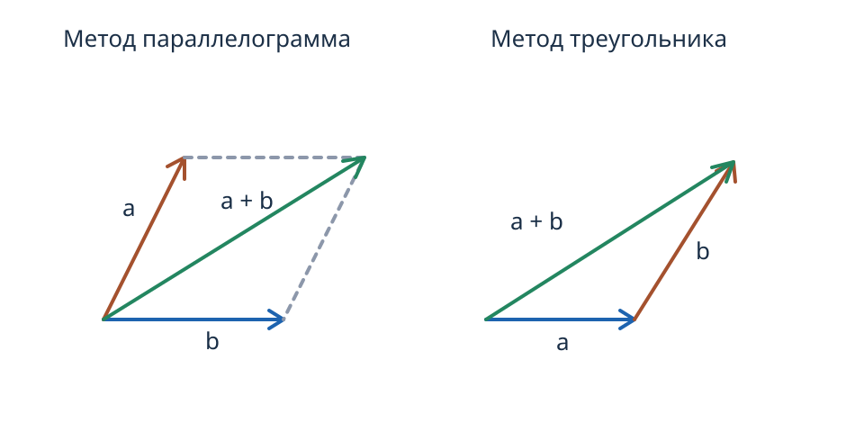

---
aliases:
  - "Линейные операции над векторами"
tags:
  - university
  - analytical-geometry
  - lecture-note
subject: "Аналитическая геометрия"
type: "lecture-note"
status: "verbatim-draft"
---

# 02 — Линейные операции над векторами

> [!info] Навигация
> [[../README|Аналитическая геометрия]] · [[01 - Вектор и системы координат|Предыдущая]] · [[03 - Коллинеарность и компланарность|Следующая]]

## Линейные действия над векторами

**Линейные действия над векторами**

1) Сложение.

Метод параллелограмма.

Метод треугольника.

Коммутативность — $\vec a+\vec b=\vec b+\vec a$.

$$\vec a+\vec b+\vec c=\vec b+\vec c+\vec a$$

— свойство ассоциативности.

 Начали применять в разных .

**Нуль вектор** — вектор нулевой длины и имеющий любое направление.

$$\vec a+\vec0=\vec0+\vec a=\vec a.$$

$\vec a=\overrightarrow{AB}$.

$\overrightarrow{BA}=-\vec a$.

2) Вычитание.

$$\vec a+(-\vec a)=\vec0.$$

$$\vec a-\vec b=\vec a+(-\vec b).$$

3) Умножение на число.

$\lambda$ — const.

$\lambda\vec a$ — вектор, получающийся из вектора $\vec a$ растяжением в $\lambda$ раз, и если $\lambda>0$, .

то направление сохраняется, если отрицательное, то меняется.

**Свойства**

1) $(-1)\vec a=-\vec a$.

2) $1\cdot\vec0=\vec0$.

3) $0\cdot\vec a=\vec0$.

4) $(\lambda+\gamma)\vec a=\lambda\vec a+\gamma\vec a$.

5) $\lambda(\vec a+\vec b)=\lambda\vec a+\lambda\vec b$.

6) $\lambda\cdot(\gamma\cdot\vec a)=(\lambda\cdot\gamma)\cdot\vec a=(\lambda\gamma)\vec a$.

7)  линейная.
