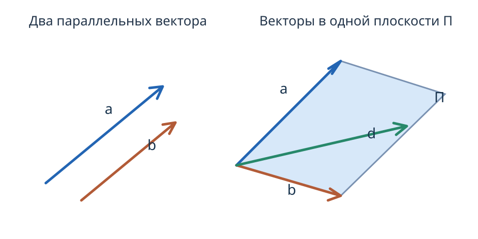

---
aliases:
  - "Коллинеарность и компланарность"
tags:
  - university
  - analytical-geometry
  - lecture-note
subject: "Аналитическая геометрия"
type: "lecture-note"
status: "verbatim-draft"
---

# 03 — Коллинеарность и компланарность

> [!info] Навигация
> [[../README|Аналитическая геометрия]] · [[02 - Линейные операции над векторами|Предыдущая]] · [[04 - Проекция вектора на ось|Следующая]]

## Линейная комбинация векторов

**Линейная комбинация векторов**

$$\vec d=\lambda\vec a+\beta\vec b+\gamma\vec c.$$

Векторы называются линейно зависимыми, если из этих векторов линейно выражается через остальные, в противном случае — линейно независимыми.

1) 2 вектора являются линейно зависимыми, если они параллельны друг другу.

$$\vec b=\lambda\vec a,\qquad\vec b\parallel\vec a,\quad\text{и наоборот}.$$

Если один из векторов можно растянуть во столько раз, чтобы получить второй.

2) 3 вектора являются линейно зависимыми, если они параллельны одной плоскости.

Пусть

$$\vec d=\lambda\vec a+\beta\vec b.$$

Отнесём все 3 вектора $\vec a$, $\vec b$ и $\vec c$ к одному началу и проведём через векторы $\vec a$ и $\vec b$ плоскость $\Pi$, тогда векторы $\lambda\vec a$ и $\beta\vec b$ тоже будут лежать в плоскости $\Pi$, значит и вектор $\vec d\in\Pi$.

$\Downarrow$

Вынужденное положение векторов — быть параллельными $\Pi$.

Если 3 вектора параллельны одной плоскости и если их отнести к одному началу, то они все будут лежать в одной плоскости и 2 из них линейно выражаются через .

3) 4 вектора и больше всегда линейно зависимы друг от друга.

Продлим вектор $\vec c$ до пересечения с плоскостью, образованной векторами $\vec a$ и $\vec b$.

[Второй рисунок: параллелограмм на плоскости, векторы $\vec a$, $\vec b$, $\vec c$, $\vec d$, результирующий $\vec d$.]

$$\lambda\vec d=\vec a+\beta\vec b+\gamma\vec c.$$

Последнее равенство — это разложение одного вектора по 3 другим векторам, не параллельным одной плоскости.
