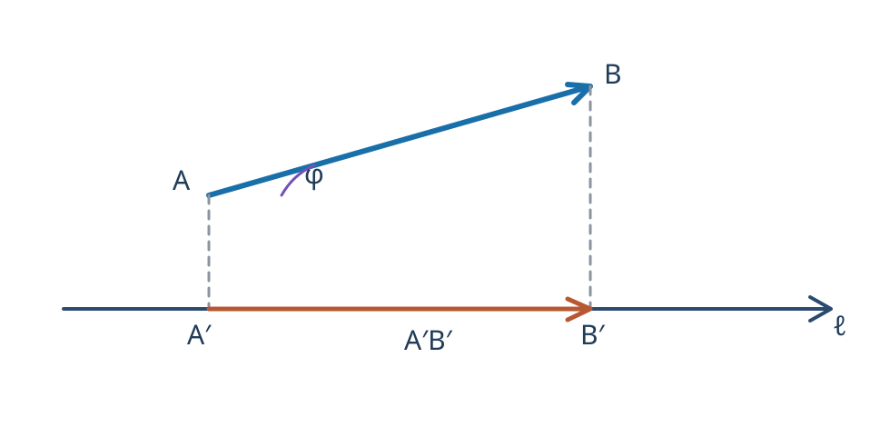

---
aliases:
  - "Проекция вектора на ось"
tags:
  - university
  - analytical-geometry
  - lecture-note
subject: "Аналитическая геометрия"
type: "lecture-note"
status: "verbatim-draft"
---

# 04 — Проекция вектора на ось

> [!info] Навигация
> [[../README|Аналитическая геометрия]] · [[03 - Коллинеарность и компланарность|Предыдущая]] · [[05 - Скалярное произведение|Следующая]]

## Проекция вектора на ось

**Проекция вектора на ось**

$$\operatorname{пр}_{\ell}\overrightarrow{AB}=\overline{A'B'}.$$

Знак у будет положительным, если направления оси и вектора совпадают, и отрицательным, если отличаются. Проекция равна нулю, когда вектор перпендикулярен оси.

При параллельном переносе проекция вектора не меняется.

$|\overrightarrow{AB}|$ — длина вектора $AB$.

$$\operatorname{пр}_{\ell}\overrightarrow{AB}=|\overrightarrow{AB}|\cdot\cos\varphi.$$
