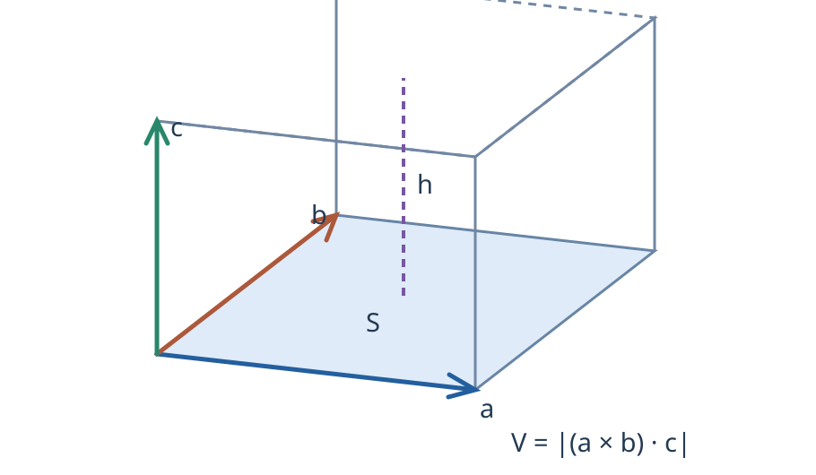

# 08 — Смешанное произведение

[[07 - Векторное произведение|← Предыдущая]] · [[09 - Преобразование системы координат|Следующая →]]

## Смешанное произведение 3-х векторов

$$
(\vec a\times\vec b)\cdot\vec c.
$$

Скалярное произведение.

$$
(\vec a\times\vec b)\cdot\vec c
=|\vec d|\cdot|\vec c|\cos(\vec d\wedge\vec c)
=S_{\text{пар}}\cdot\operatorname{пр}_{\vec d}\vec c
=S_{\text{пар}}\cdot h
=V_{\text{параллелепипеда}}.
$$

Геометрический смысл смешанного произведения — это объём параллелепипеда.

При циклической перестановке векторов смешанное произведение не меняется.

Смешанное произведение равно нулю, если все 3 вектора параллельны одной плоскости (компланарны).

$$
(\vec a,\vec b,\vec c)=
\begin{vmatrix}
a_x&a_y&a_z\\
b_x&b_y&b_z\\
c_x&c_y&c_z
\end{vmatrix}.
$$
