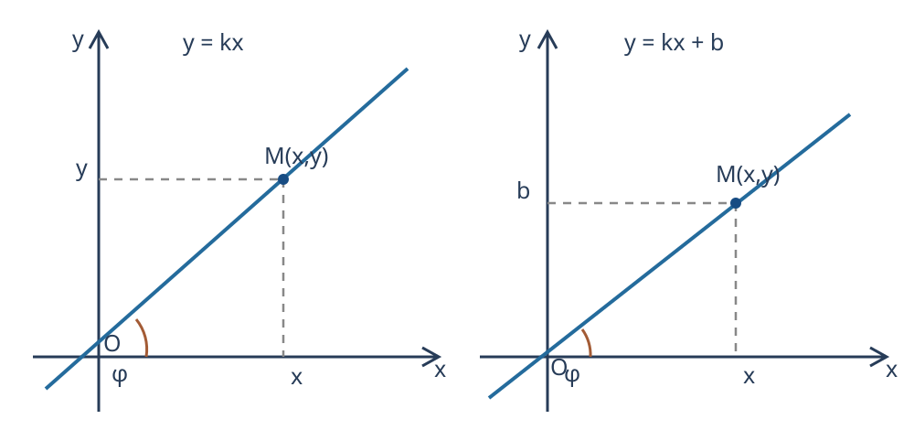
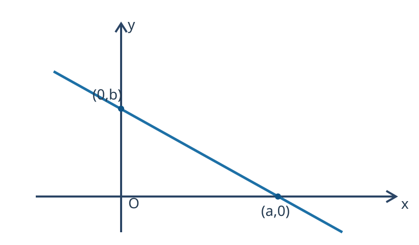
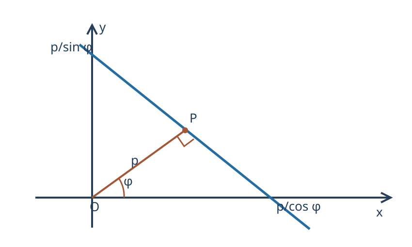
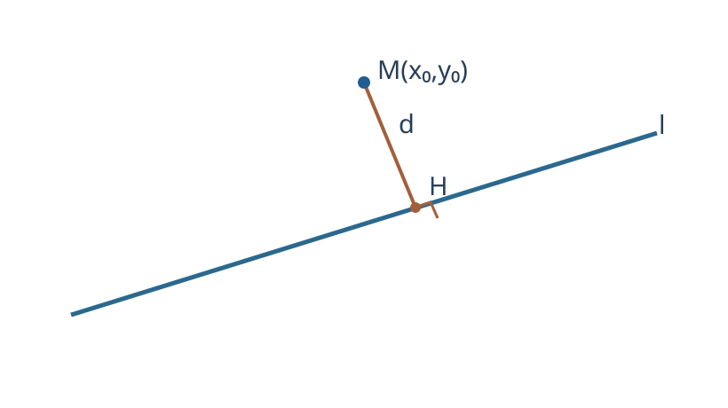

# 10 — Уравнения прямой на плоскости

[[09 - Преобразование системы координат|← Преобразование системы координат]] · [[11 - Окружность и эллипс|Окружность и эллипс →]]

## Прямая линия на плоскости

$$
\frac{y}{x}=\operatorname{tg}\varphi.
$$

$$
y=\operatorname{tg}\varphi\cdot x=kx.
$$

$$
\frac{y-b}{x}=\operatorname{tg}\varphi.
$$

$$
\boxed{y=kx+b}.
$$

Прямая $\parallel Oy$, $\varphi=90^\circ$.

$\operatorname{tg}90^\circ$ — не существует.

$b$ — не существует.

$$
x=l.
$$

Прямая $\parallel Ox$, $\varphi=0$.

$\operatorname{tg}0^\circ=0$.

$$
y=b.
$$

Уравнение $Ox$:

$$
y=0.
$$

Уравнение $Oy$:

$$
x=0.
$$

## Общее уравнение прямой

$$
Ax+By+C=0.
$$

Любое уравнение первой степени относительно $x$ и $y$, где одновременно $A,B$ и $C$ не равны нулю, описывает прямую.

Если $B\ne0$:

$$
By=-Ax-C.
$$

$$
y=-\frac ABx-\frac CB.
$$

$$
k=-\frac AB,\qquad b=-\frac CB.
$$

$A,B$ — координаты вектора нормали.

$$
\vec n=(A,B).
$$

Нормаль — вектор, перпендикулярный прямой.

1) $Ax+C=0$, $B=0$.

$$
x=-\frac CA.
$$

$\parallel Oy$.

2) $C=0$.

$(0;0)$.

3) $A=C=0$.

$$
y=0.
$$

## Уравнение прямой через одну точку

$$
y=kx+b,\qquad M_1(x_1;y_1).
$$

$$
y_1=kx_1+b.
$$

$$
b=y_1-kx_1.
$$

$$
y=kx+y_1-kx_1.
$$

$$
\boxed{y=k(x-x_1)+y_1}.
$$

## Уравнение прямой через две заданные точки

$M_2(x_2;y_2)$, $M_1(x_1;y_1)$.

$$
y_2=k(x_2-x_1)+y_1.
$$

$$
k=\frac{y_2-y_1}{x_2-x_1}.
$$

$$
y=\frac{y_2-y_1}{x_2-x_1}(x-x_1)+y_1.
$$

$$
y-y_1=(y_2-y_1)\frac{x-x_1}{x_2-x_1}.
$$

$$
\boxed{\frac{x-x_1}{x_2-x_1}=\frac{y-y_1}{y_2-y_1}}.
$$

## Уравнение прямой в отрезках

$$
\frac{x-a}{-a}=\frac yb.
$$

$$
b(x-a)=-ay.
$$

$$
bx+ay=ab.
$$

$$
\boxed{\frac xa+\frac yb=1}.
$$

## Каноническое уравнение прямой

Направляющий — любой ненулевой вектор, параллельный прямой.

$$
\vec s=(a,b).
$$

$M(x_0;y_0)$.

$M'(x_0+a,y_0+b)\in l$.

$$
\frac{x-x_0}{x_0+a-x_0}=\frac{y-y_0}{y_0+b-y_0}.
$$

$$
\boxed{\frac{x-x_0}{a}=\frac{y-y_0}{b}}.
$$

## Параметрическое уравнение прямой

$$
\frac{x-x_0}{a}=\frac{y-y_0}{b}=t.
$$

$t\in\mathbb R$.

$$
\frac{x-x_0}{a}=t,\qquad\frac{y-y_0}{b}=t.
$$

$$
\boxed{\begin{cases}
x=at+x_0,\\
y=bt+y_0.
\end{cases}}
$$

Придавая $t$ всевозможные числовые значения, будем получать координаты точек прямой.

## Нормальное уравнение прямой

$$
OP=p.
$$

$$
\frac{x}{p/\cos\varphi}+\frac{y}{p/\sin\varphi}=1.
$$

$$
\boxed{x\cos\varphi+y\sin\varphi-p=0}.
$$

Нормальное уравнение прямой.

$$
p\ge0.
$$

## Расстояние от точки до прямой

$l$ — прямая.

$M(x_0;y_0)\notin l$.

$$
x\cos\varphi+y\sin\varphi-p=0.
$$

$$
x_0\cos\varphi+y_0\sin\varphi-(p\pm d)=0.
$$

$$
d=|x_0\cos\varphi+y_0\sin\varphi-p|.
$$

$$
\delta=x_0\cos\varphi+y_0\sin\varphi-p.
$$

$\delta$ — отклонение точки от прямой.

Если $\delta>0$, то точка и начало координат лежат по разные стороны от прямой.

## Переход от общего уравнения к нормальному

$$
Ax+By+C=0.
$$

$$
\mu=\pm\frac1{\sqrt{A^2+B^2}}.
$$

$\mu$ — нормализующий множитель.

## Условия параллельности и перпендикулярности прямых

$$
l_1:\ y=k_1x+b_1.
$$

$$
l_2:\ y=k_2x+b_2.
$$

$$
l_1\parallel l_2,\qquad k_1=k_2.
$$

$$
l_1\perp l_2,\qquad k_1k_2=-1.
$$

$$
l_1:\ A_1x+B_1y+C_1=0.
$$

$$
l_2:\ A_2x+B_2y+C_2=0.
$$

$$
l_1\parallel l_2\Rightarrow\vec n_1\parallel\vec n_2
\Rightarrow\frac{A_1}{A_2}=\frac{B_1}{B_2}.
$$

$$
l_1\perp l_2\Rightarrow\vec n_1\perp\vec n_2
\Rightarrow\vec n_1\cdot\vec n_2=0.
$$

$$
A_1A_2+B_1B_2=0.
$$

$$
\operatorname{tg}(\varphi_2-\varphi_1).
$$

$$
k_1=\operatorname{tg}\varphi_1,\qquad k_2=\operatorname{tg}\varphi_2.
$$

$$
\operatorname{tg}(\varphi_2-\varphi_1)
=\frac{\operatorname{tg}\varphi_2-\operatorname{tg}\varphi_1}
{1+\operatorname{tg}\varphi_1\operatorname{tg}\varphi_2}
=\frac{k_2-k_1}{1+k_1k_2}.
$$

$$
l_1\wedge l_2=\vec n_1\wedge\vec n_2.
$$

$$
\cos(l_1\wedge l_2)=
\frac{\vec n_1\cdot\vec n_2}{|\vec n_1|\,|\vec n_2|}
=\frac{A_1A_2+B_1B_2}{\sqrt{A_1^2+B_1^2}\sqrt{A_2^2+B_2^2}}.
$$

## Пересечение прямых

$$
\begin{cases}
l_1:\ A_1x+B_1y+C_1=0,\\
l_2:\ A_2x+B_2y+C_2=0.
\end{cases}
$$

Точка пересечения — решение системы.

Если система решений не имеет — прямые параллельны.

Если бесконечное количество — уравнения описывают одну прямую.
