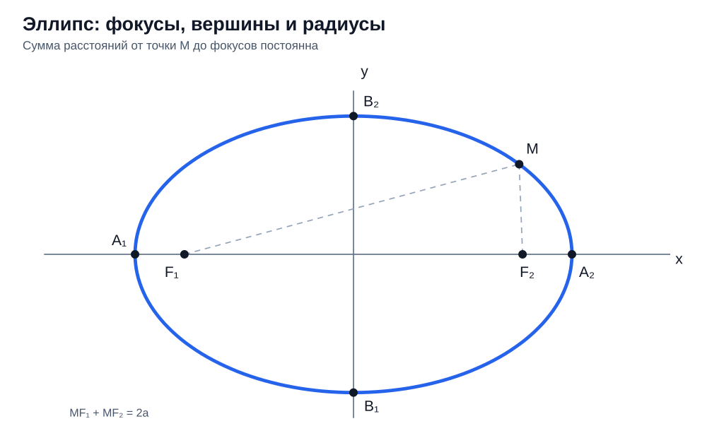

# 11 — Окружность и эллипс

> [!info] Навигация и источник
> [[10 - Уравнения прямой на плоскости|Предыдущая тема]] · [[12 - Гипербола|Следующая тема]] · [[../summaries/11 - Окружность и эллипс|Прежняя краткая версия]].
>
> В основу положены **страницы 1–9** рукописного PDF (33 страницы). Здесь сохранены определения, последовательность доказательств, вывод формул, исследование графика и смысл рисунков. Там, где видна ошибка записи или пропущен шаг, математически восстановленный/исправленный фрагмент подчёркнут. Неясные оригинальные строки оставлены в [[../transcripts/2026-11-24 - Кривые второго порядка - PDF 33 страницы|постраничной расшифровке]].

## 1. Кривые второго порядка на плоскости. Геометрическое место точек (страница 1)

**Геометрическое место точек на плоскости** — совокупность точек, обладающих некоторым общим свойством, которое отличает их от остальных точек плоскости.

Кривая второго порядка задаётся уравнением второй степени относительно координат $x$ и $y$. В дальнейших темах будут рассмотрены окружность, эллипс, гипербола, парабола, их касательные и общее уравнение.

При описании кривых преподаватель использует геометрические определения через расстояния, после чего получает канонические уравнения.

## 2. Окружность: определение и уравнение (страницы 1–2)

**Окружность** — геометрическое место точек плоскости, расстояние от каждой из которых до одной заданной точки, называемой центром, постоянно.

Пусть центр — $M_0(a,b)$, радиус — $R$, а $M(x,y)$ — произвольная точка окружности.

По определению:
$$
M_0M=R.
$$

Расстояние между точками:
$$
M_0M=\sqrt{(x-a)^2+(y-b)^2}.
$$

Поэтому:
$$
\sqrt{(x-a)^2+(y-b)^2}=R.
$$

Возводим обе части в квадрат:
$$
\boxed{(x-a)^2+(y-b)^2=R^2}.
$$

Это **уравнение окружности с центром $(a,b)$ и радиусом $R$**.

Если центр помещён в начало координат $O(0,0)$, то $a=b=0$:
$$
\boxed{x^2+y^2=R^2}.
$$

Для реальной невырожденной окружности $R>0$. При $R=0$ уравнение задаёт одну точку.

**Что необходимо сказать на коллоквиуме:** дать определение, обозначить центр и произвольную точку, записать расстояние, приравнять радиусу, возвести в квадрат, привести частный случай с центром в начале координат.

## 3. Эллипс: геометрическое определение (страницы 2–3)

**Эллипс** — геометрическое место точек плоскости, для каждой из которых **сумма расстояний до двух фиксированных точек**, называемых фокусами, равна одной постоянной величине.

Фокусы обозначим $F_1,F_2$. Для любой точки $M$ эллипса:
$$
F_1M+F_2M=2a.
$$

В рукописи расстояния $F_1M$ и $F_2M$ называются **фокальными радиусами точки**:
$$
r_1=F_1M,\qquad r_2=F_2M.
$$

Пусть расстояние между фокусами:
$$
F_1F_2=2c.
$$

Из неравенства треугольника:
$$
F_1M+F_2M\ge F_1F_2.
$$

Для невырожденного эллипса, не являющегося отрезком между фокусами, требуется
$$
2a>2c,\qquad \boxed{a>c}.
$$

В исходнике этот вывод следует сразу за определением: **постоянная сумма должна превышать расстояние между фокусами**.

## 4. Выбор системы координат и фокальные радиусы (страница 3)

*Рисунок: два фокуса, вершины и фокальные радиусы $MF_1$, $MF_2$.*

Выберем ось $Ox$ по прямой через фокусы, а начало координат — посередине между ними:
$$
O(0,0),\qquad F_1(-c,0),\qquad F_2(c,0).
$$

Пусть $M(x,y)$ — произвольная точка эллипса. Тогда
$$
r_1=\sqrt{(x+c)^2+y^2},\qquad
r_2=\sqrt{(x-c)^2+y^2}.
$$

Подставляя в геометрическое определение:
$$
\boxed{\sqrt{(x+c)^2+y^2}+\sqrt{(x-c)^2+y^2}=2a}.
$$

Это уравнение в радикалах ещё неудобно для исследования формы кривой. Его преобразуют к **каноническому уравнению**.

## 5. Вывод канонического уравнения эллипса (страницы 3–5)

Из определения:
$$
\sqrt{(x+c)^2+y^2}=2a-\sqrt{(x-c)^2+y^2}.
$$

Возводим обе части в квадрат:
$$
(x+c)^2+y^2
=4a^2-4a\sqrt{(x-c)^2+y^2}+(x-c)^2+y^2.
$$

Разность квадратов:
$$
(x+c)^2-(x-c)^2=4cx.
$$

Следовательно:
$$
4cx=4a^2-4a\sqrt{(x-c)^2+y^2}.
$$

Разделим на $4$:
$$
cx=a^2-a\sqrt{(x-c)^2+y^2}.
$$

Получаем рационализированное равенство:
$$
\boxed{\sqrt{(x-c)^2+y^2}=\frac{a^2-cx}{a}}.
$$

> [!note] Исправленный/восстановленный переход
> На страницах 3–4 промежуточные строки частично смазаны. Здесь цепочка проверена раскрытием квадратов; восстановленный числитель $\underline{a^2-cx}$ отмечен подчёркиванием при сверке в [[../checks/02 - Исправления исходных формул кривых второго порядка - 33 страницы|файле исправлений]].

Возводим в квадрат второй раз:
$$
(x-c)^2+y^2=\frac{(a^2-cx)^2}{a^2}.
$$

Умножим на $a^2$ и раскроем скобки:
$$
a^2(x^2-2cx+c^2+y^2)=a^4-2a^2cx+c^2x^2.
$$

Слагаемые $-2a^2cx$ сокращаются:
$$
a^2x^2+a^2c^2+a^2y^2=a^4+c^2x^2.
$$

Переносим:
$$
(a^2-c^2)x^2+a^2y^2=a^2(a^2-c^2).
$$

Поскольку $a>c$, число $a^2-c^2$ положительно. Вводим обозначение **малой полуоси**:
$$
\boxed{b^2=\underline{a^2-c^2}>0}.
$$

Здесь знак «минус» принципиально важен: для эллипса $c^2=a^2-b^2$.

Тогда:
$$
b^2x^2+a^2y^2=a^2b^2.
$$

Делим на $a^2b^2$:
$$
\boxed{\frac{x^2}{a^2}+\frac{y^2}{b^2}=1}.
\tag{*}
$$

Это **каноническое уравнение эллипса** с большой полуосью $a$ по $Ox$ и малой полуосью $b$ по $Oy$, если $a>b>0$.

### Обратное утверждение (страницы 4–5)

В рукописи отдельно сказано, что нужно проверить **обратный переход**: каждая точка, удовлетворяющая каноническому уравнению, должна удовлетворять определению через сумму расстояний. Это важно, поскольку при возведении в квадрат могут появиться лишние решения.

Из
$$
\frac{x^2}{a^2}+\frac{y^2}{b^2}=1
$$
следует $|x|\le a$. Из $a>c>0$:
$$
a^2-cx\ge a^2-ca=a(a-c)>0;
$$
аналогично $a^2+cx>0$. Раскрывая выражения фокальных радиусов с учётом $b^2=a^2-c^2$, имеем
$$
\begin{aligned}
r_2^2&=(x-c)^2+y^2\\
&=x^2-2cx+c^2+b^2\left(1-\frac{x^2}{a^2}\right)\\
&=\frac{c^2}{a^2}x^2-2cx+a^2
=\left(a-\frac ca x\right)^2.
\end{aligned}
$$

Выражение в скобках положительно, значит
$$
r_2=a-\frac ca x.
$$

Аналогично:
$$
r_1=a+\frac ca x.
$$

Их сумма:
$$
r_1+r_2=2a.
$$

Следовательно, **каноническое уравнение и геометрическое определение эквивалентны** при указанных условиях. Условие положительности перед снятием квадратного корня — ключевая часть доказательства, которую преподаватель начинает на стр. 5.

## 6. Исследование формы эллипса (страницы 5–7)

Из уравнения:
$$
\frac{x^2}{a^2}+\frac{y^2}{b^2}=1
$$
видно, что при замене $x\mapsto-x$ или $y\mapsto-y$ оно не меняется. Значит, эллипс симметричен относительно **обеих координатных осей** и начала координат.

Ограничения:
$$
\frac{x^2}{a^2}\le1,\quad\frac{y^2}{b^2}\le1
\quad\Longrightarrow\quad
|x|\le a,\quad |y|\le b.
$$

Выразим $y$:
$$
\frac{y^2}{b^2}=1-\frac{x^2}{a^2},
$$

$$
y=\pm b\sqrt{1-\frac{x^2}{a^2}}
=\pm\frac ba\sqrt{a^2-x^2}.
$$

Достаточно изучить первую четверть:
$$
y=\frac ba\sqrt{a^2-x^2},\qquad 0\le x\le a.
$$

- При $x=0$: $y=b$. Это верхняя вершина $(0,b)$.
- При $x=a$: $y=0$. Это правая вершина $(a,0)$.
- При увеличении $x$ от $0$ до $a$ значение $y$ убывает от $b$ до $0$.
- Остальные три четверти получаются отражением относительно осей.

**Вершины эллипса** — точки пересечения с его осями:
$$
A_1(-a,0),\quad A_2(a,0),\quad B_1(0,-b),\quad B_2(0,b).
$$

**Оси эллипса:** большая длиной $2a$, малая длиной $2b$. **Полуоси:** $a$ и $b$.

Если фокусы выбраны на вертикальной оси, большая полуось располагается по $Oy$ (в рукописи отмечено изменение ориентации). При равенстве полуосей $a=b$ получаем **окружность**.

### Рисунок (страница 6)

В тетради эллипс центрирован в начале координат: две симметричные половины выше и ниже $Ox$; вертикальная отметка $b$ и горизонтальная отметка $a$. Для изображения с $a>b$ горизонтальная ось — большая.

## 7. Эксцентриситет эллипса (страницы 7–8)

**Эксцентриситет** — отношение расстояния от центра до фокуса к большой полуоси, то есть отношение расстояния между фокусами к длине большой оси:
$$
\boxed{\varepsilon=\frac ca=\frac{2c}{2a}}.
$$

Поскольку $0\le c<a$:
$$
\boxed{0\le\varepsilon<1}.
$$

Из $b^2=a^2-c^2$:
$$
c^2=a^2-b^2,
$$

$$
\varepsilon^2=\frac{c^2}{a^2}
=1-\frac{b^2}{a^2},
$$

$$
\boxed{\varepsilon=\sqrt{1-\left(\frac ba\right)^2}}.
$$

**Геометрический смысл:** чем ближе $\varepsilon$ к нулю, тем ближе эллипс к окружности; с ростом $\varepsilon$ эллипс более вытянут. Для окружности $c=0$, $\varepsilon=0$.

## 8. Рациональные формулы фокальных радиусов эллипса (страница 9)

Пусть $M(x,y)$ лежит на эллипсе, а $\varepsilon=c/a$. Мы уже получили:
$$
r_2=a-\frac ca x=\boxed{a-\varepsilon x}.
$$

Из $r_1+r_2=2a$:
$$
r_1=2a-(a-\varepsilon x)=\boxed{a+\varepsilon x}.
$$

Итак:
$$
\boxed{r_1=a+\varepsilon x,\qquad r_2=a-\varepsilon x}.
$$

**Как запомнить знаки:** левый фокус $F_1(-c,0)$, правый $F_2(c,0)$. При движении точки вправо расстояние до левого фокуса растёт, до правого — уменьшается.

Проверка при $x=0$: $r_1=r_2=a$; сумма $2a$.

## 9. Выводы для ответа преподавателю

1. Определить геометрическое место точек.
2. Дать определение окружности и вывести $(x-a)^2+(y-b)^2=R^2$.
3. Дать определение эллипса через $r_1+r_2=2a$, пояснить $a>c$.
4. Выбрать фокусы $(-c,0)$, $(c,0)$, записать оба радикала.
5. Дважды возвести в квадрат и получить $b^2=a^2-c^2$ и каноническое уравнение.
6. Указать необходимость проверки обратного утверждения после возведения в квадрат.
7. Доказать симметрию, ограниченность, найти вершины, полуоси.
8. Определить $\varepsilon=c/a$, вывести формулу через $b/a$.
9. Получить $r_1=a+\varepsilon x$, $r_2=a-\varepsilon x$.

[[12 - Гипербола|Далее: гипербола]] · [[../exam/06 - Кривые второго порядка - полная подготовка к коллоквиуму|Полная подготовка к коллоквиуму]]
