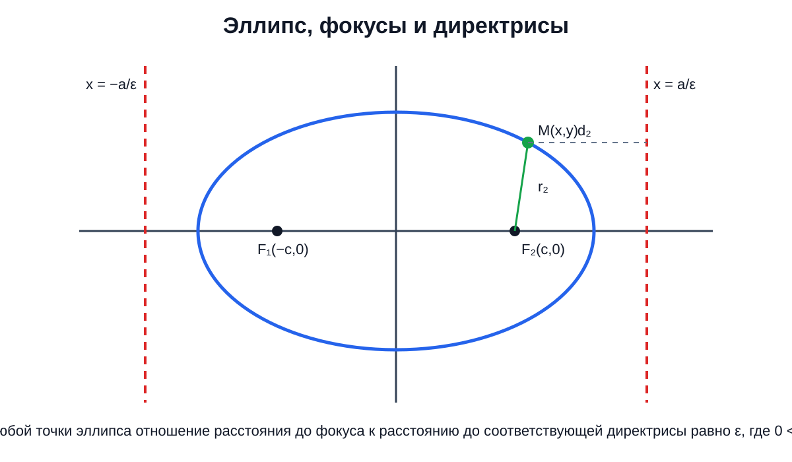
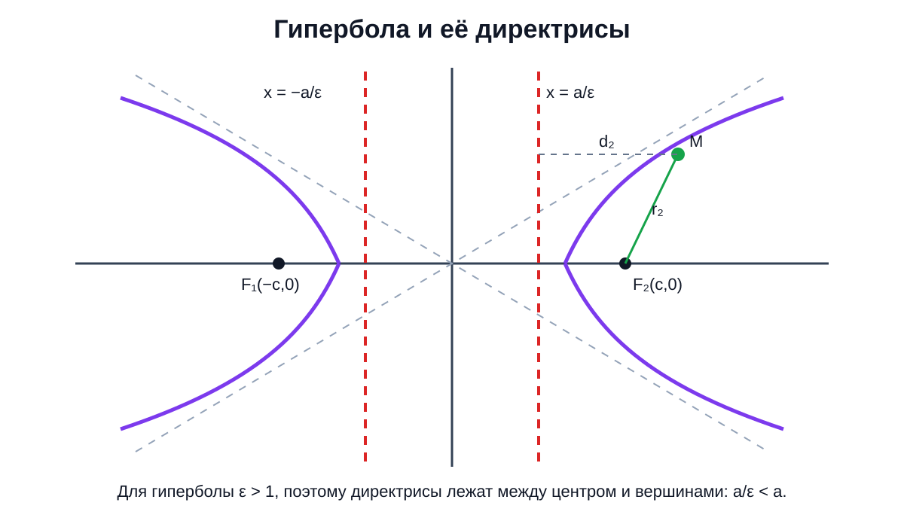
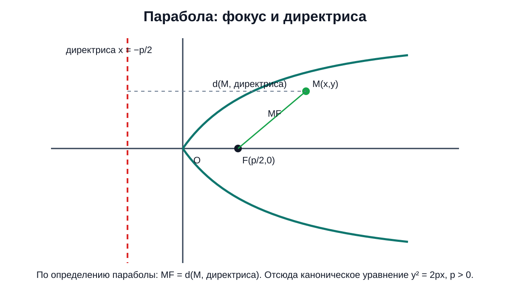

# 13 — Директрисы эллипса и гиперболы. Парабола

> [!info] Навигация и источник
> [[12 - Гипербола|Гипербола]] · [[14 - Касательные, нормали и общее уравнение кривой второго порядка|Следующая тема]] · [[../summaries/13 - Директрисы эллипса и гиперболы. Парабола|Краткая версия]].
>
> Основные рукописные страницы **18–25**. Сохраняются геометрические формулировки, рисунки, свойство отношения расстояний и вывод параболы. В частности, на стр. 19–21 в тетради встречаются указания «нарисуй рисунок» и неоднозначная запись одной формулы расстояния до директрисы; исправленная математическая формула подчёркнута, а оригинальная оговорка зафиксирована в [[../checks/02 - Исправления исходных формул кривых второго порядка - 33 страницы|проверке]].

## 1. Директрисы эллипса (страница 18)

Рассматриваем эллипс
$$
\frac{x^2}{a^2}+\frac{y^2}{b^2}=1,
\qquad a>b>0.
$$

Для эллипса:
$$
c^2=a^2-b^2,\qquad \varepsilon=\frac ca,\qquad 0<\varepsilon<1.
$$

**Директрисами эллипса** называются две прямые, которые:
1. параллельны друг другу;
2. перпендикулярны **большой оси** эллипса;
3. расположены симметрично относительно центра;
4. находятся на расстоянии $a/\varepsilon$ от центра.

При большой оси по $Ox$ это прямые:
$$
\boxed{x=\pm\frac a\varepsilon}.
$$

На стр. 18 нарисованы две вертикальные директрисы слева и справа от горизонтального эллипса и его центра; обозначено расстояние $a/\varepsilon$.

### Расположение директрис относительно эллипса

Поскольку $0<\varepsilon<1$:
$$
\frac a\varepsilon>a.
$$

Крайние точки эллипса по $Ox$ имеют координаты $\pm a$, поэтому директрисы находятся **за его вершинами, вне фигуры**.

Если $c=0$ и $\varepsilon=0$ (окружность), выражение $a/\varepsilon$ не определено: конечных директрис обычного эллипса в таком представлении нет. Этот частный случай уточняет фразу преподавателя «$a\ne b$» на стр. 18.

## 2. Директрисы гиперболы (страница 19)

Рассмотрим гиперболу
$$
\frac{x^2}{a^2}-\frac{y^2}{b^2}=1,\qquad
c^2=a^2+b^2,\qquad \varepsilon=\frac ca>1.
$$

**Директрисами гиперболы** называются две прямые, которые:
1. параллельны между собой;
2. перпендикулярны той её оси, которая пересекает гиперболу (действительной оси);
3. расположены симметрично относительно центра;
4. находятся на расстоянии $a/\varepsilon$ от центра.

Уравнения:
$$
\boxed{x=\pm\frac a\varepsilon}.
$$

В отличие от эллипса, $\varepsilon>1$, следовательно:
$$
0<\frac a\varepsilon<a.
$$

Это значит, что директрисы гиперболы лежат **между её вершинами** $(-a,0)$ и $(a,0)$.

На стр. 19 после определения оставлена авторская пометка **«нарисуй рисунок»**, полного рисунка нет. Для самостоятельного построения: нарисовать гиперболу с вершинами $\pm a$, фокусами $\pm c$ и две вертикальные линии $x=\pm a/\varepsilon$ внутри промежутка между вершинами.

## 3. Фокально-директрисное свойство эллипса (страницы 20–21)

**Теорема из рукописи:** если $r$ — расстояние от некоторой точки эллипса до одного из его фокусов, а $d$ — расстояние от той же точки до соответствующей этому фокусу директрисы, то
$$
\boxed{\frac rd=\operatorname{const}=\varepsilon}.
$$

Докажем для стандартного горизонтального эллипса.

### Правый фокус и правая директриса

Выбираем правый фокус $F_2(c,0)$ и соответствующую ему директрису
$$
x=\frac a\varepsilon.
$$

У любой точки $M(x,y)$ эллипса $-a\le x\le a$, а $a/\varepsilon>a$, поэтому директриса находится правее точки. Расстояние от $M$ до правой директрисы:
$$
d_2=\frac a\varepsilon-x.
$$

Из предыдущей темы фокальный радиус:
$$
r_2=a-\varepsilon x.
$$

Тогда
$$
r_2=\varepsilon\left(\frac a\varepsilon-x\right)=\varepsilon d_2,
$$
то есть
$$
\boxed{\frac{r_2}{d_2}=\varepsilon}.
$$

### Левый фокус и левая директриса

Левый фокус $F_1(-c,0)$, директриса
$$
x=-\frac a\varepsilon.
$$

Поскольку $x\ge-a>-a/\varepsilon$, точка $M$ расположена правее левой директрисы:
$$
d_1=x+\frac a\varepsilon.
$$

А $r_1=a+\varepsilon x$; значит
$$
r_1=\varepsilon\left(x+\frac a\varepsilon\right)=\varepsilon d_1.
$$

Следовательно,
$$
\boxed{\frac{r_1}{d_1}=\varepsilon}.
$$

Это и есть требуемое доказательство для обоих соответствующих пар «фокус — директриса».

> [!warning] О рукописной формуле расстояния
> На стр. 21 один фрагмент выглядит как $d=(x-a)/\varepsilon$. Для директрисы $x=a/\varepsilon$ правильное расстояние — $\underline{d=\left|x-\frac a\varepsilon\right|}$. При интерпретации следует учитывать модуль и **не распределять** деление на $\varepsilon$ по всему $x-a$.

## 4. Фокально-директрисное свойство гиперболы (страницы 20–22)

**Теорема:** для любой точки гиперболы отношение расстояния до фокуса к расстоянию до соответствующей директрисы постоянно и равно эксцентриситету:
$$
\boxed{\frac rd=\varepsilon}.
$$

Фокальные радиусы:
$$
r_1=|\varepsilon x+a|,
\qquad
r_2=|\varepsilon x-a|.
$$

Для правой директрисы $x=a/\varepsilon$:
$$
d_2=\left|x-\frac a\varepsilon\right|.
$$

Следовательно,
$$
r_2=|\varepsilon x-a|
=\varepsilon\left|x-\frac a\varepsilon\right|
=\varepsilon d_2
$$
и $\frac{r_2}{d_2}=\varepsilon$.

Аналогично для левой директрисы $x=-a/\varepsilon$:
$$
d_1=\left|x+\frac a\varepsilon\right|,
$$
$$
r_1=|\varepsilon x+a|
=\varepsilon\left|x+\frac a\varepsilon\right|
=\varepsilon d_1.
$$

На странице 20 преподаватель оставил пометки о необходимости построить рисунки **для доказательства** обеих теорем. При устном ответе рисунок особенно полезен: покажите центр, фокусы $\pm c$, вершины $\pm a$, директрисы $\pm a/\varepsilon$, точку $M$, отрезки $MF$ и перпендикуляр от $M$ к директрисе.

## 5. Объединяющее геометрическое определение (страница 22)

Для каждой кривой второго порядка рассматривается фиксированная точка $F$ (фокус), фиксированная прямая $l$ (директриса) и произвольная точка $M$.

Пусть:
$$
r=MF,\qquad d=\operatorname{dist}(M,l).
$$

Отношение
$$
\boxed{\frac rd=\varepsilon}
$$
характеризует тип кривой:

| Эксцентриситет | Кривая |
|---|---|
| $0<\varepsilon<1$ | Эллипс |
| $\varepsilon=1$ | Парабола |
| $\varepsilon>1$ | Гипербола |

Для окружности как предельного/особого случая $\varepsilon=0$, однако конечная директриса в указанном фокально-директрисном определении не задаётся.

Это важный **объединяющий принцип** темы: эллипс, гипербола и парабола различаются величиной одного безразмерного отношения расстояний.

## 6. Парабола: определение и выбор координат (страницы 22–23)

**Парабола** — геометрическое место точек, равноудалённых от фиксированной точки, называемой **фокусом**, и фиксированной прямой, называемой **директрисой**.

Директриса не проходит через фокус.

Выберем координатную систему так:
- ось $Ox$ перпендикулярна директрисе и проходит через фокус;
- начало координат — середина отрезка от фокуса до директрисы;
- парабола открывается вправо;
- расстояние между фокусом и директрисой обозначается $p>0$.

В выбранной системе:
$$
\boxed{F\left(\frac p2,0\right)},\qquad
\boxed{l:x=-\frac p2}.
$$

Для произвольной точки $M(x,y)$ параболы:
$$
MF=\operatorname{dist}(M,l).
$$

На стр. 23 в тетради есть рисунок-построение: вертикальная директриса слева, фокус справа, начало координат посередине, параболическая ветвь, ось $Ox$.

## 7. Вывод канонического уравнения параболы (страницы 23–24)

Расстояние до фокуса:
$$
MF=\sqrt{\left(x-\frac p2\right)^2+y^2}.
$$

Расстояние до директрисы $x=-p/2$:
$$
d=\left|x+\frac p2\right|.
$$

Для параболы, открытой вправо, точка $M$ располагается при $x\ge0$; значит $x+p/2>0$ и:
$$
d=x+\frac p2.
$$

По определению:
$$
\sqrt{\left(x-\frac p2\right)^2+y^2}
=x+\frac p2.
$$

Возводим в квадрат:
$$
\left(x-\frac p2\right)^2+y^2
=\left(x+\frac p2\right)^2.
$$

Раскрываем квадраты:
$$
x^2-px+\frac{p^2}4+y^2
=x^2+px+\frac{p^2}4.
$$

Одинаковые слагаемые сокращаются, остаётся:
$$
y^2=2px.
$$

Получаем **каноническое уравнение параболы**:
$$
\boxed{y^2=\underline{2px}},\qquad p>0.
$$

Противопоставление эллипсу и гиперболе: парабола имеет **один фокус и одну директрису**, а её эксцентриситет равен **1**.

### Обратная проверка

Пусть точка удовлетворяет $y^2=2px$ при $p>0$. Тогда $x=y^2/(2p)\ge0$, значит $x+p/2>0$.

Из равенства
$$
\left(x-\frac p2\right)^2+y^2
=\left(x+\frac p2\right)^2
$$
получаем
$$
MF=\sqrt{\left(x-\frac p2\right)^2+y^2}
=x+\frac p2=d.
$$

Итак, каноническое уравнение описывает именно геометрическое место точек, равноудалённых от фокуса и директрисы.

## 8. Исследование формы параболы (страницы 24–25)

### Симметрия

В уравнение $y^2=2px$ координата $y$ входит в квадрате. При замене $y\mapsto-y$ уравнение не меняется. Следовательно, ось симметрии — $Ox$.

### Вершина

При $x=0$:
$$
y^2=0\quad\Longrightarrow\quad y=0.
$$

Единственная точка на оси $Oy$ — вершина:
$$
\boxed{O(0,0)}.
$$

### Область существования

Поскольку $y^2\ge0$ и $p>0$:
$$
x=\frac{y^2}{2p}\ge0.
$$

Парабола лежит справа от оси $Oy$.

### Верхняя и нижняя ветви

Из уравнения:
$$
y=\pm\sqrt{2px},\qquad x\ge0.
$$

Для верхней половины $y\ge0$: при увеличении $x$ возрастает $y$. График идёт вправо и вверх без ограничения.

Для нижней половины $y\le0$: ветвь симметрична верхней относительно $Ox$.

На стр. 25 нарисована парабола, раскрытая вправо, с вершиной в начале координат и осью $Ox$.

## 9. Четыре ориентации канонической параболы (страница 25)

| Уравнение | Направление ветвей | Ось симметрии |
|---|---|---|
| $\boxed{y^2=2px}$ | Вправо | $Ox$ |
| $\boxed{y^2=-2px}$ | Влево | $Ox$ |
| $\boxed{x^2=2py}$ | Вверх | $Oy$ |
| $\boxed{x^2=-2py}$ | Вниз | $Oy$ |

Здесь всюду $p>0$. При смене знака правой части меняется направление, а при обмене $x$ и $y$ — ориентация оси симметрии.

Фокус и директриса для других направлений следуют из симметрии:
- влево: $F(-p/2,0)$, директриса $x=p/2$;
- вверх: $F(0,p/2)$, директриса $y=-p/2$;
- вниз: $F(0,-p/2)$, директриса $y=p/2$.

## 10. Что отвечать на коллоквиуме

**Если вопрос о директрисах:**
1. Указать, какая ось является фокальной.
2. Дать словесные определения для эллипса и гиперболы.
3. Записать $x=\pm a/\varepsilon$.
4. Пояснить положение: у эллипса снаружи вершин; у гиперболы внутри.
5. Назвать и доказать $r/d=\varepsilon$ для соответствующих пар.
6. Показать на рисунке фокус, директрису и перпендикуляр до неё.

**Если вопрос о параболе:**
1. Дать определение через равноудалённость от фокуса и прямой.
2. Выбрать $F(p/2,0)$ и $x=-p/2$.
3. Приравнять расстояния и получить $y^2=2px$.
4. Исследовать симметрию, вершину и область $x\ge0$.
5. Перечислить четыре ориентации.
6. Пояснить, что $\varepsilon=1$.

[[14 - Касательные, нормали и общее уравнение кривой второго порядка|Далее: оптические свойства и касательные]] · [[../exam/06 - Кривые второго порядка - полная подготовка к коллоквиуму|Подготовка]]
