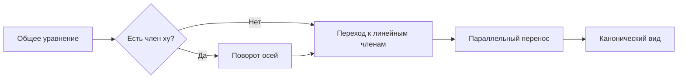

---
tags:
  - university
  - analytical-geometry
  - conics
  - second-order-curves
type: lecture-note
status: active
source_date: "2026-10-16"
source_images:
  - "1000039534.jpg"
  - "1000039535.jpg"
  - "1000039536.jpg"
  - "1000039537.jpg"
  - "1000039538.jpg"
  - "1000039539.jpg"
  - "1000039540.jpg"
  - "1000039541.jpg"
---

# 14 — Оптическое свойство параболы, касательные и общее уравнение кривой второго порядка

> [!info] Навигация
> [[13 - Директрисы эллипса и гиперболы. Парабола|← Назад: директрисы и парабола]] · [[../exam/01 - Подготовка к тесту по кривым второго порядка 19.10.2026|Вперёд: подготовка к тесту по кривым второго порядка →]]

## 1. Оптическое свойство параболы

Если пучок лучей падает на параболу параллельно её оси, то после отражения лучи проходят через фокус.

И наоборот: если источник света расположен в фокусе параболы, то отражённые лучи выходят параллельно её оси.

![[assets/13-parabola-optical-property.svg|950]]

Это свойство используется в параболических отражателях, антеннах, прожекторах и оптических системах.

## 2. Касательная и нормаль к кривой

**Касательная** — прямая, являющаяся предельным положением секущей при сближении двух точек кривой.

**Нормаль** — прямая, проходящая через точку касания перпендикулярно касательной.

### Касательная к эллипсу

Для эллипса

$$
\frac{x^2}{a^2}+\frac{y^2}{b^2}=1
$$

и точки $M_0(x_0,y_0)$, лежащей на эллипсе,

$$
\frac{xx_0}{a^2}+\frac{yy_0}{b^2}=1.
$$

### Касательная к гиперболе

Для гиперболы

$$
\frac{x^2}{a^2}-\frac{y^2}{b^2}=1
$$

и точки $M_0(x_0,y_0)$, лежащей на гиперболе,

$$
\frac{xx_0}{a^2}-\frac{yy_0}{b^2}=1.
$$

## 3. Общее уравнение кривой второго порядка

Общее уравнение имеет вид

$$
Ax^2+2Bxy+Cy^2+2Dx+2Ey+F=0,
$$

где $A,B,C,D,E,F$ — постоянные коэффициенты, причём $A,B,C$ не равны нулю одновременно.

Квадратичная часть:

$$
Ax^2+2Bxy+Cy^2.
$$

## 4. Поворот осей координат

Если в уравнении присутствует смешанный член $xy$, его можно устранить поворотом осей:

$$
x=x'\cos\alpha-y'\sin\alpha,
$$

$$
y=x'\sin\alpha+y'\cos\alpha.
$$

Угол $\alpha$ выбирают так, чтобы коэффициент при $x'y'$ стал равен нулю.

После поворота уравнение имеет вид без смешанного квадратичного члена:

$$
A'{x'}^2+C'{y'}^2+2D'x'+2E'y'+F'=0.
$$

## 5. Параллельный перенос

Далее выполняют перенос начала координат:

$$
x'=x''+x_0,
\qquad
y'=y''+y_0.
$$

Для **центральных коник** (эллипса и гиперболы, когда $AC-B^2\ne0$) подходящим переносом можно устранить оба линейных члена и перейти к уравнению вида

$$
A''{x''}^2+C''{y''}^2+F''=0.
$$

Для **параболического случая** ($AC-B^2=0$) вообще говоря нельзя одним переносом убрать оба линейных члена: после поворота и переноса остаётся линейный член, который и приводит к канонической форме параболы, например

$$
y^2=2px.
$$

> [!important]
> Поэтому универсально безопасный порядок действий такой: сначала убрать смешанный член поворотом, затем переносом привести оставшееся уравнение к каноническому виду. Для некоторых центральных коник перенос и поворот можно выполнять и в другом порядке.

## 6. Классификация по квадратичной части

Для

$$
Ax^2+2Bxy+Cy^2
$$

вводится величина

$$
\delta=AC-B^2.
$$

Для невырожденных коник:

- $\delta>0$ — эллиптический тип;
- $\delta<0$ — гиперболический тип;
- $\delta=0$ — параболический тип.

Это классификация **типа квадратичной части**. Для полного определения кривой нужно учитывать также линейные и свободный члены: возможны вырожденные случаи, пустое множество, точка, пара прямых и т. п.

## 7. Алгоритм приведения общего уравнения

1. Выписать коэффициенты $A,B,C,D,E,F$.
2. Посчитать

$$
\delta=AC-B^2.
$$

3. Если $B\ne0$, выполнить поворот осей и убрать член $xy$.
4. Выполнить перенос начала координат и упростить линейные члены.
5. Привести уравнение к каноническому виду.
6. Определить, получился эллипс, гипербола, парабола или вырожденный случай.

## 8. Что нужно запомнить

- Параллельные оси параболы лучи после отражения проходят через фокус; лучи из фокуса отражаются параллельно оси.
- Общее уравнение:

$$
Ax^2+2Bxy+Cy^2+2Dx+2Ey+F=0.
$$

- Поворот устраняет смешанный член $xy$.
- Перенос меняет начало координат и упрощает линейные члены.
- Для центральных коник переносом можно убрать оба линейных члена; для параболы обычно остаётся один линейный член.
- Классификационная величина:

$$
\delta=AC-B^2.
$$

- Касательная к эллипсу:

$$
\frac{xx_0}{a^2}+\frac{yy_0}{b^2}=1.
$$

- Касательная к гиперболе:

$$
\frac{xx_0}{a^2}-\frac{yy_0}{b^2}=1.
$$
