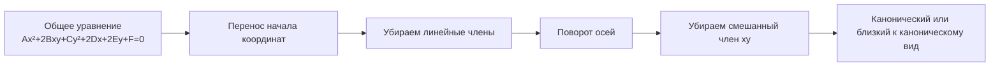

---
tags:
  - university
  - analytical-geometry
  - conics
  - second-order-curves
type: lecture-note
status: restored
source_date: "2026-10-16"
source_images:
  - "1000039534.jpg"
  - "1000039535.jpg"
  - "1000039536.jpg"
  - "1000039537.jpg"
  - "1000039538.jpg"
  - "1000039539.jpg"
  - "1000039540.jpg"
  - "1000039541.jpg"
---

# 14 — Касательные, нормали и общее уравнение кривой второго порядка

> [!info] Навигация
> [[13 - Директрисы эллипса и гиперболы. Парабола|← Предыдущая тема: директрисы и парабола]]

> [!note] Источник
> Конспект восстановлен по фотографиям продолжения лекции от **16.10.2026**. Часть преобразований в тетради записана сокращённо. Там, где шаг стандартный и однозначно следует из темы, он добавлен как пояснение; сомнительные строки не выдаются за дословную запись преподавателя.

## 1. Касательная и нормаль к кривой

**Касательная** — прямая, имеющая с кривой общую точку и являющаяся предельным положением секущей при сближении двух точек кривой.

**Нормаль** — прямая, проходящая через точку касания перпендикулярно касательной.

На фотографиях сначала рассматривается касательная к кривым второго порядка, после чего тема переходит к общему уравнению кривой второго порядка.

### Касательная к эллипсу

Для эллипса

$$
\frac{x^2}{a^2}+\frac{y^2}{b^2}=1
$$

и точки

$$
M_0(x_0,y_0)
$$

на эллипсе стандартное уравнение касательной имеет вид

$$
\frac{xx_0}{a^2}+\frac{yy_0}{b^2}=1.
$$

> [!note] Восстановление
> На фото видны формулы, приводящие к уравнению касательной в точке $M_0(x_0,y_0)$, но промежуточная строка читается не полностью. Поэтому выше записана стандартная итоговая форма, соответствующая теме страницы.

Аналогично для гиперболы

$$
\frac{x^2}{a^2}-\frac{y^2}{b^2}=1
$$

касательная в точке $M_0(x_0,y_0)$ записывается как

$$
\frac{xx_0}{a^2}-\frac{yy_0}{b^2}=1.
$$

## 2. Общее уравнение кривой второго порядка

В тетради записано общее уравнение:

$$
Ax^2+2Bxy+Cy^2+2Dx+2Ey+F=0.
$$

Здесь $A,B,C,D,E,F$ — постоянные коэффициенты, причём коэффициенты при квадратных членах не должны одновременно обращаться в ноль.

Задача преобразований координат — привести это уравнение к более простому виду, в котором можно определить тип кривой.

## 3. Перенос начала координат

Сначала выполняется параллельный перенос системы координат:

$$
x=x'+x_0,
\qquad
y=y'+y_0.
$$

Подставляя эти выражения в исходное уравнение и подбирая $x_0,y_0$, можно устранить линейные члены, если это допускает конкретное уравнение.

После такого переноса уравнение принимает более простой вид вида

$$
A{x'}^2+2Bx'y'+C{y'}^2+F'=0.
$$

> [!note]
> На фотографиях рядом с этим шагом записано, что начало координат выбирают так, чтобы убрать линейные слагаемые.

## 4. Поворот осей координат

Если после переноса остаётся смешанный член $x'y'$, выполняют поворот осей на угол $\alpha$:

$$
x'=x''\cos\alpha-y''\sin\alpha,
$$

$$
y'=x''\sin\alpha+y''\cos\alpha.
$$

Угол $\alpha$ выбирают так, чтобы после подстановки коэффициент при произведении $x''y''$ стал равен нулю.

В результате уравнение можно привести к форме

$$
A'{x''}^2+C'{y''}^2+F''=0.
$$

То есть сначала устраняются **линейные члены**, затем — **смешанный член**.

## 5. Инвариант квадратичной части

На последней фотографии отдельно выделена величина

$$
\delta=AC-B^2.
$$

Она используется для различения типов кривых второго порядка.

В контексте невырожденных коник:

- если $\delta>0$, квадратичная часть имеет эллиптический тип;
- если $\delta<0$, гиперболический тип;
- если $\delta=0$, параболический тип.

> [!warning]
> Само значение $\delta$ ещё не полностью определяет, является ли кривая невырожденной: дополнительно важны остальные коэффициенты и итог после приведения уравнения. На фото преподаватель отдельно связывает $\delta=0$ с параболическим случаем, а $\delta\ne0$ — с эллиптическим/гиперболическим типом.

## 6. Зачем нужны перенос и поворот

Смысл преобразований:

1. **Перенос** меняет начало координат и позволяет убрать линейные члены.
2. **Поворот** меняет направление осей и позволяет убрать член $xy$.
3. После этого становится видно, к какому стандартному виду относится кривая:
   - эллипс;
   - гипербола;
   - парабола;
   - либо вырожденный случай.

> [!important] Основной алгоритм
> Если дано общее уравнение второй степени, сначала анализируем линейные члены и выполняем перенос, затем при необходимости поворачиваем оси, после чего сравниваем получившееся уравнение с каноническими уравнениями коник.

## 7. Что нужно запомнить

- Общее уравнение кривой второго порядка:

$$
Ax^2+2Bxy+Cy^2+2Dx+2Ey+F=0.
$$

- Перенос:

$$
x=x'+x_0,
\qquad y=y'+y_0.
$$

- Поворот:

$$
x'=x''\cos\alpha-y''\sin\alpha,
\qquad
y'=x''\sin\alpha+y''\cos\alpha.
$$

- Для квадратичной части важна величина

$$
\delta=AC-B^2.
$$

- Касательная к эллипсу в $M_0(x_0,y_0)$:

$$
\frac{xx_0}{a^2}+\frac{yy_0}{b^2}=1.
$$

- Касательная к гиперболе:

$$
\frac{xx_0}{a^2}-\frac{yy_0}{b^2}=1.
$$

## 8. Неразборчивые места

Без догадок не восстанавливались:
- несколько промежуточных алгебраических строк при выводе касательной;
- отдельные обозначения коэффициентов после переноса и поворота;
- часть текста в самом низу последних страниц после классификации по $\delta$.

Где формула была очевидно продолжением стандартного вывода, она добавлена как **поясняющее восстановление**, а не как дословная запись тетради.
