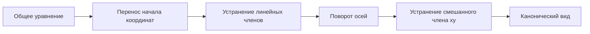

---
tags:
  - university
  - analytical-geometry
  - conics
  - second-order-curves
type: lecture-note
status: active
source_date: "2026-10-16"
source_images:
  - "1000039534.jpg"
  - "1000039535.jpg"
  - "1000039536.jpg"
  - "1000039537.jpg"
  - "1000039538.jpg"
  - "1000039539.jpg"
  - "1000039540.jpg"
  - "1000039541.jpg"
---

# 14 — Оптическое свойство параболы, касательные и общее уравнение кривой второго порядка

> [!info] Навигация
> [[13 - Директрисы эллипса и гиперболы. Парабола|← Предыдущая тема: директрисы и парабола]]

## 1. Оптическое свойство параболы

Если пучок лучей падает на параболу параллельно её оси, то после отражения лучи проходят через фокус.

И наоборот: если источник света расположен в фокусе параболы, то отражённые лучи выходят параллельно её оси.

![[assets/13-parabola-optical-property.svg|950]]

Это свойство используется в параболических отражателях, антеннах, прожекторах и оптических системах.

## 2. Касательная и нормаль к кривой

**Касательная** — прямая, являющаяся предельным положением секущей при сближении двух точек кривой.

**Нормаль** — прямая, проходящая через точку касания перпендикулярно касательной.

### Касательная к эллипсу

Для эллипса

$$
\frac{x^2}{a^2}+\frac{y^2}{b^2}=1
$$

и точки

$$
M_0(x_0,y_0)
$$

уравнение касательной:

$$
\frac{xx_0}{a^2}+\frac{yy_0}{b^2}=1.
$$

### Касательная к гиперболе

Для гиперболы

$$
\frac{x^2}{a^2}-\frac{y^2}{b^2}=1
$$

касательная в точке $M_0(x_0,y_0)$:

$$
\frac{xx_0}{a^2}-\frac{yy_0}{b^2}=1.
$$

## 3. Общее уравнение кривой второго порядка

Общее уравнение имеет вид

$$
Ax^2+2Bxy+Cy^2+2Dx+2Ey+F=0.
$$

Здесь $A,B,C,D,E,F$ — постоянные коэффициенты, причём $A,B,C$ не равны нулю одновременно.

Цель преобразований координат — привести уравнение к более простому виду и определить тип кривой.

## 4. Перенос начала координат

Параллельный перенос:

$$
x=x'+x_0,
\qquad
y=y'+y_0.
$$

Подбором $x_0,y_0$ можно устранить линейные члены. После переноса уравнение принимает вид

$$
A{x'}^2+2Bx'y'+C{y'}^2+F'=0.
$$

## 5. Поворот осей координат

Если остаётся смешанный член $x'y'$, выполняют поворот осей на угол $\alpha$:

$$
x'=x''\cos\alpha-y''\sin\alpha,
$$

$$
y'=x''\sin\alpha+y''\cos\alpha.
$$

Угол $\alpha$ выбирают так, чтобы коэффициент при $x''y''$ стал равен нулю.

После этого уравнение приводится к форме

$$
A'{x''}^2+C'{y''}^2+F''=0.
$$

## 6. Классификация по квадратичной части

Рассматривается величина

$$
\delta=AC-B^2.
$$

Для невырожденных коник:

- $\delta>0$ — эллиптический тип;
- $\delta<0$ — гиперболический тип;
- $\delta=0$ — параболический тип.

Окончательный вид кривой определяется после учёта всех коэффициентов и приведения уравнения.

## 7. Алгоритм приведения уравнения

1. Записать общее уравнение второй степени.
2. Выполнить перенос начала координат и убрать линейные члены.
3. При наличии члена $xy$ повернуть оси.
4. Получить упрощённое уравнение.
5. Сравнить его с каноническими уравнениями эллипса, гиперболы и параболы.

## 8. Что нужно запомнить

- Параллельные оси параболы лучи после отражения проходят через фокус; лучи из фокуса отражаются параллельно оси.
- Общее уравнение кривой второго порядка:

$$
Ax^2+2Bxy+Cy^2+2Dx+2Ey+F=0.
$$

- Перенос:

$$
x=x'+x_0,
\qquad y=y'+y_0.
$$

- Поворот:

$$
x'=x''\cos\alpha-y''\sin\alpha,
\qquad
y'=x''\sin\alpha+y''\cos\alpha.
$$

- Классификационная величина:

$$
\delta=AC-B^2.
$$

- Касательная к эллипсу:

$$
\frac{xx_0}{a^2}+\frac{yy_0}{b^2}=1.
$$

- Касательная к гиперболе:

$$
\frac{xx_0}{a^2}-\frac{yy_0}{b^2}=1.
$$
