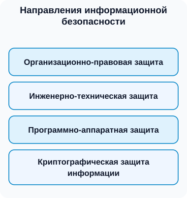
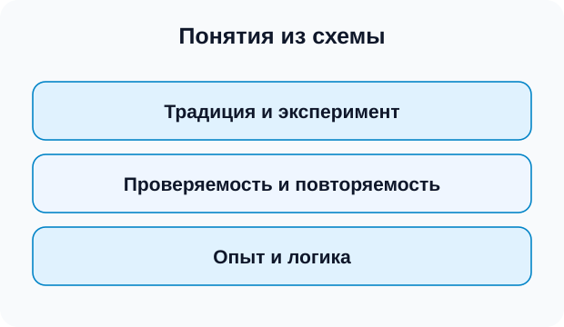

# 01 — Информация как объект защиты

## Введение в информационную безопасность

**Александр Дмитриевич Подок** — преподаватель.

**6–8-я неделя — контрольная работа.**

### Части информационной безопасности

Информационная безопасность включает четыре направления:

1. **Организационно-правовая защита.**
2. **Инженерно-техническая защита информации.**
3. **Программно-аппаратная защита.**
4. **Криптографическая защита информации.**

## Информация как объект защиты

**Информация не материальна.**

Защищаем не информацию, а **материальный носитель**.

### Свойства информации

В записи выделены:

1. **<u>Доступность</u>.**
2. **Целостность.**
3. **Конфиденциальность.**

При рассмотрении свойств информации также используются понятия **конкретности** и **ценности** информации.

В схеме центральным понятием выступает <u>познание</u>.

## Проверяемость информации

В схеме сопоставлены **традиция** и **эксперимент**.

Основные признаки:

1. **Проверяемость.**
2. **Повторяемость.**

Они связаны с двумя элементами — **опытом** и **логикой**:

---

[[../overview/Главная|← Главная]] · [[02 - Правовая защита и государственная тайна|Следующая →]] · [[../summaries/01 - Информация как объект защиты|Краткий конспект]]
