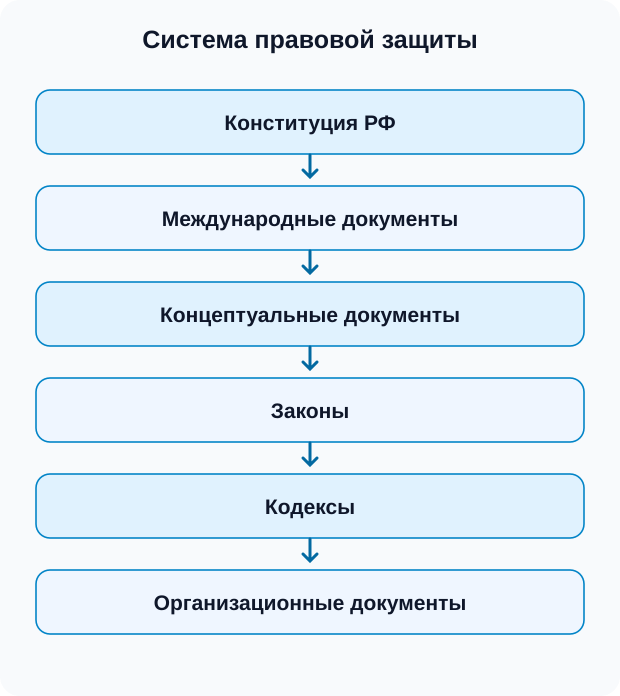

# 02 — Правовая защита и государственная тайна

## Правовая защита информации

**Правовая защита информации** представляет собой пакет юридических документов, действующих на территории Российской Федерации.

### Система правовой защиты информации

К концептуальным документам относятся, в частности, **доктрина о национальной и информационной безопасности** и другие документы.

Основные законы, отмеченные в записи:

1. **Закон о государственной тайне.**
2. **Закон о коммерческой тайне.**
3. **Закон о персональных данных.**

Защита государственной тайны строится на основе одноимённого закона.

## Государственная тайна

### Уровни секретности государственной тайны

1. **«Секретно»** — форма допуска № 3.
2. **«Совершенно секретно»** — форма допуска № 2.
3. **«Особой важности»** — форма допуска № 1.

Государственную тайну могут содержать **документы, изделия и вещества**.

### Условия работы с государственной тайной

Для того чтобы предприятие работало с государственной тайной, ему необходимо выполнить определённые требования:

1. **Помещения** должны быть оборудованы средствами защиты и соответствовать уровню секретности.
2. **Сотрудники** должны иметь допуски по нужной форме.

**Режимное предприятие** — предприятие, работающее с государственной тайной.

### Организации, отвечающие за защиту государственной тайны

В конспекте перечислены:

1. **ФСБ** — Федеральная служба безопасности.
2. **Минобороны** — Министерство обороны.
3. **СВР** — Служба внешней разведки.
4. **ФСТЭК** — Федеральная служба по техническому и экспортному контролю.

Для получения необходимого доступа к государственной тайне работник проходит соответствующие процедуры.

При устройстве на работу и увольнении нужно подписать документ о неразглашении.

### Процедура при увольнении

В записи указано:

- подписка о неразглашении;
- сдать именное удостоверение;
- сдать ключи от сейфа;
- сдать ключи от кабинета.

### Ответственность за нарушение режима государственной тайны

Выделены три уровня ответственности:

1. **Дисциплинарная** — нарушение требований и обязанностей сотрудника.
2. **Административная.**
3. **Уголовная.**

## Организационно-правовые меры защиты

Правовую защиту обеспечивают документы, определяющие:

- права и обязанности организации и сотрудников;
- порядок допуска и обращения с защищаемой информацией;
- ответственность за нарушение режима защиты;
- особенности работы с государственной тайной.

[[../summaries/02 - Правовая защита и государственная тайна|Предыдущий конспект для повторения]]
