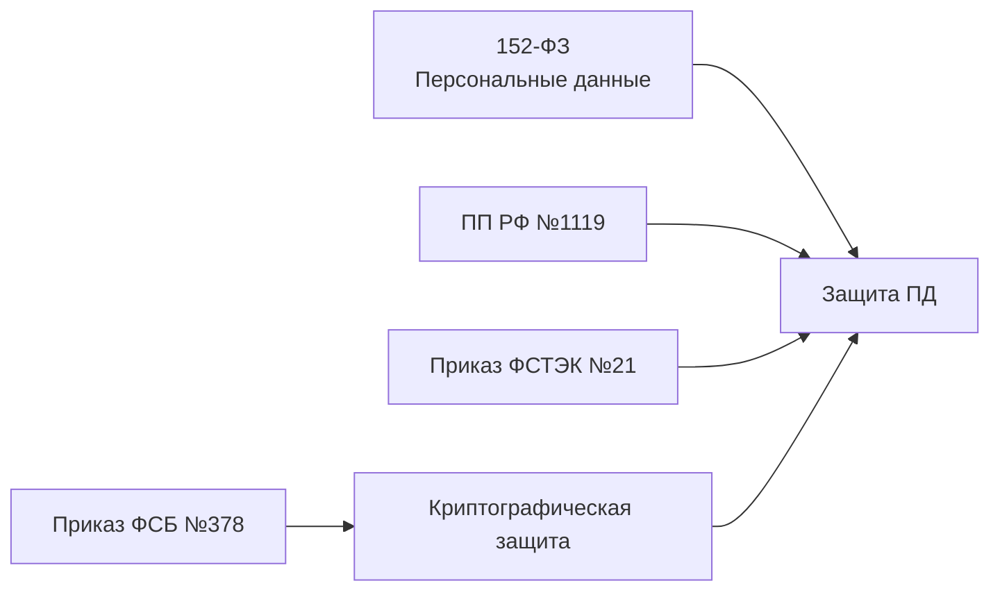
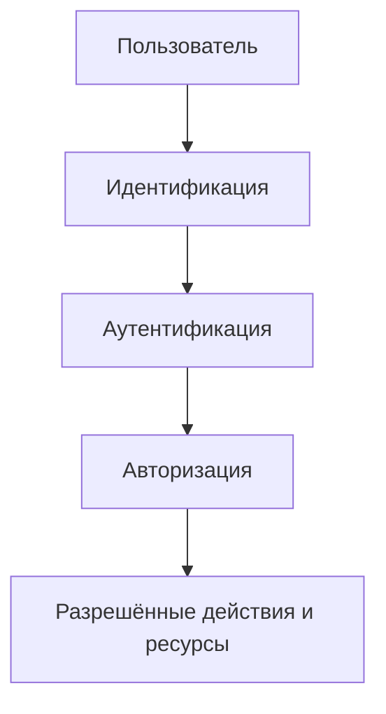

---
aliases:
  - "Персональные данные и ИСПДн"
  - "Идентификация, аутентификация и авторизация"
tags:
  - university
  - information-security
  - lecture-note
  - personal-data
  - authentication
subject: "Введение в информационную безопасность"
type: lecture-note
status: restored
source_images:
  - "IMG_20261011_201110.jpg"
  - "IMG_20261011_201132.jpg"
  - "IMG_20261011_201128.jpg"
  - "IMG_20261011_201122.jpg"
  - "IMG_20261011_201118.jpg"
---

# 05 — Персональные данные, идентификация и защита ИСПДн

> [!info] Навигация
> [[00 - Введение в информационную безопасность|Введение в ИБ]] · [[04 - ФЗ №149-ФЗ и защита информации|← Предыдущая]]

> [!note] Источник
> Конспект восстановлен по пяти фотографиям тетради. Формулировки сохранены максимально близко к исходнику. Нечитаемые фрагменты не додумывались. Нормативные ссылки здесь фиксируются как содержание лекции; их актуальность отдельно не проверялась.

## 1. Персональные данные

В тетради основным нормативным актом по теме указан **Федеральный закон №152-ФЗ «О персональных данных»**.

Записанное определение можно восстановить так:

> **Персональные данные** — любая информация, которая прямо или косвенно относится к человеку и позволяет его идентифицировать.

Смысл определения: персональными являются не только очевидные реквизиты вроде ФИО, но и иные сведения, если по ним можно связать информацию с конкретным человеком.

## 2. Категории персональных данных

На странице приведена схема с четырьмя ветвями: **общие**, **специальные**, **биометрические**, **иные**.

![[assets/05-personal-data-categories.svg|900]]

> [!note] Реконструкция схемы
> В SVG перенесены только уверенно читаемые подписи. Неразборчивые примеры из фотографии не добавлялись.

### Общие персональные данные

В конспекте среди примеров читаются:
- ФИО;
- год рождения;
- номер паспорта;
- другие обычные идентифицирующие сведения.

### Специальные персональные данные

Уверенно читаются:
- национальность;
- расовая принадлежность;
- религия;
- состояние здоровья.

### Биометрические персональные данные

В качестве примеров записаны:
- фотография;
- отпечатки пальцев;
- другие признаки, которые могут использоваться для идентификации человека.

### Иные персональные данные

В исходной схеме присутствует отдельная ветвь **«Иные»**, но подробный перечень рядом с ней не записан либо не читается.

## 3. Уровни защищённости персональных данных

В конспекте отдельно записано **Постановление Правительства РФ №1119** и тема выбора **уровня защищённости** персональных данных в информационной системе.

На фотографиях видны обозначения уровней **УЗ1, УЗ2, УЗ3** и записи о количестве субъектов персональных данных. Часть условий выбора конкретного уровня читается недостаточно уверенно, поэтому они не восстановлены как точные правила.

> [!warning]
> Не использовать этот фрагмент как готовую юридическую таблицу выбора УЗ: на фотографии часть критериев неразборчива. Для теста следует опираться на формулировку преподавателя, а для практической работы — на действующую редакцию нормативных документов.

## 4. Меры защиты в информационной системе

На страницах перечислены организационные требования. Уверенно читаются следующие пункты:

1. **обеспечение безопасности помещений**, в которых размещаются средства информационной системы;
2. **сохранность материальных носителей** персональных данных;
3. **определение перечня лиц**, допущенных к работе с персональными данными.

Также в конспекте упоминается **приказ ФСТЭК №21** и меры защиты, среди которых читаются:
- идентификация и аутентификация;
- управление доступом.

Остальная часть перечня на фотографии читается не полностью и не переносится дословно.

## 5. Идентификация, аутентификация и авторизация

В тетради работа пользователя с информационной системой разобрана как последовательность из трёх процедур.

![[assets/05-identity-access-flow.svg|900]]

### 5.1. Идентификация

**Идентификация** — определение пользователя, который обращается к информационной системе.

Практический смысл: система должна понять, **кто именно** пытается получить доступ.

### 5.2. Аутентификация

**Аутентификация** — подтверждение личности пользователя.

Практический смысл: после того как пользователь назвал себя, система проверяет, **действительно ли это он**.

### 5.3. Авторизация

В конспекте записано:

> **Авторизация** — наделение правами, которыми пользователь может пользоваться в системе.

То есть после установления и подтверждения личности система определяет, **что именно этому пользователю разрешено делать**.

> [!important] Короткое различие
> **Идентификация** — «кто ты?» → **аутентификация** — «докажи, что это ты» → **авторизация** — «что тебе разрешено?».

## 6. Криптографическая защита

Отдельным блоком в тетради записана **криптографическая защита** и упоминается **приказ ФСБ №378**.

Также присутствует запись о том, что криптографические средства делятся на **5 классов**. Подробная классификация на этих фотографиях не приведена, поэтому классы не раскрываются без дополнительного источника.

## 7. Нормативные документы, упомянутые в конспекте

Эта схема показывает **только связи тем, как они встречаются в конспекте**, а не юридическую иерархию нормативных актов.

## 8. Логика защиты доступа

Такое представление помогает не путать три близких термина: сначала определяется субъект, затем подтверждается его личность, после чего назначаются разрешённые права.

## 9. Что особенно важно запомнить

> [!important]
> - **152-ФЗ** — основной закон, указанный в конспекте по персональным данным.
> - Персональные данные — сведения, прямо или косвенно относящиеся к человеку и позволяющие его идентифицировать.
> - Категории на схеме: **общие, специальные, биометрические, иные**.
> - **ПП РФ №1119** связано в конспекте с уровнями защищённости персональных данных.
> - **Приказ ФСТЭК №21** — меры защиты; среди читаемых: идентификация/аутентификация и управление доступом.
> - **Приказ ФСБ №378** упомянут в блоке криптографической защиты.
> - Не путать: **идентификация → аутентификация → авторизация**.

## 10. Неразборчивые фрагменты исходника

Не были восстановлены без уверенности:
- точные условия выбора УЗ1/УЗ2/УЗ3 на странице с уровнями защищённости;
- часть примеров биометрических данных;
- часть перечня мер из приказа ФСТЭК №21;
- отдельные подписи в верхней части первой фотографии.

Если появятся более чёткие фотографии этих мест, их следует дописать в эту же тему, а не заменять догадками.

---

## Связанные заметки

- [[04 - ФЗ №149-ФЗ и защита информации]]
- [[00 - Введение в информационную безопасность]]
