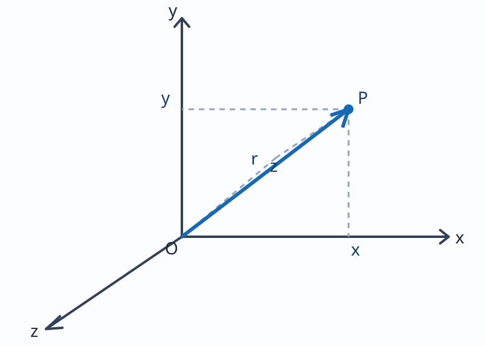
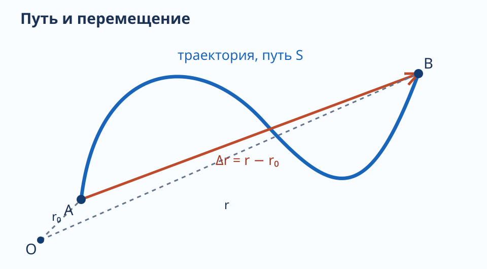
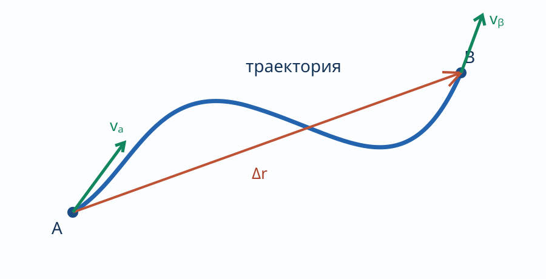

---
aliases:
  - "Механика. Кинематика и механическое движение"
tags:
  - university
  - physics
  - lecture-note
subject: "Физика"
type: "lecture-note"
status: "source-faithful-draft-needs-proofreading"
---

# 01 — Механика. Кинематика и механическое движение

> [!info] Навигация
> [[00 - Физика|Физика]] · [[02 - Вращательное движение и угловая скорость|Следующая]]

## Механика

**Механика** — часть физики, в которой изучаются законы механического движения и причины, вызывающие или изменяющие это движение.

**Механическое движение** — изменение с течением времени взаимного расположения тел или его частей.

Механика:
- Кинематика — изучает движение тел, не рассматривая причины, которые вызвали это движение.
- Динамика — изучает законы движения тел и причины, вызывающие или изменяющие это движение.
- Статика — изучает законы равновесия тел.

## Кинематика

**Кинематика.**

Материальная точка — тело, обладающее массой, размерами которого в условиях данной задачи можно пренебречь.

Произвольное тело или систему тел можно мысленно разбить на материальные точки, и тогда движение этого тела сводится к движению системы мат. точек.

Абсолютно твёрдое тело (АТТ) — это тело, которое ни при каких условиях не может деформироваться и при любых условиях расстояние между двумя точками этого тела остаётся постоянным.

Любое движение твёрдого тела можно представить как .

поступательного и вращательного движения.

Поступательное движение — это движение, при котором любая прямая, жёстко связанная с телом, остаётся параллельной своему первоначальному положению.

Вращательное движение — движение, при котором все точки тела движутся по окружностям, центры которых лежат на одной прямой; эта прямая называется осью вращения.

## Система отсчёта и радиус-вектор

Система отсчёта — это совокупность системы координат и часов, связанных с телом отсчёта.

Радиус-вектор — это вектор, соединяющий начало отсчёта и положение точки в данный момент времени.

$\vec r=x\vec i+y\vec j+z\vec k$.

$\vec i$, $\vec j$, $\vec k$ — единичные векторы.

$|\vec r|=\sqrt{x^2+y^2+z^2}$.

Отсчёт времени начинается с момента, когда тело находилось в точке A, тогда длина участка AB будет длина пути S.

Путь — скалярная величина.

$\Delta S=S(t)$ — путь .

$\Delta\vec r=\vec r-\vec r_0$ — перемещение.

Вектор $\Delta\vec r$ проведён из начального положения движущейся точки в её конечное положение и при этом не зависит от формы траектории движения.

При движении материальной точки её координаты меняются с течением времени:

$x=x(t)$, $y=y(t)$, $z=z(t)$, или $\vec r=\vec r(t)$.

**Кинематические уравнения** — если исключить время из этих уравнений, то получим уравнение траектории.

Траектория — это линия вдоль которой движется тело.

В зависимости от формы траектории движение может быть прямолинейным и криволинейным.

## Скорость

При прямолинейном движении модуль вектора перемещения равен пройденному пути.

Скорость — это векторная физическая величина, определяющая быстроту и направление изменения положения в пространстве.

$\langle\vec v\rangle$ — средняя скорость.

При движении материальной точки по криволинейной траектории наблюдается, что в каждый момент времени вектор скорости направлен по касательной к траектории.

траектории; изменения $\vec r$ и, соответственно, $\vec v$.

В течение малого промежутка времени $\Delta t$ частица проходит $\Delta S$ и получит перемещение $\Delta\vec r$.

Вектором средней скорости называется отношение перемещения точки к промежутку времени $\Delta t$.

$\langle\vec v\rangle=\frac{\Delta\vec r}{\Delta t}$ — средняя скорость перемещения.

Устремим $\Delta t$ к нулю, тогда средняя скорость стремится к значению, которое называется мгновенной скоростью.

**Мгновенная скорость.**

$\vec v=\lim_{\Delta t\to0}\frac{\Delta\vec r}{\Delta t}=\frac{d\vec r}{dt}$ — производная радиус-вектора.

Мгновенная скорость — это предел среднего [неразборчиво] при стремлении промежутка времени к нулю.

Пример: $x(t)=4t^2+5t^3-8$.

$v_x(t)=8t+15t^2$.

$\vec v=v_x\vec i+v_y\vec j+v_z\vec k$.

$v_x=\frac{dx}{dt}$, $v_y=\frac{dy}{dt}$, $v_z=\frac{dz}{dt}$.

$v=\sqrt{v_x^2+v_y^2+v_z^2}$.

$v=|\vec v|=\lim_{\Delta t\to0}\frac{|\Delta\vec r|}{\Delta t}=\lim_{\Delta t\to0}\frac{\Delta S}{\Delta t}=\frac{dS}{dt}$.

$dS=v(t)\,dt$.

$\langle v\rangle=\frac{S_{\text{весь}}}{t_{\text{всё}}}$ — средняя скорость пути.

$S=\int_{t_1}^{t_2}v(t)\,dt$.

Ускорение — это векторная физическая величина, характеризующая быстроту изменения скорости по модулю и [продолжение обрезано].
