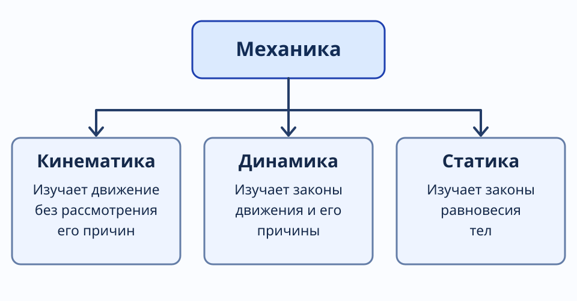

---
aliases:
  - "Механика. Кинематика и механическое движение"
tags:
  - university
  - physics
  - lecture-note
  - механика
  - кинематика
subject: "Физика"
type: "lecture-note"
status: "full-from-new-photos"
---

# 01 — Механика. Кинематика и механическое движение

> [!info] Навигация
> [[00 - Физика|Физика]] · [[02 - Вращательное движение и угловая скорость|Следующая тема →]] · [[../summaries/01 - Механика. Кинематика и механическое движение|Краткая версия]]

## Механика и механическое движение

**Механика** — часть физики, в которой изучаются законы механического движения и причины возникновения или изменения движения.

**Механическое движение** — изменение с течением времени взаимного расположения тел или их частей.

Механика разделяется на три раздела:

- **Кинематика** изучает движение тел, не рассматривая причины, которые вызывают это движение.
- **Динамика** изучает законы движения тел и причины возникновения или изменения движения.
- **Статика** изучает законы равновесия тел.

Схема показывает три раздела механики как параллельные области.

## Кинематика

Кинематика описывает движение с помощью положения тела, траектории, пройденного пути, перемещения, скорости и других кинематических характеристик.

### Материальная точка

**Материальная точка** — тело, обладающее массой, размерами которого в условиях данной задачи можно пренебречь.

Произвольное тело или систему тел можно мысленно разбить на материальные точки; тогда движение тела сводится к движению системы материальных точек.

### Абсолютно твёрдое тело

**Абсолютно твёрдое тело (АТТ)** — тело, которое ни при каких условиях не деформируется и расстояния между любыми двумя его точками остаются постоянными.

### Поступательное и вращательное движение

Движение твёрдого тела можно представить через поступательную и вращательную составляющие.

**Поступательное движение** — движение, при котором любая прямая, жёстко связанная с телом, остаётся параллельной своему первоначальному положению.

**Вращательное движение** — движение, при котором точки тела движутся по окружностям, центры которых расположены на одной прямой — **оси вращения**.

## Система отсчёта

**Система отсчёта** — совокупность системы координат и часов, связанных с телом отсчёта.

Для описания движения необходимо выбрать начало отсчёта, координатные оси и способ отсчитывать время.

### Радиус-вектор

**Радиус-вектор** — вектор, соединяющий начало отсчёта с точкой и определяющий её положение в данный момент времени.

В декартовой системе координат:

$$
\vec r=x\vec i+y\vec j+z\vec k,
$$

где $x,y,z$ — координаты точки, а $\vec i,\vec j,\vec k$ — единичные векторы вдоль осей.

Модуль радиус-вектора:

$$
|\vec r|=\sqrt{x^2+y^2+z^2}.
$$

При движении материальной точки координаты меняются с течением времени:

$$
x=x(t),\qquad y=y(t),\qquad z=z(t).
$$

Эквивалентная векторная запись:

$$
\vec r=\vec r(t).
$$

Эти зависимости являются **кинематическими уравнениями движения**. Если исключить из них время, можно получить уравнение траектории.

## Траектория и виды движения

**Траектория** — линия, вдоль которой движется тело.

В зависимости от формы траектории различают **прямолинейное** и **криволинейное** движение.

### Путь

**Путь** $S$ — скалярная величина, равная длине пройденного участка траектории. Если отсчёт пути начинается с точки A, то при переходе к точке B пройденный участок AB имеет длину $S$.

Для промежутка времени:

$$
\Delta S=S(t)-S(t_0).
$$

В исходной записи при выборе начала отсчёта пути в A отдельно приведена краткая формула $\Delta S=S(t)$.

### Перемещение

**Перемещение** — вектор, направленный от начального положения точки к конечному:

$$
\Delta\vec r=\vec r-\vec r_0.
$$

Этот вектор не зависит от конкретной формы траектории между начальным и конечным положениями. При прямолинейном движении без смены направления модуль перемещения совпадает с пройденным путём.

## Скорость

**Скорость** — векторная физическая величина, определяющая быстроту и направление изменения положения тела в пространстве.

При движении по криволинейной траектории вектор **мгновенной скорости** направлен по касательной к траектории в рассматриваемой точке.

### Средняя скорость перемещения

За промежуток времени $\Delta t$ тело совершает перемещение $\Delta\vec r$.

**Средняя векторная скорость** — отношение перемещения к промежутку времени:

$$
\langle\vec v\rangle=\frac{\Delta\vec r}{\Delta t}.
$$

Её направление совпадает с направлением вектора перемещения. При движении по кривой направление средней скорости в общем случае не совпадает с направлением касательной к траектории.

### Мгновенная скорость

Если промежуток времени стремится к нулю, средняя скорость стремится к мгновенной:

$$
\vec v=\lim_{\Delta t\to0}\frac{\Delta\vec r}{\Delta t}
=\frac{d\vec r}{dt}.
$$

Следовательно, мгновенная скорость — производная радиус-вектора по времени.

### Координатное представление скорости

Поскольку

$$
\vec r=x\vec i+y\vec j+z\vec k,
$$

то

$$
\vec v=v_x\vec i+v_y\vec j+v_z\vec k,
$$

где проекции скорости:

$$
v_x=\frac{dx}{dt},\qquad
v_y=\frac{dy}{dt},\qquad
v_z=\frac{dz}{dt}.
$$

Модуль скорости:

$$
v=|\vec v|=\sqrt{v_x^2+v_y^2+v_z^2}.
$$

### Пример вычисления скорости

В конспекте приведена зависимость координаты от времени:

$$
x(t)=4t^2+5t^3-8.
$$

Находим производную:

$$
v_x(t)=\frac{dx}{dt}=8t+15t^2.
$$

То есть при известной зависимости координаты от времени можно найти проекцию мгновенной скорости.

## Путь через скорость

Для достаточно малого промежутка времени длина пройденного участка траектории связана с модулем мгновенной скорости:

$$
v=\lim_{\Delta t\to0}\frac{\Delta S}{\Delta t}=\frac{dS}{dt}.
$$

Отсюда:

$$
dS=v(t)\,dt.
$$

Путь за интервал от $t_1$ до $t_2$:

$$
S=\int_{t_1}^{t_2}v(t)\,dt.
$$

**Средняя путевая скорость**:

$$
\langle v\rangle=\frac{S_{\text{весь}}}{t_{\text{всё}}}.
$$

Среднюю путевую скорость не следует путать с модулем средней векторной скорости: в первом случае используется пройденный путь, во втором — перемещение.

## Начало темы ускорения

**Ускорение** — векторная физическая величина, характеризующая быстроту изменения скорости. Эта тема продолжается в [[03 - Ускорение и классификация движения|лекции об ускорении]].

## Что важно запомнить

- Кинематика описывает движение, не исследуя вызывающие его причины.
- Материальная точка обладает массой, но её размерами можно пренебречь в конкретной задаче.
- Путь — скаляр, перемещение — вектор.
- Радиус-вектор задаёт положение, а его производная по времени — мгновенную скорость.
- Мгновенная скорость направлена по касательной к траектории.
- По модулю скорости можно найти пройденный путь интегрированием.

## Вопросы для самопроверки

1. Чем кинематика отличается от динамики и статики?
2. Когда тело можно считать материальной точкой?
3. Как определить систему отсчёта?
4. Чем различаются путь и перемещение?
5. Как из $\vec r(t)$ получить $\vec v(t)$?
6. Почему мгновенная скорость при криволинейном движении направлена по касательной?
7. Чем средняя путевая скорость отличается от средней векторной?

---

## Связанные заметки

- [[00 - Физика]]
- [[02 - Вращательное движение и угловая скорость]]
- [[03 - Ускорение и классификация движения]]
