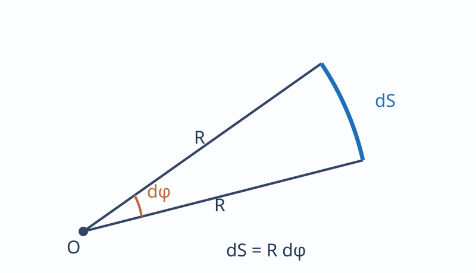

---
aliases:
  - "Вращательное движение и угловая скорость"
tags:
  - university
  - physics
  - lecture-note
subject: "Физика"
type: "lecture-note"
status: "source-faithful-draft-needs-proofreading"
---

# 02 — Вращательное движение и угловая скорость

> [!info] Навигация
> [[00 - Физика|Физика]] · [[01 - Механика. Кинематика и механическое движение|Кинематика]] · [[03 - Ускорение и классификация движения|Ускорение]]

## Угловая скорость и угловое ускорение

**Угловая скорость и угловое ускорение.**

Рассмотрим твёрдое тело, которое вращается вокруг некоторой оси.

Тогда отдельная точка этого тела будет описывать окружность радиуса $R$, центр которой лежит на оси вращения.

Пусть некоторая точка движется по окружности $R$, её положение через $\Delta t$ задаётся углом $\Delta\varphi$.

Элементарные углы поворота $\Delta\vec\varphi$ <u>рассматриваются</u> как векторы.

Модуль $\Delta\vec\varphi$ равен углу поворота:

$$|\Delta\vec\varphi|=\Delta\varphi.$$

Совпадает с направлением поступательного движения острия винта, который вращается в направлении движения точки по окружности, т. е. направляется правилом правого винта (буравчика).

Векторы, направления которых связывают с направлением вращения, называют псевдовекторами, потому что эти векторы не имеют точек приложения, они откладываются из любого места на оси вращения.

Вектор характеризуется направлением, модулем, точкой приложения (действие). 

**Угловая скорость** — это векторная физическая величина, равная первой производной угла поворота по времени.

$$\vec\omega=\lim_{\Delta t\to0}\frac{\Delta\vec\varphi}{\Delta t},
\qquad\omega=\frac{d\varphi}{dt}=\dot\varphi.$$

Вектор $\vec\omega$ направлен вдоль оси вращения по правилу правого винта.

$$[\omega]=\mathrm{рад/с}.$$

$$v=\frac{dS}{dt}=\frac{d(R\varphi)}{dt}
=R\frac{d\varphi}{dt}=R\omega.$$

$dS=R\,d\varphi.$

$$\vec v=[\vec\omega\times\vec r]$$
— в общем случае.

$$|\vec v|=\omega r\sin\alpha=\omega R.$$

Если угловая скорость постоянная $(\omega=\mathrm{const})$, вращение будет равномерным, и его можно характеризовать периодом вращения $T$, т. е. временем, за которое точка совершает полный оборот, т. е. поворачивается на $2\pi$.

$$\Delta t=T,\qquad\Delta\varphi=2\pi.$$

$$\omega=\frac{\Delta\varphi}{\Delta t}=\frac{2\pi}{T},
\qquad T=\frac{2\pi}{\omega}.$$

Частота вращения — число полных оборотов, совершаемых точкой за 1 секунду.

$$\nu=\frac1T=\frac{\omega}{2\pi},\qquad\omega=2\pi\nu.$$
