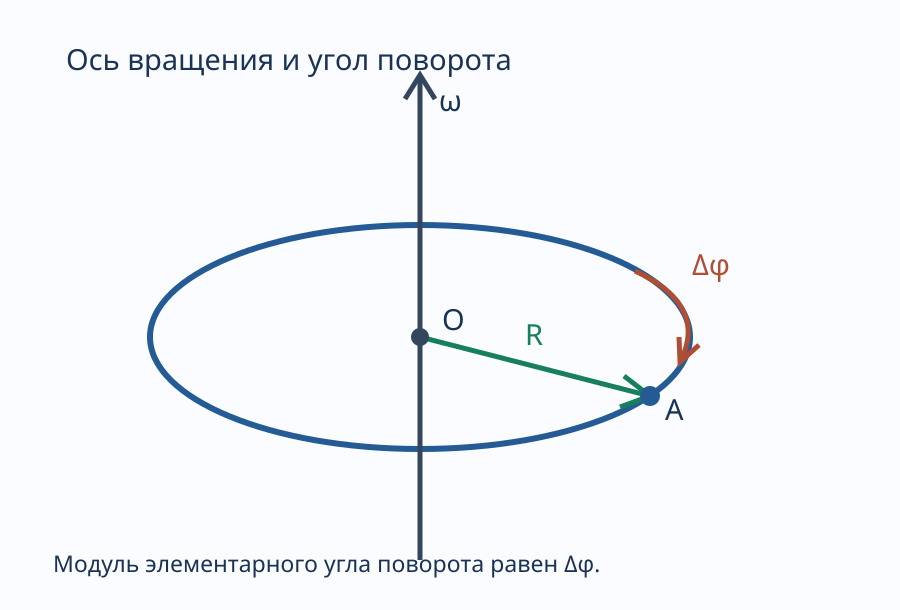

---
aliases:
  - "Вращательное движение и угловая скорость"
tags:
  - university
  - physics
  - lecture-note
  - механика
  - вращение
subject: "Физика"
type: "lecture-note"
status: "full-from-new-photos"
---

# 02 — Вращательное движение и угловая скорость

> [!info] Навигация
> [[00 - Физика|Физика]] · [[01 - Механика. Кинематика и механическое движение|Кинематика]] · [[03 - Ускорение и классификация движения|Ускорение]] · [[../summaries/02 - Вращательное движение и угловая скорость|Краткая версия]]

## Вращательное движение твёрдого тела

Рассмотрим твёрдое тело, которое вращается вокруг некоторой оси.

Каждая отдельная точка этого тела, не лежащая на оси, описывает окружность радиуса $R$. Центр этой окружности расположен на оси вращения. За промежуток времени $\Delta t$ положение точки изменяется, а угол её поворота составляет $\Delta\varphi$.

Схема показывает ось вращения, окружность радиуса $R$, точку A и угол поворота $\Delta\varphi$.

### Угол поворота

При повороте точки вокруг оси удобно характеризовать изменение положения **углом поворота**.

В записи лекции рассматривается вектор элементарного угла поворота $\Delta\vec\varphi$, модуль которого равен углу поворота:

$$
\boxed{|\Delta\vec\varphi|=\Delta\varphi}.
$$

Направление этого вектора совпадает с направлением поступательного движения острия правого винта, вращаемого в ту же сторону, что и точка тела. Такой способ определения направления называют **правилом правого винта (буравчика)**.

В тетради отдельно отмечается, что направление вектора, связанного с вращением, может быть отложено вдоль оси. Такие величины рассматривают как **псевдовекторы (аксиальные векторы)**. Различие обычных полярных и аксиальных векторов связано не только с возможностью переноса стрелки на рисунке, но и с их преобразованием при отражении координат.

> [!note] Описание в лекции
> В исходной записи псевдовекторы объясняются через отсутствие фиксированной точки приложения и возможность откладывать их на оси вращения. Академическое уточнение вынесено в [[../checks/There might be a mistake|проверку формулировок]].

## Угловая скорость

**Угловая скорость** — векторная физическая величина, характеризующая быстроту вращения. Она определяется как предел отношения элементарного углового перемещения к соответствующему промежутку времени:

$$
\boxed{\vec\omega=\lim_{\Delta t\to0}
\frac{\Delta\vec\varphi}{\Delta t}}.
$$

При вращении вокруг неподвижной оси её модуль выражается как первая производная угла поворота по времени:

$$
\omega=\frac{d\varphi}{dt}=\dot\varphi.
$$

Вектор угловой скорости направлен вдоль оси вращения по правилу правого винта.

Единица измерения:

$$
[\omega]=\mathrm{рад/с}.
$$

Таким образом, угловая скорость показывает, какой угол поворота приходится на единицу времени при бесконечно малом промежутке времени.

## Связь линейной и угловой скорости

Пусть точка находится на расстоянии $R$ от оси вращения. За малый угол поворота $d\varphi$ она проходит дугу окружности длиной $dS$.

Длина дуги связана с углом:

$$
dS=R\,d\varphi.
$$

По определению модуль линейной скорости равен производной пути по времени:

$$
v=\frac{dS}{dt}.
$$

Подставляем выражение длины дуги:

$$
v=\frac{d(R\varphi)}{dt}.
$$

Так как $R$ постоянно для рассматриваемой точки твёрдого тела:

$$
v=R\frac{d\varphi}{dt}.
$$

Но

$$
\omega=\frac{d\varphi}{dt}.
$$

Следовательно:

$$
\boxed{v=R\omega}.
$$

**Векторная связь** линейной скорости точки с угловой скоростью вращения:

$$
\boxed{\vec v=\vec\omega\times\vec r},
$$

где $\vec r$ — радиус-вектор точки относительно выбранного начала на оси, а символ $\times$ означает векторное произведение.

Модуль этого произведения:

$$
|\vec v|=\omega r\sin\alpha,
$$

где $\alpha$ — угол между $\vec\omega$ и $\vec r$.

Если $R$ — кратчайшее расстояние от точки до оси вращения, то

$$
R=r\sin\alpha.
$$

Поэтому

$$
\boxed{|\vec v|=\omega R}.
$$

Линейная скорость направлена по касательной к окружности движения точки, а угловая — вдоль оси вращения.

## Равномерное вращение

Если угловая скорость постоянна,

$$
\omega=\mathrm{const},
$$

вращение называется **равномерным**.

Равномерное вращение удобно характеризовать **периодом** и **частотой**.

### Период вращения

**Период вращения** $T$ — время, за которое точка совершает один полный оборот вокруг оси.

Для одного полного оборота:

$$
\Delta t=T,\qquad\Delta\varphi=2\pi.
$$

Тогда по определению постоянной угловой скорости:

$$
\omega=\frac{\Delta\varphi}{\Delta t}=\frac{2\pi}{T}.
$$

Выражаем период:

$$
\boxed{T=\frac{2\pi}{\omega}}.
$$

### Частота вращения

**Частота вращения** $\nu$ — число полных оборотов за одну секунду.

Поэтому:

$$
\boxed{\nu=\frac1T}.
$$

Подставляем выражение периода через угловую скорость:

$$
\nu=\frac{\omega}{2\pi}.
$$

Или обратно:

$$
\boxed{\omega=2\pi\nu}.
$$

Для равномерного вращения период измеряется в секундах, частота — в обратных секундах (герцах).

## Что важно запомнить

- Точки твёрдого тела при вращении вокруг неподвижной оси движутся по окружностям.
- Угловое перемещение и угловая скорость ориентируются согласно правилу правого винта.
- Мгновенная угловая скорость связана с производной угла поворота по времени.
- Линейная скорость точки тем больше, чем дальше она от оси при той же угловой скорости.
- При равномерном вращении $\omega$, $T$ и $\nu$ связаны формулами $\omega=2\pi/T=2\pi\nu$.

## Вопросы для самопроверки

1. Как определить направление вектора угловой скорости?
2. Почему точки одного вращающегося тела могут иметь разные линейные скорости, но одинаковую угловую?
3. Как вывести $v=R\omega$ из длины дуги окружности?
4. Чем модуль $\omega r\sin\alpha$ отличается от $\omega R$?
5. Что такое период и частота вращения?
6. Какая связь существует между периодом, частотой и угловой скоростью?

---

## Связанные заметки

- [[01 - Механика. Кинематика и механическое движение]]
- [[03 - Ускорение и классификация движения]]
- [[05 - Угловое ускорение и связь линейных и угловых ускорений]]
