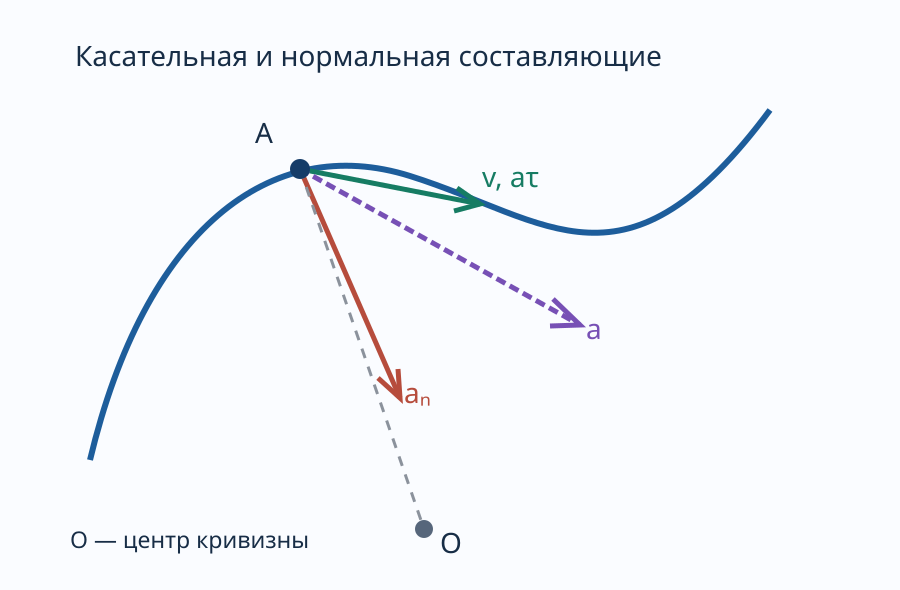
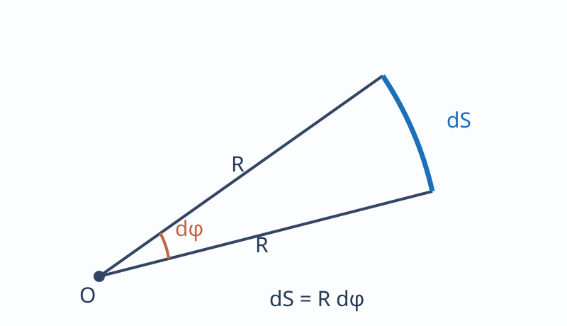

---
aliases:
  - "Ускорение и классификация движения"
tags:
  - university
  - physics
  - lecture-note
subject: "Физика"
type: "lecture-note"
status: "source-faithful-draft-needs-proofreading"
---

# 03 — Ускорение и классификация движения

> [!info] Навигация
> [[00 - Физика|Физика]] · [[02 - Вращательное движение и угловая скорость|Вращение]] · [[04 - Законы Ньютона, сила, масса и импульс|Следующая]]

## Ускорение

Средним ускорением неравномерного движения называется векторная величина, равная отношению изменения скорости за $\Delta t$ к этому промежутку.

$$\langle\vec a\rangle=\frac{\Delta\vec v}{\Delta t}.$$

Мгновенным ускорением будет предел среднего ускорения:

$$\vec a=\lim_{\Delta t\to0}\frac{\Delta\vec v}{\Delta t}
=\frac{d\vec v}{dt}=\frac{d^2\vec r}{dt^2}.$$

$$\vec a=\dot{\vec v}=\ddot{\vec r}.$$

Ускорение — это первая производная от скорости по времени, или 2-я производная от радиус-вектора по времени.

Пример.

$$x(t)=4t^2+5t^3-8,$$
$$v_x(t)=8t+15t^2,$$
$$a_x(t)=8+30t.$$

$$\vec a=a_x\vec i+a_y\vec j+a_z\vec k.$$

$$a_x=\frac{dv_x}{dt}=\frac{d^2x}{dt^2};\quad
a_y=\frac{dv_y}{dt};\quad a_z=\frac{dv_z}{dt}.$$

$$a=\sqrt{a_x^2+a_y^2+a_z^2}.$$

$$\vec a=\vec a_\tau+\vec a_n,\qquad
a=\sqrt{a_\tau^2+a_n^2}.$$

## Тангенциальное и нормальное ускорения

Тангенциальная составляющая ускорения $(a_\tau)$ определяет быстроту изменения скорости по модулю (туда же, куда и скорость).

$$a_\tau=\frac{dv}{dt}.$$

Нормальная составляющая ускорения $(a_n)$ направлена по нормали к траектории к центру кривизны (центростремительная).

Докажем, что $\vec a=\vec a_\tau+\vec a_n$.

$$\vec a=\frac{d\vec v}{dt}=\frac{d(v\vec\tau)}{dt}
=\frac{dv}{dt}\vec\tau+v\frac{d\vec\tau}{dt}.$$

$$\frac{dS}{dt}=v.$$

$$\vec a=a_\tau\vec\tau+v^2\frac{d\vec\tau}{dS}.$$

$dS=R\,d\varphi.$

$$\vec a=a_\tau\vec\tau+\frac{v^2}{R}\frac{d\vec\tau}{d\varphi}.$$

$$\frac{d\vec\tau}{d\varphi}=\vec n,$$
где $\vec n$ — единичный вектор нормали.

$$\vec a=a_\tau\vec\tau+a_n\vec n.$$

В зависимости от тангенциальной и нормальной составляющих ускорения движения можно классифицировать следующим образом.

1. $a_\tau=0,\ a_n=0$ — равномерное прямолинейное движение.
2. $a_\tau=\mathrm{const},\ a_n=0$ — прямолинейное равнопеременное движение.

## Классификация движения и уравнение траектории

$$t_1=0,\quad v_1=v_0;\qquad t_2=t,\quad v_2=v.$$

$$a=\frac{v-v_0}{t},\qquad v=v_0+at.$$

$$S=\int_0^t v(t)\,dt=\int_0^t(v_0+at)\,dt$$

$$=\int_0^t v_0\,dt+\int_0^t at\,dt
=v_0t+\frac{at^2}{2}.$$

3. $a_\tau=f(t),\ a_n=0$ — прямолинейное движение с переменным ускорением.
4. $a_\tau=0,\ a_n=\mathrm{const}$ — равномерное движение по окружности.

5. $a_\tau=0,\ a_n\ne0$ — равномерное криволинейное движение.
6. $a_\tau=\mathrm{const},\ a_n\ne0$ — криволинейное равнопеременное движение.
7. $a_\tau=f(t),\ a_n\ne0$ — криволинейное движение с переменным ускорением.

Уравнение траектории.

$$\begin{cases}x(t)=\sin t,\\y(t)=\cos t.\end{cases}$$

Найти $y(x)$?

$$x^2=\sin^2t,\qquad y^2=\cos^2t,\qquad x^2+y^2=1.$$
