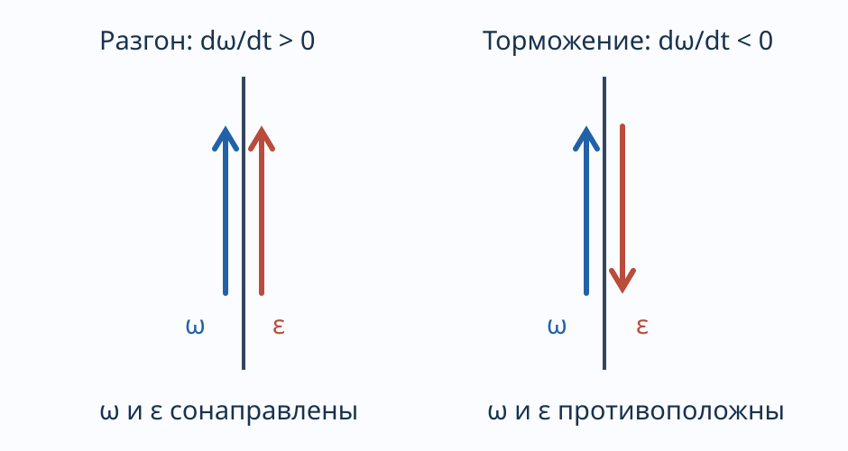

---
aliases:
  - "Угловое ускорение и связь линейных и угловых ускорений"
tags:
  - university
  - physics
  - lecture-note
subject: "Физика"
type: "lecture-note"
status: "needs-verbatim-proofread"
---

# 05 — Угловое ускорение и связь линейных и угловых ускорений

> [!info] Навигация
> [[00 - Физика|Физика]] · [[04 - Законы Ньютона, сила, масса и импульс|Предыдущая]] · [[06 - Деформация и сила упругости|Следующая]]

Угловое ускорение — это векторная физическая величина, равная первой производной от угловой скорости по времени или второй производной от угла поворота по времени.

$$
\vec\varepsilon=\lim_{\Delta t\to0}\frac{\Delta\vec\omega}{\Delta t}
=\frac{d\vec\omega}{dt}=\frac{d^2\vec\varphi}{dt^2}.
$$

$$\vec\varepsilon=\dot{\vec\omega}=\ddot{\vec\varphi}.$$

При ускоренном движении $\vec\varepsilon$ сонаправлен $\vec\omega$, при замедленном — противоположен.

$$[\varepsilon]=\frac{\mathrm{рад}}{\mathrm{с}^2}.$$

$$a_\tau=\frac{dv}{dt}=R\frac{d\omega}{dt}=R\varepsilon.$$

$$v=\omega R.$$

$$a_{\text{норм}}=\frac{v^2}{R}=\omega^2R.$$

Связь линейного и углового ускорения.

$$\vec v=[\vec\omega\times\vec r].$$

$$
\vec a=\frac{d\vec v}{dt}
=\frac{d[\vec\omega\times\vec r]}{dt}
=[\frac{d\vec\omega}{dt}\times\vec r]+[\vec\omega\times\frac{d\vec r}{dt}]
$$

$$
=[\vec\varepsilon\times\vec r]+[\vec\omega\times\vec v]
=[\vec\varepsilon\times\vec r]+[\vec\omega\times[\vec\omega\times\vec r]].
$$

Под первым слагаемым подпись вращательное ускорение (в контексте тангенциальное), под вторым центростремительное ускорение.
