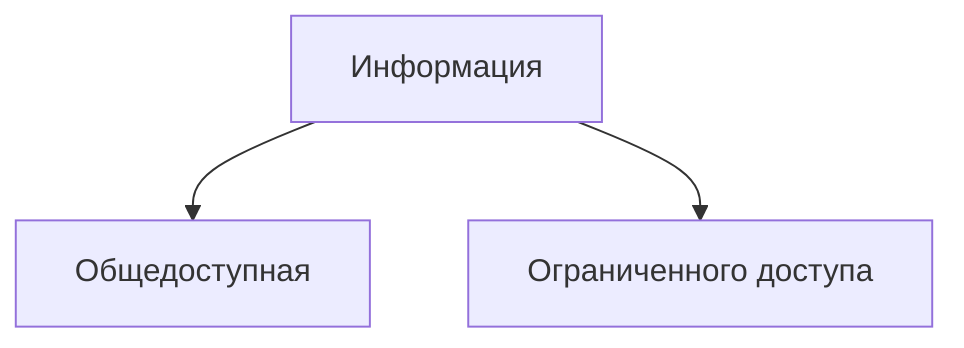

---
aliases:
  - "Информация и шифрование"
  - "Основы шифрования"
tags:
  - university
  - information-security
  - information-protection
  - encryption
subject: "Осипов"
type: lecture-note
status: restored
source_images:
  - "IMG_20261012_213925_119.jpg"
  - "IMG_20261012_213924_675.jpg"
  - "IMG_20261012_213925_234.jpg"
source_date: "2026-09-25"
---

# 01 — Информация и основы шифрования

> [!info] Навигация
> [[00 - Осипов|Карта предмета]]

> [!note] Источник
> Конспект восстановлен по трём фотографиям тетради от **25.09.2026**. Формулировки сохранены максимально близко к источнику; плохо читаемые места не додумывались.

## 1. Информация

В конспекте записано несколько определений информации.

### Общее определение

> **Информация** — это сведения, сообщения, сигналы независимо от формы их представления.

### Определение по ГОСТ

В тетради приведена формулировка:

> **Информация** — сведения, воспринимаемые человеком и (или) специальными устройствами как отражение фактов материального и духовного мира в процессе коммуникации.

### Смысловое определение

В конспекте также записано:

> **Информация** — это знание относительно предметов, событий, вещей, идей и понятий, которые в определённом контексте имеют конкретный смысл.

И отдельно:

> **Информация** — результат отражения, взаимодействия сознания с материальным объектом.

## 2. Информация по режиму доступа

На второй странице информация разделена на две крупные группы:

В конспекте рядом с информацией ограниченного доступа упомянуты государственные регуляторы:
- **ФСБ**;
- **ФСТЭК России** — Федеральная служба по техническому и экспортному контролю.

> [!warning]
> Связь конкретных видов информации с полномочиями каждого регулятора на фотографии раскрыта не полностью, поэтому здесь не добавляются дополнительные юридические выводы.

## 3. Передача и защита информации

На странице нарисована схема прохождения информации через техническую систему: от источника через устройства обработки/передачи и среду к получателю. На нескольких участках показано возможное воздействие помех.

![[assets/01-encryption-channel.svg|950]]

> [!note] Реконструкция рисунка
> SVG передаёт структуру рукописной схемы. Неразборчивые подписи отдельных блоков не восстанавливались догадками.

Общий смысл схемы: защищаемая информация проходит несколько этапов обработки и передачи, а воздействие на систему возможно не только в одной точке, поэтому защита должна учитывать весь канал.

## 4. Шифрование

В конспекте шифрование рассматривается как один из способов защиты информации при передаче и обработке.

Упоминаются:
- **исходная информация**;
- специальное устройство/средство преобразования;
- передача преобразованных данных;
- обратное преобразование на стороне получателя.

Упрощённо этот процесс можно представить так:

## 5. Что влияет на стойкость шифрования

В нижней части второй и на третьей фотографии перечисляются условия, от которых зависит качество/стойкость шифрования.

Уверенно читается упоминание:
- **математической устойчивости**;
- количества/множества возможных ключей — часть формулировки вокруг этого пункта читается не полностью;
- вероятного противника и его методов/средств получения информации.

> [!important]
> Из конспекта следует общий принцип: стойкость защиты должна оцениваться не только по самому алгоритму, но и с учётом возможностей противника и используемых им средств.

### Математическая устойчивость

В рукописи математическая устойчивость связывается со сложностью обратного вычисления/восстановления исходной информации. Конец определения на фотографии читается частично, поэтому точная формулировка не восстанавливается.

## 6. Коротко для повторения

- Информация может рассматриваться как **сведения/сообщения/сигналы**, независимо от формы представления.
- В ГОСТ-формулировке информация связана с восприятием человеком и/или специальными устройствами и отражением фактов окружающего мира.
- По режиму доступа в конспекте выделены **общедоступная** и **ограниченного доступа** информация.
- Среди регуляторов упомянуты **ФСБ** и **ФСТЭК России**.
- При передаче защищаемых данных необходимо учитывать весь канал и возможные воздействия/помехи.
- Шифрование преобразует исходную информацию в форму, предназначенную для защищённой передачи/хранения, с последующим обратным преобразованием.
- Стойкость шифрования связывается с ключами, математической устойчивостью и возможностями вероятного противника.

## 7. Неразборчивые места

Без догадок не восстановлены:
- отдельные слова в названии темы на первой странице;
- точная формулировка первого пункта в перечне условий успешного шифрования;
- конец определения математической устойчивости;
- часть подписей блоков и помех на схеме передачи.
